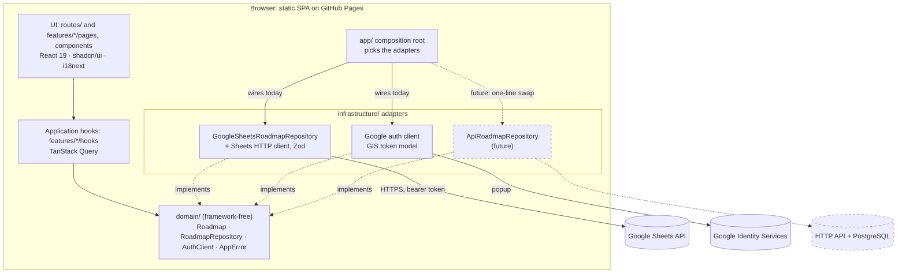

# DHCW Roadmap Editor

[](https://github.com/collisdigital/roadmaps-editor/actions/workflows/ci.yml)

An internal tool for Digital Health and Care Wales (DHCW) staff: Product Leads use it to
manage the public Now / Next / Later roadmaps of their products, writing each roadmap
item's title, description, expected outcomes and tags. A separate app, the public site,
reads the same data source and shows the published roadmaps. The item editor is being
built; the [Product Lead persona](docs/backlog/personas/product-lead.md) describes who it
is for.

Today it is a static, frontend-only React app that lists roadmaps. You connect a Google
account, the app reads the **roadmap index** (the first tab) of one Google Spreadsheet,
and each roadmap it lists appears as a card, as the public site lists them, published or
not. It runs entirely in the browser and is hosted on
GitHub Pages: **<https://collisdigital.github.io/roadmaps-editor/>**.

Google Sheets is a _temporary_ data source. The app is built so that a PostgreSQL-backed
HTTP API can replace it without touching the UI (see
[Replacing Google Sheets](#replacing-google-sheets-with-an-http-api)).

The UI is available in English and Welsh (Cymraeg).

## Contents

- [How it works](#how-it-works)
- [Spreadsheet format](#spreadsheet-format)
- [Architecture](#architecture)
- [Technology choices](#technology-choices)
- [Getting started](#getting-started)
- [Google Cloud setup](#google-cloud-setup)
- [Testing and quality checks](#testing-and-quality-checks)
- [Deploying to GitHub Pages](#deploying-to-github-pages)
- [Troubleshooting](#troubleshooting)
- [Security and data access](#security-and-data-access)
- [Internationalisation](#internationalisation)
- [Replacing Google Sheets with an HTTP API](#replacing-google-sheets-with-an-http-api)
- [Project documentation](#project-documentation)

## How it works

1. The page loads Google Identity Services (GIS) from `accounts.google.com`.
2. **Connect Google** opens Google's popup (the OAuth 2.0 _token model_). The user picks
   an account and allows access to Google Sheets.
3. GIS returns a short-lived access token (about an hour). It stays in memory only: it is
   never written to storage, URLs or logs.
4. The app makes two Sheets API reads of the configured spreadsheet: its tab list
   (`spreadsheets.get`, tab properties only), then the values of the tab with the lowest
   index, the roadmap index (`spreadsheets.values.get`, cells as displayed). It shows one
   card per roadmap the index lists, grouped by product family and sorted by title
   (ADR-009). A card opens `#/roadmaps/<id>`, where
   the id is the public site's address for that roadmap (`ProductA` → `producta`).
5. When the token expires the app says so and offers **Reconnect**. **Disconnect**
   revokes the token and clears all loaded data.

There is no backend, no client secret and no refresh token. What a user can see is decided
entirely by Google: see [Security and data access](#security-and-data-access).

## Spreadsheet format

The spreadsheet is shared with the public site, so its format is a contract with it
([ADR-009](docs/adr/ADR-009-roadmap-list-from-the-first-tab.md)). The **first tab**,
whatever it is called and even when hidden, is the roadmap index: row 1 is the header and
each other row is one roadmap. Its `Sheet` column (required) names the tab holding that
roadmap's items; `Enabled` (exactly `Yes`), `Title`, `Category`, `Family`, `Status label`,
`Last updated`, `Colour`, `Vision`, `Service description` and `Product Lead` are read
when present, with `(cy)` columns for Welsh. Every other tab is a roadmap's items, not read
yet.

- The rules, and how the editor differs from the public site on mistakes, are in
  [the roadmap index analysis](docs/analysis/roadmaps-tab-format.md).
- An example spreadsheet, with steps to import it into a test spreadsheet of your own, is in
  [`tests/fixtures/sheets/`](tests/fixtures/sheets/README.md).
- A list that can't be read (no tabs, an empty first tab, or no `Sheet` column) shows a
  problem asking the spreadsheet owner to check it. A roadmap whose tab is missing, or a
  mistake in one row, never hides the rest.

## Architecture

The code is layered with one-way dependencies (ADR-002); ESLint enforces the import
rules. `app/` is the composition root and the only place that knows about Google.



| Folder                                     | Holds                                                                      | May import                       |
| ------------------------------------------ | -------------------------------------------------------------------------- | -------------------------------- |
| `src/domain/`                              | `Roadmap`, `RoadmapRepository`, `AuthClient`: plain TypeScript types/ports | `lib/` only                      |
| `src/infrastructure/`                      | Google Sheets and GIS adapters; Zod parsing of everything Google returns   | `domain/`, `lib/`                |
| `src/features/<name>/`                     | hooks (TanStack Query), components and pages for one feature               | `domain/`, `lib/`, `components/` |
| `src/routes/`                              | thin TanStack Router file routes                                           | features                         |
| `src/app/`                                 | config, composition root, providers, router                                | everything                       |
| `src/components/`, `src/lib/`, `src/i18n/` | shadcn/ui, app shell, theme; small utilities; i18n setup and catalogues    | —                                |
| `build/`                                   | build-time helpers (the GitHub Pages base path)                            | —                                |

**The repository abstraction.** The UI only ever sees `Roadmap` (its id, its title in
English and Welsh, and the rest of what the roadmap list holds about it; ADR-009) and
`AppError` (a transport-neutral error with a `kind` such as `forbidden` or
`rate-limited`). It gets data through one port:

```ts
interface RoadmapRepository {
  listRoadmaps(options?: { signal?: AbortSignal }): Promise<Roadmap[]>
}
```

`GoogleSheetsRoadmapRepository` implements it today; `app/composition.ts` creates it and
hands it to React through `RoadmapRepositoryProvider`. Every implementation must pass the
shared contract test (`describeRoadmapRepositoryContract`), so swapping data sources is a
change to the composition root and nothing else. Auth works the same way: the UI uses the
`AuthClient` port, and only `infrastructure/google-identity/` touches the `google` global.

Routing uses hash history (`/roadmaps-editor/#/roadmaps/producta`), so deep links survive a
reload on GitHub Pages without a 404 fallback (ADR-004).

## Technology choices

| Area           | Choice                                                                    | Notes                                                                                                           |
| -------------- | ------------------------------------------------------------------------- | --------------------------------------------------------------------------------------------------------------- |
| Runtime        | Node.js 26 (Active LTS) in CI and `.nvmrc`; pnpm 12.18                    | `engines` also accepts Node 22.22+ and 24.15+. pnpm is pinned in `packageManager`.                              |
| Build          | Vite 8.3, `@vitejs/plugin-react` 6                                        | Static output in `dist/`; base path per [deployment](#base-path); `react`/`vendor` chunks cache across deploys. |
| UI             | React 19.3, TypeScript 6.0 (strict)                                       | TypeScript stays on 6.0 because typescript-eslint 8.x requires `typescript <6.1`.                               |
| Routing        | TanStack Router 1.170, file-based, hash history                           | Route tree generated into `src/routeTree.gen.ts` (committed).                                                   |
| Server state   | TanStack Query 5.107                                                      | Retries only retryable `AppError`s, twice; data is cleared on disconnect.                                       |
| Components     | shadcn/ui 4 on Base UI 1.9, Tailwind CSS 4.3, lucide-react, sonner        | Base UI flavour, not Radix (ADR-005). Light/dark theme.                                                         |
| Validation     | Zod 4.6 (`zod/mini`)                                                      | Config, Sheets responses and GIS token responses are parsed at the boundary.                                    |
| Auth           | Google Identity Services token model                                      | Types from `@types/google.accounts`; responses re-parsed with Zod because the typings are wrong.                |
| i18n           | i18next 27 + react-i18next 18                                             | English and Welsh bundled; keys are typed.                                                                      |
| Unit/component | Vitest 5.1, Testing Library, jsdom 31, MSW 3                              | MSW 3 uses `onUnhandledFrame` and `msw/http`.                                                                   |
| E2E            | Playwright 1.64.1 (exact pin), `@axe-core/playwright`                     | Pinned exactly because each version needs its own Chromium build.                                               |
| Lint/format    | ESLint 10 (typescript-eslint strict, `jsx-a11y-x`, `i18next`), Prettier 3 | `eslint-plugin-jsx-a11y` supports ESLint ≤ 9 only, so its maintained fork `eslint-plugin-jsx-a11y-x` is used.   |
| CI/CD          | GitHub Actions → GitHub Pages                                             | One workflow; actions pinned to commit SHAs and kept current by Dependabot.                                     |

## Getting started

### Prerequisites

- Node.js 26 (see `.nvmrc`; 22.22+ and 24.15+ also work).
- pnpm, e.g. `npm install --global pnpm` (see <https://pnpm.io/installation>). Any recent
  pnpm switches itself to the 12.18.0 pinned in `packageManager`. Node 25+ no longer
  ships Corepack.
- For running against real Google data: a Google account with access to the configured
  spreadsheet, and an OAuth client that lists your local origin (see
  [Google Cloud setup](#google-cloud-setup)). Tests need neither.

### Install and run

```sh
git clone https://github.com/collisdigital/roadmaps-editor.git
cd roadmaps-editor
pnpm install --frozen-lockfile
cp .env.example .env.local   # required: `pnpm dev` does not read .env.production
pnpm dev                     # http://localhost:5173
```

`pnpm build && pnpm preview` serves the production build at <http://localhost:4173>.

### Environment configuration

Configuration is public (an OAuth client ID and a spreadsheet ID are not secrets) and is
validated with Zod at startup; a bad value stops the app with a message naming the
variable.

| Variable                     | Purpose                                                                           | Where it is set                                                            |
| ---------------------------- | --------------------------------------------------------------------------------- | -------------------------------------------------------------------------- |
| `VITE_GOOGLE_CLIENT_ID`      | OAuth client ID (`….apps.googleusercontent.com`)                                  | `.env.production` (committed, used by builds); `.env.local` for `pnpm dev` |
| `VITE_GOOGLE_SPREADSHEET_ID` | The spreadsheet to read: the `<ID>` in `docs.google.com/spreadsheets/d/<ID>/edit` | same                                                                       |
| `VITE_BASE_PATH`             | Optional build-time override of the URL base path, e.g. `/preview/`               | shell / CI                                                                 |
| `PAGES_CUSTOM_DOMAIN`        | Custom Pages domain; forces base path `/`                                         | GitHub repository variable                                                 |
| `GITHUB_REPOSITORY`          | `owner/repo`; derives the base path                                               | set automatically by GitHub Actions                                        |

`.env.example` and `.env.production` hold the same values. Vite gives
`.env.production` priority over `.env.local` when building, so to build with other values
locally use `.env.production.local` (git-ignored). Never put secrets in `VITE_*`
variables: they are compiled into the public JavaScript.

## Google Cloud setup

You need one Google Cloud project with the Sheets API enabled and a **Web application**
OAuth client. These steps use the Google Cloud console's _Google Auth Platform_ pages
(older consoles call them "OAuth consent screen" and "Credentials").

1. **Project.** Open <https://console.cloud.google.com/>, then use the project picker to
   create a project (or select an existing one).
2. **Enable the Google Sheets API.** _APIs & Services → Library_, search for "Google
   Sheets API", then **Enable**. It must be the same project as the OAuth client.
3. **Configure the consent screen.** _Google Auth Platform → Get started_ (or
   _Branding_): app name "DHCW Roadmap Editor", user support email, developer contact email.
   Then _Audience_:
   - **Internal**: only accounts in your Google Workspace organisation; no test-user list
     and no verification needed.
   - **External**: any Google account. While the publishing status is **Testing**, only
     the accounts listed under _Audience → Test users_ (up to 100) can authorise, so add
     each person who will use the app.
4. **Declare the scope.** _Data Access → Add or remove scopes_, add
   `https://www.googleapis.com/auth/spreadsheets` (listed as a sensitive scope), and save.
5. **Create the OAuth client.** _Clients → Create client_:
   - Application type: **Web application**.
   - **Authorised JavaScript origins** — origins only (scheme, host and port; no path and
     no trailing slash):
     - `http://localhost:5173` (`pnpm dev`)
     - `http://localhost:4173` (optional: `pnpm preview`)
     - `https://collisdigital.github.io` (production; **not**
       `https://collisdigital.github.io/roadmaps-editor`, which Google rejects as it has a
       path)
   - **Authorised redirect URIs: leave empty.** The token model's popup returns the token
     to the opener page, so no redirect URI is involved; redirect URIs are only for the
     authorisation-code model's redirect mode.
   - Create it and copy the **Client ID**. Ignore the client secret: a static app cannot
     keep one, and this flow does not use it.
6. **Configure the app.** Put the client ID and spreadsheet ID in `.env.production` and
   `.env.example` (and your `.env.local`), then commit.
7. **Share the spreadsheet** with every account that will use the app. Viewer access is
   enough to read roadmaps.

Changes to origins can take from five minutes to a few hours to take effect.

## Testing and quality checks

```sh
pnpm typecheck      # tsc -b over app, config and E2E projects
pnpm lint           # ESLint, zero warnings allowed (includes layering and i18n rules)
pnpm format:check   # Prettier (pnpm format to fix)
pnpm test           # Vitest unit + component tests; no network, no Google
pnpm build          # production build into dist/

pnpm exec playwright install --with-deps chromium   # once per @playwright/test version
pnpm test:e2e       # builds, serves with vite preview on :4173, fakes GIS + Sheets
```

The E2E suite is hermetic: Google's script and the Sheets API are faked in the browser,
and any request to another origin fails the test, as does an access token written to
storage, cookies, the URL or the console at any point. It reuses a server already listening on
port 4173 locally, so stop any stale `pnpm preview` first. Live Google integration can
only be checked by hand (connect on the deployed site). See `tests/e2e/AGENTS.md` for the
fixtures.

## Deploying to GitHub Pages

### The workflow

`.github/workflows/ci.yml` (**CI/CD**) runs on pull requests, pushes to `main` and manual
dispatch:

```
verify ──┐   typecheck · lint · format:check · test · build
         ├──► deploy   (push to main only: deploy-pages → github-pages environment)
e2e ─────┘   Playwright (Chromium cached per Playwright version)
```

- `verify` and `e2e` run in parallel. On a push to `main`, `verify` also reads the Pages
  configuration, checks the build's base path against it and uploads `dist/` as the Pages
  artifact.
- `deploy` runs only after both pass, and only for pushes to `main`. It does not check
  out or install anything; it publishes the artifact `verify` uploaded. It alone has
  `pages: write` and `id-token: write`; everything else is read-only.
- A new push to a pull request cancels its running checks. On `main` a running workflow
  is never cancelled; a newer push replaces one that is still waiting, so the latest
  commit is what deploys. To redeploy without a new commit, re-run the latest `main`
  run (each attempt uploads its own artifact).
- The Playwright report (and traces of failed tests) is uploaded as an artifact of every
  run that was not cancelled.

No GitHub secrets are needed: the public config is committed in `.env.production`.

### First deployment, step by step

1. **Create the repository** on GitHub (`collisdigital/roadmaps-editor`). Make it public,
   or use a plan that supports Pages for private repositories.
2. **Enable Pages:** _Settings → Pages → Build and deployment → Source:_ **GitHub
   Actions**. Do this before the first push to `main`, or the first `verify` fails at
   "Read the Pages site configuration" (re-run it afterwards).
3. **Push** the code:
   ```sh
   git remote add origin https://github.com/collisdigital/roadmaps-editor.git
   git push -u origin main
   ```
4. **Watch the run:** _Actions → CI/CD_. When `deploy` finishes, the run summary shows the
   site URL. The `github-pages` environment only accepts deployments from `main` by
   default; keep that rule.
5. **Add the origin in Google Cloud:** make sure `https://collisdigital.github.io` is in
   the OAuth client's Authorised JavaScript origins (step 5 of
   [Google Cloud setup](#google-cloud-setup)).
6. **Open** <https://collisdigital.github.io/roadmaps-editor/>, choose **Connect Google**,
   pick an account (a test user, if the app is External and in Testing) and allow access
   to Google Sheets.
7. **See your roadmaps:** one card per roadmap the spreadsheet's first tab lists
   ([Spreadsheet format](#spreadsheet-format)).

### Base path

A project site is served from `https://<owner>.github.io/<repo>/`, so the build needs
Vite's `base` set to `/<repo>/`. `build/resolve-base-path.ts` decides it, in this order:

1. `VITE_BASE_PATH`, if set (normalised to `/…/`);
2. `/` if the `PAGES_CUSTOM_DOMAIN` repository variable is set;
3. from `GITHUB_REPOSITORY`: `/` for a user or organisation site (`owner/owner.github.io`),
   otherwise `/<repo>/`;
4. `/` (local development).

Playwright uses the same function for its `baseURL`, so CI's E2E run tests the app under
`/roadmaps-editor/` exactly as deployed. Before uploading, `verify` checks the built
`index.html` against the `base_path` that `actions/configure-pages` reports and fails on a
mismatch, rather than deploying a site whose assets 404. A fork deploys to
`/<fork-name>/` automatically, but needs its own OAuth client and spreadsheet in
`.env.production`.

### Custom domain

1. Configure the domain in _Settings → Pages → Custom domain_ (and its DNS records).
2. Add a repository variable `PAGES_CUSTOM_DOMAIN` with the domain (_Settings → Secrets
   and variables → Actions → Variables_). This makes the build use base `/`. No `CNAME`
   file is needed: GitHub ignores it for Actions deployments.
3. Add `https://<your-domain>` to the OAuth client's Authorised JavaScript origins.
4. Push to `main` (or re-run the latest `main` run).

## Troubleshooting

| Symptom                                                                          | Cause and fix                                                                                                                                                                                                                                                                                                                                                                                                                                                                     |
| -------------------------------------------------------------------------------- | --------------------------------------------------------------------------------------------------------------------------------------------------------------------------------------------------------------------------------------------------------------------------------------------------------------------------------------------------------------------------------------------------------------------------------------------------------------------------------- |
| Google's popup shows **Error 400: origin_mismatch** or **redirect_uri_mismatch** | The page's origin is not in the OAuth client's Authorised JavaScript origins. Add the exact origin: scheme, host and port, no path, no trailing slash (`http://127.0.0.1:5173` and `http://localhost:5173` differ). Do not add redirect URIs; this flow doesn't use them. Wait a few minutes for the change to apply.                                                                                                                                                             |
| Google's sign-in page says "to continue to" another app's name                   | The name comes from the OAuth client's Google Cloud project: _Google Auth Platform → Branding → App name_. Set it to "DHCW Roadmap Editor", or create a dedicated project for this app.                                                                                                                                                                                                                                                                                           |
| Popup shows **Error 401: invalid_client** / "OAuth client was not found"         | `VITE_GOOGLE_CLIENT_ID` is wrong or the client was deleted. Check `.env.production` (or `.env.local` for `pnpm dev`) and rebuild.                                                                                                                                                                                                                                                                                                                                                 |
| "Your browser blocked the Google window"                                         | The popup was blocked. Allow pop-ups for the site and choose Connect again.                                                                                                                                                                                                                                                                                                                                                                                                       |
| "The Google window was closed before connecting finished"                        | The popup was closed before finishing. Connect again.                                                                                                                                                                                                                                                                                                                                                                                                                             |
| "Access wasn't granted…" (**access_denied**)                                     | The user chose Cancel, or the app is External and in Testing and the account is not a test user (Google then shows "Error 403: access_denied … has not completed the Google verification process"). Add the account under _Audience → Test users_, or use an Internal app.                                                                                                                                                                                                        |
| "Access to Google Sheets is needed…"                                             | The Sheets checkbox was left unticked on the consent screen. Connect again and tick it.                                                                                                                                                                                                                                                                                                                                                                                           |
| **"Google hasn't verified this app"** screen                                     | Expected for an External app in Testing that requests a sensitive scope. Test users can continue past it. To remove it, complete Google's verification or use an Internal app; see [Security and data access](#security-and-data-access).                                                                                                                                                                                                                                         |
| "You don't have access to this spreadsheet" (**403**)                            | Either the account cannot open the spreadsheet (share it with the account), or the **Google Sheets API is not enabled** in the OAuth client's project. To tell them apart, open DevTools → Network → the `sheets.googleapis.com` request: "The caller does not have permission" means sharing; `SERVICE_DISABLED` / "Google Sheets API has not been used in project … or it is disabled" means enable the API (then wait a few minutes). A Workspace admin may also block access. |
| "The spreadsheet couldn't be found" (**404**)                                    | `VITE_GOOGLE_SPREADSHEET_ID` is wrong or the spreadsheet was deleted. Copy the ID from the spreadsheet URL.                                                                                                                                                                                                                                                                                                                                                                       |
| "Too many requests right now" (**429**)                                          | Sheets API per-minute quota exceeded. The app retries twice with back-off; wait a minute and choose Retry. Quotas: _APIs & Services → Google Sheets API → Quotas_.                                                                                                                                                                                                                                                                                                                |
| "Your session has expired"                                                       | Access tokens last about an hour, and the app expires the session a minute early (or on a 401). Choose **Reconnect**; Google usually skips the consent screen.                                                                                                                                                                                                                                                                                                                    |
| "Google couldn't be reached"                                                     | `accounts.google.com/gsi/client` failed to load: offline, a corporate proxy, or a blocker extension. Allow `accounts.google.com` and choose Connect (it retries the load).                                                                                                                                                                                                                                                                                                        |
| Popup opens but never completes, or closes at once                               | Strict privacy settings (third-party cookie blocking, Safari cross-site tracking prevention, Brave Shields, Firefox strict mode) or extensions can interfere with Google's sign-in. Allow `accounts.google.com`, or try a normal (non-private) window. If you host the app elsewhere, don't send `Cross-Origin-Opener-Policy: same-origin`; use `same-origin-allow-popups`.                                                                                                       |
| Deployed site is blank, assets 404                                               | Base path mismatch, e.g. a custom domain without the `PAGES_CUSTOM_DOMAIN` variable. The `verify` job normally catches this ("Base path mismatch"). See [Base path](#base-path).                                                                                                                                                                                                                                                                                                  |
| `verify` fails at "Read the Pages site configuration"                            | Pages is not enabled with source **GitHub Actions**. Enable it, then re-run.                                                                                                                                                                                                                                                                                                                                                                                                      |
| `pnpm dev` shows "Invalid app configuration"                                     | `.env.local` is missing: `cp .env.example .env.local`.                                                                                                                                                                                                                                                                                                                                                                                                                            |

## Security and data access

- **Frontend-only.** Everything runs in the user's browser with the user's own Google
  token. There is no server to enforce permissions, so **Google Sheets permissions
  determine effective data access**: whoever can open the spreadsheet in Google can see
  its roadmaps here, and nobody else can. Manage access by sharing the spreadsheet.
- **Public configuration.** The client ID and spreadsheet ID ship in the JavaScript
  bundle. That is by design: neither grants access on its own.
- **Tokens** live in memory only, expire after about an hour, and are revoked on
  Disconnect. The app requests no refresh tokens and never runs silent background
  re-authentication.
- **No Content Security Policy yet.** GitHub Pages cannot send response headers, so a
  CSP would be a `<meta http-equiv>` tag. It would have to allow at least
  `https://accounts.google.com` (script, frame, style), `https://sheets.googleapis.com`
  and `https://oauth2.googleapis.com` (connect), Sonner's injected styles, and the
  theme script in `index.html` (by hash). Add it only together with a manual sign-in on
  the deployed site, since the hermetic E2E suite cannot prove it leaves the real
  Google flow working.
- **The full `spreadsheets` scope is sensitive.** It is requested deliberately, for
  planned editing features (ADR-003); it lets the app read and write _every_ spreadsheet
  the user can access, not just this one. Consequences depend on the audience and
  publishing status:
  - _Internal_ (Workspace): no Google verification, but a Workspace admin may need to
    allow or trust the app (_Admin console → Security → API controls_).
  - _External, Testing_: up to 100 listed test users, who see the unverified-app screen.
  - _External, In production_: Google's OAuth app verification is required (verified
    domain, privacy policy, scope justification, often a demo video). Until it is
    approved, users see the unverified-app warning and a user cap applies.

## Internationalisation

The UI is in **English** (`en`, default) and **Welsh** (`cy`). A language switcher sits in
the header; the choice is stored in `localStorage` (`roadmaps.language`). Without a stored
choice, the first language in the browser's preference list that the app supports wins
(any `cy-*` tag counts as Welsh), so `cy-GB, en-GB` gives Welsh and `en-GB, cy-GB`
English. Google's own popup uses the language of the user's Google account.

> **The Welsh copy is machine-assisted.** A fluent Welsh speaker must review
> `src/i18n/locales/cy.ts` before a public launch.

**Adding a string**

1. Add the key to `src/i18n/locales/en.ts` (the source of truth), grouped by feature.
2. Add the Welsh text to `src/i18n/locales/cy.ts`; `pnpm typecheck` fails until both
   catalogues match.
3. Use it with `const { t } = useTranslation()` and `t("group.key")`. Keys are typed.
4. Plurals: English `key_one`/`key_other`; Welsh needs all six of
   `key_zero/one/two/few/many/other`. Call `t("key", { count })`.

ESLint (`i18next/no-literal-string`) rejects literal JSX text and literal `aria-label`,
`title`, `alt` and `placeholder` values, so all user-facing copy goes through `t()`. Copy
is sentence case. The domain and infrastructure layers emit codes (`AppError.kind`, auth
error codes), never copy.

**Adding a language**

1. Add its code to `supportedLanguages` and its endonym to `languageEndonyms` in
   `src/i18n/languages.ts`.
2. Create `src/i18n/locales/<code>.ts` typed against English, like `cy.ts`
   (`satisfies Catalogue<typeof en, …>` with that language's CLDR plural categories).
3. Register it in `resources` in `src/i18n/create-i18n.ts`.
4. Add a component or E2E test that renders it.

See ADR-008 for the details.

## Replacing Google Sheets with an HTTP API

The plan is a PostgreSQL-backed HTTP API behind an `ApiRoadmapRepository`. The UI, hooks
and routes do not change.

1. **Adapter.** Create `src/infrastructure/roadmaps-api/` with:
   - a small HTTP client that uses `fetch`, passes the caller's `signal` through, and maps
     failures to `AppError` kinds the same way the Sheets client does (401 →
     `unauthenticated`, 403 → `forbidden`, 404 → `not-found`, 429 → `rate-limited`, 5xx →
     retryable `unknown`, fetch failure → `network`, unparsable body →
     `invalid-response`);
   - a Zod schema for the response;
   - `ApiRoadmapRepository implements RoadmapRepository`, mapping each item to
     `{ id: string, name: string }` in the API's order;
   - an `index.ts` barrel. The existing ESLint rules already keep this folder away from
     React, TanStack and features.
2. **Contract test.** In `api-roadmap-repository.test.ts`, seed MSW and run the shared
   contract, then add tests for each status mapping:

   ```ts
   describeRoadmapRepositoryContract("ApiRoadmapRepository", {
     withRoadmaps(roadmaps) {
       server.use(http.get(ENDPOINT, () => HttpResponse.json({ roadmaps })))
       return createRepository()
     },
     failing() {
       server.use(
         http.get(ENDPOINT, () => new HttpResponse(null, { status: 503 })),
       )
       return createRepository()
     },
   })
   ```

3. **Config.** Add e.g. `VITE_ROADMAPS_API_URL` to the Zod schema in
   `src/app/config.ts`, `.env.example` and `.env.production`.
4. **Swap it in** `composeApp` (`src/app/composition.ts`): construct
   `ApiRoadmapRepository` instead of `GoogleSheetsRoadmapRepository`. If the API accepts
   Google access tokens, pass `getAccessToken: authClient.getAccessToken`. If it has its
   own sign-in, write a new `AuthClient` adapter (the port is in `src/domain/auth/`) and
   swap it in the same place.
5. **Copy.** A few strings name the spreadsheet or Google Sheets, because that is what
   users must act on today: `landing.source`, `roadmaps.description`,
   `roadmaps.empty.description`, `errors.forbidden`, `errors.not-found` and
   `auth.errors.scope-not-granted`. Reword them in `en.ts` and `cy.ts`; no component
   changes.
6. **E2E.** Add a fake for the API to `tests/e2e/fixtures/` (the hermetic guard fails on
   any unfaked origin) and retire the Sheets fake when it is no longer used.
7. **Deploy.** The API must allow CORS from the Pages origin with the `Authorization`
   header. Record the change in an ADR that amends ADR-002, then delete
   `src/infrastructure/google-sheets/` once nothing uses it.

## Project documentation

- [`AGENTS.md`](AGENTS.md): conventions, layering rules, commands and the handoff log —
  read this before changing code. [`tests/e2e/AGENTS.md`](tests/e2e/AGENTS.md) covers the
  E2E fixtures.
- [`docs/adr/`](docs/adr/README.md): architecture decision records:
  [ADR-002 layering and repository](docs/adr/ADR-002-layered-architecture-and-repository-boundary.md),
  [ADR-003 GIS auth](docs/adr/ADR-003-browser-oauth-with-google-identity-services.md),
  [ADR-004 routing](docs/adr/ADR-004-tanstack-router-hash-history.md),
  [ADR-005 UI stack](docs/adr/ADR-005-ui-stack-shadcn-base-ui-tailwind-v4.md),
  [ADR-006 testing](docs/adr/ADR-006-testing-strategy.md),
  [ADR-007 deployment](docs/adr/ADR-007-github-pages-deployment.md),
  [ADR-008 i18n](docs/adr/ADR-008-internationalisation-english-and-welsh.md).
- [`docs/backlog/`](docs/backlog/README.md): epics, stories, defects and chores; the bootstrap
  epic this repository was built from is in `docs/backlog/_archive/EPC-001-bootstrap/`.
- [`docs/GLOSSARY.md`](docs/GLOSSARY.md): the shared domain vocabulary.
