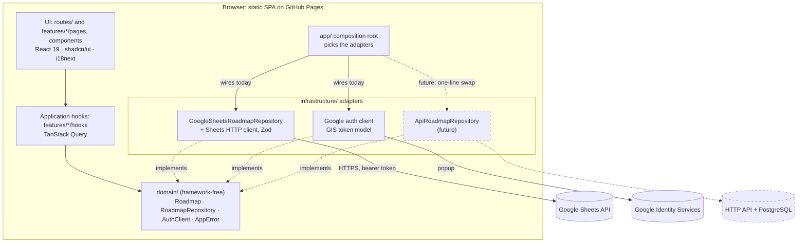

# DHCW Roadmap Editor

[](https://github.com/DHCW-Digital-Health-and-Care-Wales/roadmaps-editor/actions/workflows/ci.yml)

An internal tool for Digital Health and Care Wales (DHCW) staff: Product Leads use it to
manage the public Now / Next / Later roadmaps of their products. A separate app, the
public site, reads the same data source and shows the published roadmaps. The
[Product Lead persona](docs/backlog/personas/product-lead.md) describes who it is for.

It is a static, frontend-only React app hosted on GitHub Pages:
**<https://dhcw-digital-health-and-care-wales.github.io/roadmaps-editor/>**. You connect a
Google account; the app reads the **roadmap index** (the first tab) of one Google
Spreadsheet and lists each roadmap as a card, published or not. A roadmap's page shows
its items, and a Product Lead edits the roadmap's and its items' English and publishes
every change at once; a co-lead's change to the same text is shown beside theirs, never
overwritten.

Google Sheets is a _temporary_ data source: a PostgreSQL-backed HTTP API can replace it
without touching the UI ([how](docs/operations/replacing-google-sheets.md)).

The UI is available in English and Welsh (Cymraeg).

Licensed under the [MIT License](LICENSE).

## Contents

- [How it works](#how-it-works)
- [Spreadsheet format](#spreadsheet-format)
- [Architecture](#architecture)
- [Getting started](#getting-started)
- [Testing and quality checks](#testing-and-quality-checks)
- [Operations](#operations)
- [Security and data access](#security-and-data-access)
- [Languages](#languages)
- [Design](#design)
- [Project documentation](#project-documentation)

## How it works

1. The page loads Google Identity Services (GIS) from `accounts.google.com`.
2. **Connect Google** opens Google's popup (the OAuth 2.0 _token model_). The user picks
   an account and allows access to Google Sheets.
3. GIS returns a short-lived access token (about an hour). It stays in memory only: it is
   never written to storage, URLs or logs.
4. The app reads the configured spreadsheet's tab list (`spreadsheets.get`, tab
   properties only), then, together, the values of the tab with the lowest index, the
   roadmap index, and of the `Families` and `Categories` tabs when they exist
   (`spreadsheets.values.get`, cells as displayed). It shows one card per roadmap the
   index lists, grouped by product family and sorted by title (ADR-009, ADR-013). A card opens `#/roadmaps/<id>`, where
   the id is the public site's address for that roadmap (`ProductA` → `producta`).
5. On a roadmap's page, **Edit** turns the roadmap's text or an item into a form for its
   English. Changes stay pending in this tab, in memory only, until **Publish changes**
   (or **Save changes** on a roadmap that is not published) writes them all at once, after
   a check of what changes. Closing or reloading the tab with changes pending asks first.
6. When the token expires the app says so and offers **Reconnect**; pending changes are
   kept. **Disconnect** revokes the token and clears all loaded data; with changes
   pending, it first asks whether to keep them for the next connection or discard them.

There is no backend, no client secret and no refresh token. What a user can see is decided
entirely by Google: see [Security and data access](#security-and-data-access).

## Spreadsheet format

The spreadsheet is shared with the public site, so its format is a contract with it
([ADR-009](docs/adr/ADR-009-roadmap-list-from-the-first-tab.md)). The **first tab**,
whatever it is called and even when hidden, is the roadmap index: row 1 is the header and
each other row is one roadmap. Its `Sheet` column (required) names the tab holding that
roadmap's items; `Enabled` (exactly `Yes`), `Title`, `Category`, `Family`, `Status label`,
`Last updated`, `Colour`, `Vision`, `Service description` and `Product Lead` are read
when present, with `(cy)` columns for Welsh. The tab a row's `Sheet` names holds that
roadmap's items, one per row, its columns found by their row-1 header in any order
([ADR-011](docs/adr/ADR-011-roadmap-items-from-each-roadmaps-tab.md)); the `Template` tab
is never read. An optional `Item ID` column holds each item's identity
([ADR-012](docs/adr/ADR-012-publishing-a-roadmaps-changes.md)); the public site ignores it.

**Families and categories** are defined once, in a `Families` tab (`ID`, `Name`,
`Name (cy)`, `Colour`) and a `Categories` tab (`ID`, `Name`, `Name (cy)`), neither of
them first, which the owner sets up by hand
([the runbook](docs/operations/families-and-categories-tabs.md),
[ADR-013](docs/adr/ADR-013-families-and-categories-defined-once.md)); the public site
ignores both. A roadmap is linked to its family and category by the index's optional
`Family ID` and `Category ID` columns, or by its `Family` and `Category` cells, folded,
when it has no ID. A linked roadmap shows the list's name and colour; one whose own
cells differ is flagged as out of step, and one whose family is not in the list keeps
its own cells, flagged. Without the `Families` tab, roadmaps are grouped and coloured
from their own cells; without the `Categories` tab, a `Category` is one of the public
site's six spellings, shown in English. The editor never writes the `Categories` tab;
it writes the `Families` tab only as below.

**What the editor writes.** Publishing a roadmap writes, in one all-or-nothing
`spreadsheets.batchUpdate`, only:

- each changed English field: the index row's `Title`, `Status label`, `Product Lead`,
  `Vision` and `Service description`, and each item's `Title`, `Description`, `Outcome`
  and `Phase`, as plain text exactly as typed (trimmed; a formula, number, date or
  `TRUE` stays text), a cleared field as an empty cell;
- a moved item: its row's `Horizon` cell alone, as the public site's English value
  for the placement chosen (`Recently delivered`, `Now`, `Next`, `Later`,
  `Delivered this year` or `Not doing`), so the row keeps its place and the item
  shows in row order in its new placement; a move never blanks the cell;
- an item whose organisations changed: its row's `Organisations` cell alone, as the
  codes chosen, `National` first and then by code, separated by a comma and a space
  (`National, SBUHB`), or an empty cell for none; only codes in the editor's list are
  written, so a code it doesn't recognise goes from the cell then, and only then;
- an `Item ID` for every item row it reads (one with a title) that has none, or repeats
  another row's: eight random
  lower-case letters and digits starting with a letter, such as `k7q2xwbn`;
- a chosen family: the index row's `Family ID`, `Family`, `Family (cy)` and `Colour`,
  copied from the `Families` tab as read at publish (`Colour` lower case, as
  `#006747`); "No family" blanks `Family ID`, `Family` and `Family (cy)` and leaves
  `Colour`;
- a chosen category: the row's `Category ID` and `Category` (the `Categories` tab's
  English `Name`); "No category" blanks both;
- on any publish, the `Family ID` or `Category ID` of a row with none whose name links
  it to a listed family or category, never changing an ID already there;
- a column the roadmap needs but lacks (the `Item ID` column the first time, the
  `Family ID` or `Category ID` column, or an edited field's column, `Horizon` for a
  move and `Organisations` for a choice of organisations), appended after the last
  column in use with the public site's English header, the grid widened in the same
  request.

Adding, renaming or recolouring a family on the "Families, categories and organisations" page writes
at once, after a re-read, in one all-or-nothing `spreadsheets.batchUpdate`, only:

- to add a family: a new `Families` row after the last row in use, with an `ID` in the
  `Item ID` format, the `Name` as typed (trimmed) and the `Colour` in lower case, its
  `Name (cy)` left blank, appended by Google so a family a co-lead added meanwhile is
  kept;
- to rename or recolour one: its `Families` row's `Name` or `Colour`, whichever changed,
  and on the index row of each roadmap in the family (linked by ID, or by name if it
  has no ID) its `Family ID`, `Family`, `Family (cy)` (copied from `Name (cy)`, which is
  never written) and `Colour`, as a publish writes a chosen family; the `Family ID`
  column is appended if missing. Nothing is written while the roadmap index is named
  `Template`, and a co-lead's change to the family's name or colour, or to which
  roadmaps are in it, since the page read it refuses the whole write. An index row the
  editor doesn't list (its `Sheet` is not a valid roadmap ID, or repeats an earlier
  row's) is not rewritten, and keeps the old family name and colour.

"Make it match" on a roadmap flagged as out of step with its family or category writes
at once, after a re-read, in one all-or-nothing `spreadsheets.batchUpdate`, only that
roadmap's index row's `Family ID`, `Family`, `Family (cy)`, `Colour`, `Category ID` and
`Category`, copied from the `Families` and `Categories` tabs as read, each only where it
differs, and the `Family ID` or `Category ID` column if it is missing. It is offered
only for a family in the list, writes nothing while the roadmap index is named
`Template`, and a change since the page loaded to the roadmap's family or category, to its
row's own copied cells, or to its being out of step or published, refuses the write; its pending edits stay
pending.

"Publish roadmap" and "Unpublish roadmap" on a roadmap's page write at once, after a
confirmation and a re-read, in one all-or-nothing `spreadsheets.batchUpdate`, only that
roadmap's index row's `Enabled` cell, as exactly `Yes` or `No` (any other value, such as
`yes`, `TRUE` or blank, is overwritten), and the `Enabled` column, appended with its
header, if the index has none (STY-035). The row written is the first with the
roadmap's ID, listed or not, that still holds what the page showed; nothing is written
when none does, or when the cell already holds the value. Publishing a roadmap with
pending edits ("Save and publish") writes them with `Enabled` in the same request, as a
publish of them writes them, all or nothing. Publishing writes nothing while the row
would fail the public site's nightly sync once enabled: its `Sheet` names no tab, the
tab has no `Title` or `Horizon` column (unless the same write adds `Horizon`), its
`Colour` is `#rgb` (unless a family chosen in the same write replaces it), or another
row with the same ID is enabled. Unpublishing is never checked, and leaves pending
edits pending.

It never writes any other cell: no Welsh `(cy)` cell other than `Family (cy)`, no
`Last updated`, `Sheet`, `Labels` or `Details`, no `Enabled` cell but the one above, no `Horizon` or
`Organisations` cell but those above, no `Family`, `Category` or `Colour` cell but
those above and "Make it match"'s, no roadmap's row or tab but
those above, nothing in the `Template` or `Categories` tab, nothing in the `Families`
tab but the family changes above, and no cell whose value has not changed. A roadmap
whose `Sheet` names the `Template` tab or the roadmap index itself can't be read or
published, and nothing is published while the
roadmap index is itself named `Template`. A field a co-lead has changed since it was
loaded (a family or category by its ID, so a rename is no change), or an item or
roadmap since removed, refuses the whole publish. A family or category ID the list
doesn't have refuses it too, as does any family or category choice, "No family" or "No
category" included, while its list tab is missing.

- The rules, and how the editor differs from the public site on mistakes, are in
  [the roadmap index analysis](docs/analysis/roadmaps-tab-format.md) and
  [the roadmap tab analysis](docs/analysis/roadmap-tab-format.md).
- An example spreadsheet, with steps to import it into a test spreadsheet of your own, is in
  [`tests/fixtures/sheets/`](tests/fixtures/sheets/README.md).
- A list that can't be read (no tabs, an empty first tab, or no `Sheet` column) shows a
  problem asking the spreadsheet owner to check it. A mistake in one row never hides the
  rest. A roadmap whose tab is missing, empty or has no `Title` column is still listed, but
  its own items can't be read.

## Architecture

The code is layered with one-way dependencies (ADR-002); ESLint enforces the import
rules. `app/` is the composition root and the only place that knows about Google.



| Folder                                     | Holds                                                                           | May import                       |
| ------------------------------------------ | ------------------------------------------------------------------------------- | -------------------------------- |
| `src/domain/`                              | `Roadmap`, `RoadmapRepository`, `AuthClient`: plain TypeScript types/ports      | `lib/` only                      |
| `src/infrastructure/`                      | Google Sheets and GIS adapters; Zod parsing of everything Google returns        | `domain/`, `lib/`                |
| `src/features/<name>/`                     | hooks (TanStack Query), components and pages for one feature                    | `domain/`, `lib/`, `components/` |
| `src/routes/`                              | thin TanStack Router file routes                                                | features                         |
| `src/app/`                                 | config, composition root, providers, router                                     | everything                       |
| `src/components/`, `src/lib/`, `src/i18n/` | shadcn/ui, app shell, theme; small utilities; i18n setup and catalogues         | —                                |
| `build/`                                   | build-time helpers (the GitHub Pages base path, the footer version, lint rules) | —                                |

**The repository abstraction.** The UI only ever sees `Roadmap` (its id, its title in
English and Welsh, and the rest of what the roadmap list holds about it; ADR-009) and
`AppError` (a transport-neutral error with a `kind` such as `forbidden` or
`rate-limited`). It reads and publishes through one port (`src/domain/roadmap/roadmap-repository.ts`, whose
doc comments are the contract):

```ts
interface RoadmapRepository {
  listRoadmaps(options?: RepositoryReadOptions): Promise<Roadmap[]>
  listRoadmapItems(
    roadmapId: string,
    options?: RepositoryReadOptions,
  ): Promise<RoadmapItem[]>
  publishRoadmapChanges(
    roadmapId: string,
    changes: RoadmapChanges,
    options?: RepositoryReadOptions,
  ): Promise<PublishOutcome>
}
```

`GoogleSheetsRoadmapRepository` implements it today; `app/composition.ts` creates it and
hands it to React through `RoadmapRepositoryProvider`. Every implementation must pass the
shared contract test (`describeRoadmapRepositoryContract`), so swapping data sources is a
change to the composition root and nothing else. Auth works the same way: the UI uses the
`AuthClient` port, and only `infrastructure/google-identity/` touches the `google` global.

Routing uses hash history (`/roadmaps-editor/#/roadmaps/producta`), so deep links survive a
reload on GitHub Pages without a 404 fallback (ADR-004).

## Getting started

### Prerequisites

- Node.js 26 (see `.nvmrc`; 22.22+ and 24.15+ also work).
- pnpm, e.g. `npm install --global pnpm` (see <https://pnpm.io/installation>). Any recent
  pnpm switches itself to the version pinned in `packageManager`. Node 25+ no longer
  ships Corepack.
- For running against real Google data: a Google account with access to the configured
  spreadsheet, and an OAuth client that lists your local origin (see
  [Google Cloud setup](docs/operations/google-cloud-setup.md)). Tests need neither.

### Install and run

```sh
git clone https://github.com/DHCW-Digital-Health-and-Care-Wales/roadmaps-editor.git
cd roadmaps-editor
pnpm install --frozen-lockfile
cp .env.example .env.local   # required: `pnpm dev` does not read .env.production
pnpm dev                     # http://localhost:5173
```

`pnpm build && pnpm preview` serves the production build at <http://localhost:4173>.

### Environment configuration

Configuration is public (an OAuth client ID and a spreadsheet ID are not secrets) and is
validated with Zod at startup; a bad value stops the app with a message naming the
variable.

| Variable                     | Purpose                                                                           | Where it is set                                                            |
| ---------------------------- | --------------------------------------------------------------------------------- | -------------------------------------------------------------------------- |
| `VITE_GOOGLE_CLIENT_ID`      | OAuth client ID (`….apps.googleusercontent.com`)                                  | `.env.production` (committed, used by builds); `.env.local` for `pnpm dev` |
| `VITE_GOOGLE_SPREADSHEET_ID` | The spreadsheet to read: the `<ID>` in `docs.google.com/spreadsheets/d/<ID>/edit` | same                                                                       |
| `VITE_FEEDBACK_URL`          | Optional `https://` address for the phase banner's feedback link; none when unset | `.env.production` or `.env.local`                                          |
| `VITE_BASE_PATH`             | Optional build-time override of the URL base path, e.g. `/preview/`               | shell / CI                                                                 |
| `PAGES_CUSTOM_DOMAIN`        | Custom Pages domain; forces base path `/`                                         | GitHub repository variable                                                 |
| `GITHUB_REPOSITORY`          | `owner/repo`; derives the base path                                               | set automatically by GitHub Actions                                        |

A `VITE_FEEDBACK_URL` that is not `https` stops the app, like any other bad value; leave it
blank (or out) and the banner invites feedback without a link. The footer shows the app's
version: the package version and short commit of a CI build (`0.0.0+a1b2c3d`), or `dev` for a
local one (`build/resolve-build-version.ts`).

`.env.example` and `.env.production` hold the same values. Vite gives
`.env.production` priority over `.env.local` when building, so to build with other values
locally use `.env.production.local` (git-ignored). Never put secrets in `VITE_*`
variables: they are compiled into the public JavaScript.

## Testing and quality checks

```sh
pnpm typecheck      # tsc -b over app, config and E2E projects
pnpm lint           # ESLint, zero warnings allowed (includes layering, i18n and design-token rules)
pnpm format:check   # Prettier (pnpm format to fix)
pnpm test           # Vitest unit + component tests; no network, no Google
pnpm build          # production build into dist/

pnpm exec playwright install --with-deps chromium   # once per @playwright/test version
pnpm test:e2e       # builds, serves with vite preview on :4173, fakes GIS + Sheets
```

The E2E suite is hermetic: Google's script and the Sheets API are faked in the browser,
and any request to another origin fails the test, as does an access token written to
storage, cookies, the URL or the console at any point. It reuses a server already listening on
port 4173 locally, so stop any stale `pnpm preview` first. Live Google integration can
only be checked by hand
([how](docs/operations/google-cloud-setup.md#check-it-against-the-real-google)). See `tests/e2e/AGENTS.md` for the
fixtures.

## Operations

- [Google Cloud setup and troubleshooting](docs/operations/google-cloud-setup.md): the
  OAuth client, the spreadsheet, the manual check against the real Google, and
  connection errors.
- [Deploying to GitHub Pages](docs/operations/github-pages-deployment.md): the CI/CD
  workflow, a first deployment, the base path and a custom domain.
- [Replacing Google Sheets with an HTTP API](docs/operations/replacing-google-sheets.md).

Two version pins are deliberate: `@playwright/test` is exact because each version needs
its own Chromium build, and TypeScript stays on 6.0 because typescript-eslint 8 requires
`typescript <6.1`.

## Security and data access

- **Frontend-only.** Everything runs in the user's browser with the user's own Google
  token. There is no server to enforce permissions, so **Google Sheets permissions
  determine effective data access**: whoever can open the spreadsheet in Google can see
  its roadmaps here, and nobody else can. Manage access by sharing the spreadsheet.
- **Public configuration.** The client ID and spreadsheet ID ship in the JavaScript
  bundle. That is by design: neither grants access on its own.
- **Tokens** live in memory only, expire after about an hour, and are revoked on
  Disconnect. Two minutes before a session ends, a warning offers "Stay connected", which
  renews it in one click. The app requests no refresh tokens and never runs silent
  background re-authentication: renewal only ever starts from that click.
- **No Content Security Policy yet.** GitHub Pages cannot send response headers, so a
  CSP would be a `<meta http-equiv>` tag. It would have to allow at least
  `https://accounts.google.com` (script, frame, style), `https://sheets.googleapis.com`
  and `https://oauth2.googleapis.com` (connect), and the theme script in `index.html`
  (by hash). Add it only together with a manual sign-in on the deployed site, since the
  hermetic E2E suite cannot prove it leaves the real Google flow working.
- **The full `spreadsheets` scope is sensitive.** It is requested deliberately, because
  the editor writes a roadmap's changes back (ADR-003, ADR-012;
  [what it writes](#spreadsheet-format)); it lets the app read and write _every_ spreadsheet
  the user can access, not just this one. Consequences depend on the audience and
  publishing status:
  - _Internal_ (Workspace): no Google verification, but a Workspace admin may need to
    allow or trust the app (_Admin console → Security → API controls_).
  - _External, Testing_: up to 100 listed test users, who see the unverified-app screen.
  - _External, In production_: Google's OAuth app verification is required (verified
    domain, privacy policy, scope justification, often a demo video). Until it is
    approved, users see the unverified-app warning and a user cap applies.

## Languages

The UI is in **English** (`en`, default) and **Welsh** (`cy`), switched in the header and
remembered in the browser. Without a stored choice, the first language in the browser's
preference list that the app supports wins (any `cy-*` tag counts as Welsh). Google's own
popup uses the language of the user's Google account. How copy is added and checked is
in [ADR-008](docs/adr/ADR-008-internationalisation-english-and-welsh.md) and the
[copywriter skill](.agents/skills/copywriter/SKILL.md).

> **The Welsh copy is machine-assisted.** A fluent Welsh speaker must review
> `src/i18n/locales/cy.ts` before a public launch.

## Design

The look follows the
[Digital Health and Care Wales design system](https://github.com/DHCW-Digital-Health-and-Care-Wales/dhcw-design-system)
(© Digital Health and Care Wales; code MIT, guidance OGL v3.0). Its colours, type scale,
corner radius and yellow focus indicator are copied into `src/styles/globals.css` from the
release pinned in `package.json` (`dhcw-design-system`), and a test keeps them
equal to it. Its stylesheet and templates are not loaded
([ADR-010](docs/adr/ADR-010-align-the-ui-with-the-dhcw-design-system.md)). The dark theme
is ours, derived from DHCW's navies. Tailwind's default colours, sizes, radii and shadows
are removed, so `pnpm lint` fails on any style that isn't one of these tokens. Upgrading
the pin is described in [`src/styles/AGENTS.md`](src/styles/AGENTS.md).

**The DHCW logo and icon** (`src/assets/dhcw/`, and the favicon derived from the icon) are
not covered by DHCW's MIT or OGL licences. They are used with DHCW's permission, given by
the product owner on 2026-11-10; their source and the pinned commit are in
[`src/assets/dhcw/README.md`](src/assets/dhcw/README.md). Do not reuse them outside this app.

## Project documentation

- [`AGENTS.md`](AGENTS.md): conventions, layering rules and commands; read it before
  changing code. Nested `AGENTS.md` files (for example
  [`tests/e2e/AGENTS.md`](tests/e2e/AGENTS.md)) cover their folders.
- [`docs/adr/`](docs/adr/README.md): architecture decision records.
- [`docs/backlog/`](docs/backlog/README.md): epics, stories, defects and chores; finished
  epics are in `docs/backlog/_archive/`.
- [`docs/GLOSSARY.md`](docs/GLOSSARY.md): the shared domain vocabulary.
- [`docs/operations/`](docs/operations/): runbooks.
