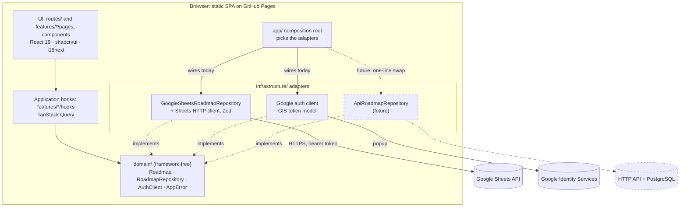

# DHCW Roadmap Editor

An internal tool for Digital Health and Care Wales (DHCW) staff: Product Leads use it to
manage the public Now / Next / Later roadmaps of their products. A separate app, the
public site, reads the same data source and shows the published roadmaps. The
[Product Lead persona](../../docs/backlog/personas/product-lead.md) describes who it is for.

It is a static, frontend-only React app hosted on GitHub Pages:
**<https://dhcw-digital-health-and-care-wales.github.io/roadmaps/>**. You connect a
Google account; the app reads the **roadmap index** (the first tab) of one Google
Spreadsheet and lists each roadmap as a card, published or not. A roadmap's page shows
its items, and a Product Lead edits the roadmap's and its items' English and publishes
every change at once; a co-lead's change to the same text is shown beside theirs, never
overwritten.

Google Sheets is a _temporary_ data source: a PostgreSQL-backed HTTP API can replace it
without touching the UI ([how](../../docs/operations/replacing-google-sheets.md)).

The UI is available in English and Welsh (Cymraeg).

The editor is the `@roadmaps/editor` package of the [roadmaps workspace](../../README.md),
which also holds the [spreadsheet format](../../README.md#spreadsheet-format) it reads and
writes, the contract with the public site. Run its commands from the repository root.

## Contents

- [How it works](#how-it-works)
- [Architecture](#architecture)
- [Getting started](#getting-started)
- [Testing and quality checks](#testing-and-quality-checks)
- [Operations](#operations)
- [Security and data access](#security-and-data-access)
- [Languages](#languages)
- [Design](#design)

## How it works

1. The page loads Google Identity Services (GIS) from `accounts.google.com`.
2. **Connect Google** opens Google's popup (the OAuth 2.0 _token model_). The user picks
   an account and allows access to Google Sheets.
3. GIS returns a short-lived access token (about an hour). It stays in memory only: it is
   never written to storage, URLs or logs.
4. The app reads the configured spreadsheet's tab list (`spreadsheets.get`, tab
   properties only), then, together, the values of the tab with the lowest index, the
   roadmap index, and of the `Families` and `Categories` tabs when they exist
   (`spreadsheets.values.get`, cells as displayed). It shows one card per roadmap the
   index lists, grouped by product family and sorted by title (ADR-009, ADR-013). A card opens `#/roadmaps/<id>`, where
   the id is the public site's address for that roadmap (`ProductA` → `producta`).
5. On a roadmap's page, **Edit** turns the roadmap's text or an item into a form for its
   English. Changes stay pending in this tab, in memory only, until **Publish changes**
   (or **Save changes** on a roadmap that is not published) writes them all at once, after
   a check of what changes. Closing or reloading the tab with changes pending asks first.
6. When the token expires the app says so and offers **Reconnect**; pending changes are
   kept. **Disconnect** revokes the token and clears all loaded data; with changes
   pending, it first asks whether to keep them for the next connection or discard them.

There is no backend, no client secret and no refresh token. What a user can see is decided
entirely by Google: see [Security and data access](#security-and-data-access).

## Architecture

The code is layered with one-way dependencies (ADR-002); ESLint enforces the import
rules. `app/` is the composition root and the only place that knows about Google.



| Folder                                                                         | Holds                                                                           | May import                       |
| ------------------------------------------------------------------------------ | ------------------------------------------------------------------------------- | -------------------------------- |
| `apps/editor/src/domain/`                                                      | `Roadmap`, `RoadmapRepository`, `AuthClient`: plain TypeScript types/ports      | `lib/` only                      |
| `apps/editor/src/infrastructure/`                                              | Google Sheets and GIS adapters; Zod parsing of everything Google returns        | `domain/`, `lib/`                |
| `apps/editor/src/features/<name>/`                                             | hooks (TanStack Query), components and pages for one feature                    | `domain/`, `lib/`, `components/` |
| `apps/editor/src/routes/`                                                      | thin TanStack Router file routes                                                | features                         |
| `apps/editor/src/app/`                                                         | config, composition root, providers, router                                     | everything                       |
| `apps/editor/src/components/`, `apps/editor/src/lib/`, `apps/editor/src/i18n/` | shadcn/ui, app shell, theme; small utilities; i18n setup and catalogues         | —                                |
| `apps/editor/build/`                                                           | build-time helpers (the GitHub Pages base path, the footer version, lint rules) | —                                |

**The repository abstraction.** The UI only ever sees `Roadmap` (its id, its title in
English and Welsh, and the rest of what the roadmap list holds about it; ADR-009) and
`AppError` (a transport-neutral error with a `kind` such as `forbidden` or
`rate-limited`). It reads and publishes through one port
(`apps/editor/src/domain/roadmap/roadmap-repository.ts`, whose doc comments are the
contract):

```ts
interface RoadmapRepository {
  listRoadmaps(options?: RepositoryReadOptions): Promise<Roadmap[]>
  listRoadmapItems(
    roadmapId: string,
    options?: RepositoryReadOptions,
  ): Promise<RoadmapItem[]>
  publishRoadmapChanges(
    roadmapId: string,
    changes: RoadmapChanges,
    options?: RepositoryReadOptions,
  ): Promise<PublishOutcome>
}
```

`GoogleSheetsRoadmapRepository` implements it today; `app/composition.ts` creates it and
hands it to React through `RoadmapRepositoryProvider`. Every implementation must pass the
shared contract test (`describeRoadmapRepositoryContract`), so swapping data sources is a
change to the composition root and nothing else. Auth works the same way: the UI uses the
`AuthClient` port, and only `infrastructure/google-identity/` touches the `google` global.

Routing uses hash history (`/roadmaps/#/roadmaps/producta`), so deep links survive a
reload on GitHub Pages without a 404 fallback (ADR-004).

## Getting started

### Prerequisites

- Node.js and pnpm, as the [workspace's README](../../README.md#getting-started) says.
- For running against real Google data: a Google account with access to the configured
  spreadsheet, and an OAuth client that lists your local origin (see
  [Google Cloud setup](../../docs/operations/google-cloud-setup.md)). Tests need neither.

### Install and run

```sh
git clone https://github.com/DHCW-Digital-Health-and-Care-Wales/roadmaps.git
cd roadmaps
pnpm install --frozen-lockfile                       # from here on, the repository root
cp apps/editor/.env.example apps/editor/.env.local   # required: dev does not read .env.production
pnpm editor:dev                                      # http://localhost:5173
```

`pnpm editor:build && pnpm editor:preview` serves the production build at
<http://localhost:4173>. Both
servers stop with an error when their port is busy, rather than move to another port that
the OAuth client does not list.

### Parallel worktrees (T3 Code)

Several worktrees can each run their own dev server and E2E suite on one host. `t3.json`
runs `scripts/worktree/worktree.sh setup` (`pnpm worktree:setup`) when T3 Code creates a
worktree. The setup claims a numbered slot, writes the slot's ports to `.env.worktree` at
the repository's root, installs dependencies and creates `apps/editor/.env.local`. Slot
_n_ owns `21000 + 10n` for `pnpm editor:dev` and `21000 + 10n + 1` for
`pnpm editor:preview` and `pnpm editor:test:e2e`; `apps/editor/vite.config.ts` and
`apps/editor/playwright.config.ts` read the file
(`scripts/worktree/dev-ports.ts`).
A checkout without it keeps 5173 and 4173. The public site takes the slot's next two
ports for `pnpm site:dev` and for `site:preview`, `site:test:e2e` and `site:lighthouse`
(the same module), or 5174 and 4174.

```sh
pnpm worktree:info      # this worktree's ports
pnpm worktree:teardown  # stop its servers, free the slot
```

Slots are tracked in `~/.local/state/roadmaps/worktree-slots`. A worktree removed
without a teardown (`git worktree remove`, or deleted and then `git worktree prune`d)
has its slot reclaimed by the next setup; after a `git worktree move`, run
`pnpm worktree:setup` in the moved worktree to claim a slot under its new path. Real
Google sign-in works only on an origin the OAuth client lists, so sign in from a checkout
on 5173, or add the worktree's `http://localhost:<dev port>` to the client's origins
([Google Cloud setup](../../docs/operations/google-cloud-setup.md)). The E2E suite fakes
Google, so it runs on any slot.

### Environment configuration

Configuration is public (an OAuth client ID and a spreadsheet ID are not secrets) and is
validated with Zod at startup; a bad value stops the app with a message naming the
variable.

| Variable                     | Purpose                                                                           | Where it is set                                                                   |
| ---------------------------- | --------------------------------------------------------------------------------- | --------------------------------------------------------------------------------- |
| `VITE_GOOGLE_CLIENT_ID`      | OAuth client ID (`….apps.googleusercontent.com`)                                  | `.env.production` (committed, used by builds); `.env.local` for `pnpm editor:dev` |
| `VITE_GOOGLE_SPREADSHEET_ID` | The spreadsheet to read: the `<ID>` in `docs.google.com/spreadsheets/d/<ID>/edit` | same                                                                              |
| `VITE_FEEDBACK_URL`          | Optional `https://` address for the phase banner's feedback link; none when unset | `.env.production` or `.env.local`                                                 |
| `VITE_REPOSITORY_URL`        | Optional `https://` address for the footer's repository link; none when unset     | `.env.production` or `.env.local`                                                 |
| `VITE_BASE_PATH`             | Optional build-time override of the URL base path, e.g. `/preview/`               | shell / CI                                                                        |
| `PAGES_CUSTOM_DOMAIN`        | Custom Pages domain; forces base path `/`                                         | GitHub repository variable                                                        |
| `GITHUB_REPOSITORY`          | `owner/repo`; derives the base path                                               | set automatically by GitHub Actions                                               |

A `VITE_FEEDBACK_URL` or `VITE_REPOSITORY_URL` that is not `https` stops the app, like any other bad value; leave it
blank (or out) and the banner invites feedback without a link, and the footer omits the
repository link. The footer shows the app's
version: the package version and short commit of a CI build (`0.0.0+a1b2c3d`), or `dev` for a
local one (`apps/editor/build/resolve-build-version.ts`).

The `.env` files are in `apps/editor/`. `.env.example` and `.env.production` hold the
same values. Vite gives
`.env.production` priority over `.env.local` when building, so to build with other values
locally use `.env.production.local` (git-ignored). Never put secrets in `VITE_*`
variables: they are compiled into the public JavaScript.

## Testing and quality checks

From the repository root:

```sh
pnpm editor:typecheck  # tsc -b over app, config and E2E projects
pnpm editor:lint       # ESLint, zero warnings allowed (includes layering, i18n and design-token rules)
pnpm format:check      # Prettier over the whole repository (pnpm format to fix)
pnpm editor:test       # Vitest unit + component tests; no network, no Google
pnpm test:docs         # the Markdown tests alone (links, agent guides)
pnpm editor:build      # production build into apps/editor/dist/

pnpm --filter @roadmaps/editor exec playwright install --with-deps chromium   # once per @playwright/test version
pnpm editor:test:e2e  # builds, serves with vite preview on :4173 (a worktree's own port), fakes GIS + Sheets
```

The E2E suite is hermetic: Google's script and the Sheets API are faked in the browser,
and any request to another origin fails the test, as does an access token written to
storage, cookies, the URL or the console at any point. It reuses a server already listening on
its port (4173, or the worktree's `PREVIEW_PORT`) locally, so stop any stale
`pnpm editor:preview` first. Live Google integration can
only be checked by hand
([how](../../docs/operations/google-cloud-setup.md#check-it-against-the-real-google)). See `apps/editor/tests/e2e/AGENTS.md` for the
fixtures.

## Operations

- [Google Cloud setup and troubleshooting](../../docs/operations/google-cloud-setup.md): the
  OAuth client, the spreadsheet, the manual check against the real Google, and
  connection errors.
- [Deploying to GitHub Pages](../../docs/operations/github-pages-deployment.md): the CI/CD
  workflow, a first deployment, the base path and a custom domain.
- [Replacing Google Sheets with an HTTP API](../../docs/operations/replacing-google-sheets.md).

Two version pins are deliberate: `@playwright/test` is exact because each version needs
its own Chromium build, and TypeScript stays on 6.0 because typescript-eslint 8 requires
`typescript <6.1`.

## Security and data access

- **Frontend-only.** Everything runs in the user's browser with the user's own Google
  token. There is no server to enforce permissions, so **Google Sheets permissions
  determine effective data access**: whoever can open the spreadsheet in Google can see
  its roadmaps here, and nobody else can. Manage access by sharing the spreadsheet.
- **Public configuration.** The client ID and spreadsheet ID ship in the JavaScript
  bundle. That is by design: neither grants access on its own.
- **Tokens** live in memory only, expire after about an hour, and are revoked on
  Disconnect. Two minutes before a session ends, a warning offers "Stay connected", which
  renews it in one click. The app requests no refresh tokens and never runs silent
  background re-authentication: renewal only ever starts from that click.
- **No Content Security Policy yet.** GitHub Pages cannot send response headers, so a
  CSP would be a `<meta http-equiv>` tag. It would have to allow at least
  `https://accounts.google.com` (script, frame, style), `https://sheets.googleapis.com`
  and `https://oauth2.googleapis.com` (connect), and the theme script in `apps/editor/index.html`
  (by hash). Add it only together with a manual sign-in on the deployed site, since the
  hermetic E2E suite cannot prove it leaves the real Google flow working.
- **The full `spreadsheets` scope is sensitive.** It is requested deliberately, because
  the editor writes a roadmap's changes back (ADR-003, ADR-012;
  [what it writes](../../README.md#spreadsheet-format)); it lets the app read and write _every_ spreadsheet
  the user can access, not just this one. Consequences depend on the audience and
  publishing status:
  - _Internal_ (Workspace): no Google verification, but a Workspace admin may need to
    allow or trust the app (_Admin console → Security → API controls_).
  - _External, Testing_: up to 100 listed test users, who see the unverified-app screen.
  - _External, In production_: Google's OAuth app verification is required (verified
    domain, privacy policy, scope justification, often a demo video). Until it is
    approved, users see the unverified-app warning and a user cap applies.

## Languages

The UI is in **English** (`en`, default) and **Welsh** (`cy`), switched in the header and
remembered in the browser. Without a stored choice, the first language in the browser's
preference list that the app supports wins (any `cy-*` tag counts as Welsh). Google's own
popup uses the language of the user's Google account. How copy is added and checked is
in [ADR-008](../../docs/adr/ADR-008-internationalisation-english-and-welsh.md) and the
[copywriter skill](../../.agents/skills/copywriter/SKILL.md).

> **The Welsh copy is machine-assisted.** A fluent Welsh speaker must review
> `apps/editor/src/i18n/locales/cy.ts` before a public launch.

## Design

The look follows the
[Digital Health and Care Wales design system](https://github.com/DHCW-Digital-Health-and-Care-Wales/dhcw-design-system)
(© Digital Health and Care Wales; code MIT, guidance OGL v3.0). Its colours, type scale,
corner radius and yellow focus indicator are copied into `apps/editor/src/styles/globals.css` from the
release pinned in `apps/editor/package.json` (`dhcw-design-system`), and a test keeps them
equal to it. Its stylesheet and templates are not loaded
([ADR-010](../../docs/adr/ADR-010-align-the-ui-with-the-dhcw-design-system.md)). The dark theme
is ours, derived from DHCW's navies. Tailwind's default colours, sizes, radii and shadows
are removed, so `pnpm lint` fails on any style that isn't one of these tokens. Upgrading
the pin is described in [`apps/editor/src/styles/AGENTS.md`](src/styles/AGENTS.md).

**The DHCW logo and icon** (`apps/editor/src/assets/dhcw/`, and the favicon derived from the icon) are
not covered by DHCW's MIT or OGL licences. They are used with DHCW's permission, given by
the product owner on 2026-11-10; their source and the pinned commit are in
[`apps/editor/src/assets/dhcw/README.md`](src/assets/dhcw/README.md). Do not reuse them outside this app.
