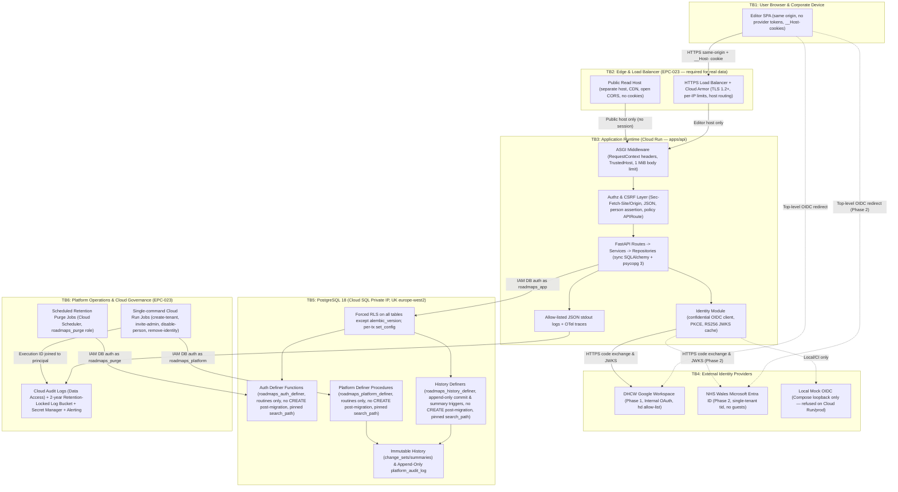
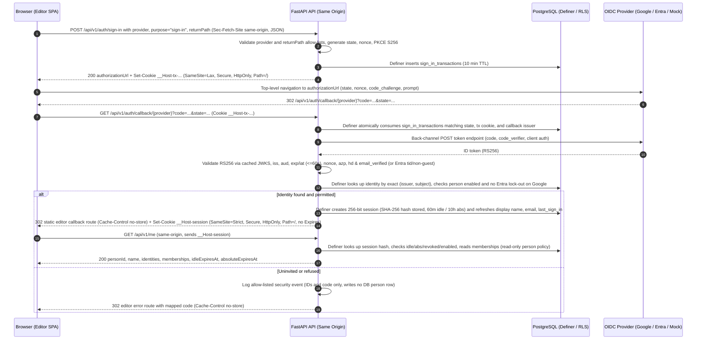
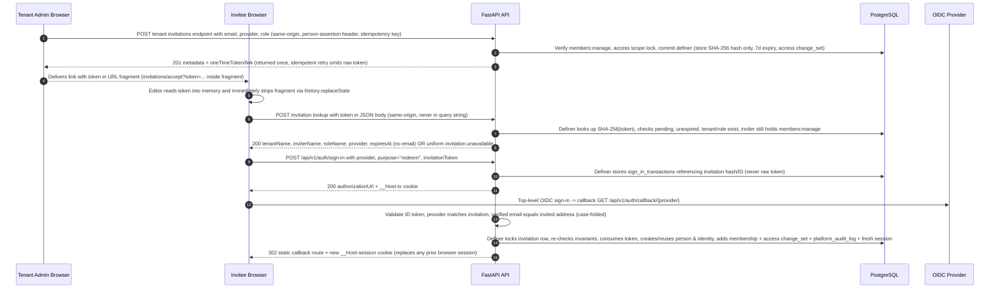
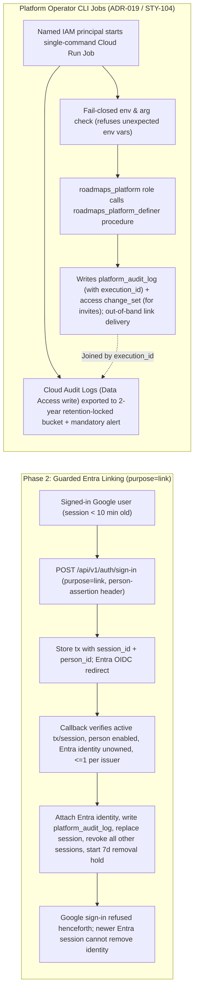

# Identity, Session, Invitation and Linking Threat Model

Design threat model for the Digital Health and Care Wales (DHCW) Roadmaps backend API and
editor sign-in flows. Written for DHCW cyber security review and phased sign-off before any
hosted API deployment, real staff data, or hosted identity provider configuration.

- **Scope**: OpenID Connect (OIDC) sign-in (DHCW Google Workspace, local mock provider, and
  planned NHS Wales Microsoft Entra ID), opaque server-side sessions, single-use
  invitations, cross-tenant isolation, route authorisation, guarded identity linking, and
  platform operator CLI jobs.
- **Out of scope**: Roadmap editing, content redaction workflows, public-site caching, and
  the legacy browser-only Google Sheets adapter (covered by separate records in
  [EPC-026](../backlog/EPC-026-roadmaps-lists-and-versioned-api/README.md),
  [EPC-028](../backlog/EPC-028-public-read-api-sheets-migration-entra-and-switch-over/README.md),
  and [ADR-003](../adr/ADR-003-browser-oauth-with-google-identity-services.md)).
- **Operational context** (`ADR-018` _EPC-024 amendments_, `STY-102` D16): The editor is an
  office/backend administrative tool (Product Leads, Tenant Admins and Viewers managing
  public roadmaps), not a clinical shared-workstation application. Current evidence assumes
  each user works on their own corporate device rather than sharing a workstation (to be
  revisited if later user research changes that). All browser, session-timeout,
  asserted-person and tab-focus controls remain in place as defence-in-depth.
- **Binding architecture decisions** (summarised inline throughout so this document can be
  reviewed standalone without repository access):
  - [ADR-015](../adr/ADR-015-the-roadmap-database-is-postgresql-tenant-scoped-and-versioned.md)
    — PostgreSQL 18 schema, tenancy, forced row-level security (RLS), dedicated definer
    owner roles and immutable history
  - [ADR-017](../adr/ADR-017-the-api-is-synchronous-fastapi-over-sqlalchemy-and-psycopg.md)
    — synchronous FastAPI API over SQLAlchemy and psycopg 3, error envelope, wire models,
    settings and migrations
  - [ADR-018](../adr/ADR-018-sign-in-through-the-api-with-a-server-side-session.md) —
    confidential OIDC client, server-side sessions, invitations, guarded identity linking,
    logging, retention and phased cyber sign-off
  - [ADR-019](../adr/ADR-019-the-api-authorises-every-route-from-a-permission-catalogue-in-code.md)
    — typed permission catalogue, shipped roles, fail-closed route policies, tenant scoping
    and IAM-gated platform operator CLI jobs
  - [ADR-020](../adr/ADR-020-the-editor-and-the-api-share-one-origin.md) — single origin
    for editor and API, separate host for public read, same-origin CSRF protection, edge
    rate limits (required for real data) and HTTP security headers
- **Standards referenced**: OAuth 2.0 Security Best Current Practice (RFC 9700), OAuth 2.0
  for Browser-Based Applications (RFC 10017), OWASP ASVS 5.0 (V3 Web Frontend Security, V6
  Authentication, V7 Session Management, V8 Authorisation, V10 OAuth and OIDC, V16 Security
  Logging and Error Handling), and NIST SP 800-63B-4.
- **Methodology**: STRIDE (Spoofing, Tampering, Repudiation, Information Disclosure, Denial
  of Service, Elevation of Privilege) applied flow by flow across all trust boundaries.

## Public-safe document rules and disposition legend

This repository is public, so DHCW maintains a two-layer governance split:

1. **This public design threat model** documents system architecture, trust boundaries,
   flows, standard threat classes, mitigating controls, implementing records or standing
   checks, high-level accepted residual risks already recorded in ADR-018, and the sanitised
   phased sign-off gate.
2. **DHCW's private governance record** (outside this repository) holds formal risk scoring
   and severity/exploitability ratings, reviewer identities, internal ticket references,
   internal WAF or rate-limit thresholds, raw cyber review findings, and any unfixed
   security gaps.

**Public hygiene rules that bind this file and every change touching it:**

- No severity or exploitability ratings (`High`/`Medium`/`Low` or numeric scores), no
  internal WAF or rate-limit thresholds, no reviewer personal data, and no internal ticket
  references appear here.
- No unfixed or exploitable security gap in an accepted design or merged/deployed code is
  published here or in any public PR surface (commit messages, PR bodies, Review records,
  review threads, or Delivery sections). Any newly discovered gap is reported privately to
  the owner first so the owner can tighten a story requirement, track it privately, or
  amend ADR-018 before anything is committed publicly.
- Every threat row uses exactly one of the five dispositions below. Where a
  `Mitigated by design` row cites an open grilling question in an unstarted story or
  candidate scope in `EPC-023`, the ADR-level control is settled while the exact
  implementation mechanism remains conditional on that story or epic's grilling.

| Disposition              | Meaning                                                                                                |
| ------------------------ | ------------------------------------------------------------------------------------------------------ |
| `Mitigated`              | Control is implemented in the repository and proven by a standing automated test or check cited inline |
| `Mitigated by design`    | Control is specified in accepted ADRs and assigned to an implementing story or infrastructure epic     |
| `Accepted residual risk` | High-level residual risk explicitly accepted by the owner in ADR-018 (listed in the register below)    |
| `Pending Entra spike`    | Phase 2 Microsoft Entra ID unknown that blocks Entra enablement until the EPC-028 spike settles it     |
| `Under review`           | Neutral marker for an item tracked in DHCW's private governance space, without vulnerability detail    |

## 1. Domain vocabulary, assets and actors

### Key domain terms

The roadmaps domain distinguishes NHS Wales directory concepts from application tenancy
([GLOSSARY.md](../GLOSSARY.md)):

- **Tenant**: An NHS Wales organisation (DHCW first) that owns its own roadmaps, lists,
  roles, memberships, invitations and change history. Nothing one tenant holds is visible to
  another.
- **Directory**: Microsoft's shared NHS Wales Entra ID register (>125,000 staff accounts
  across all NHS Wales organisations). A directory ID (`tid`) never identifies which
  application **tenant** a person belongs to; application memberships are the sole
  authority.
- **Sign-in identity**: One external account linked to a person, keyed strictly by
  `(issuer, subject)` — Google's `sub` or Entra's `oid` under the pinned NHS Wales directory
  issuer — never by email address.
- **Invitation**: A single-use offer of a tenant membership to one email address, created by
  a tenant Admin (or by a platform operator job for a tenant's first or replacement Admin).
  It is the only way a person record or tenant membership is created.
- **Membership**: A person's place in one tenant with their role there (one `NOT NULL` role
  per membership in v1, `STY-103` D3). Three shipped
  roles exist: **Admin** (every permission except `roadmaps:edit`, covered by
  `roadmaps:edit-any`), **Product Lead** (`roadmaps:create`, `roadmaps:edit`,
  `roadmaps:publish`, `tags:edit`), and **Viewer** (read-only across current roadmaps,
  drafts and history; no write permissions).
- **Platform operator**: A DHCW engineer authorised via Google Cloud IAM to run
  single-command Cloud Run jobs (such as creating a tenant or disabling a person). Holds no
  tenant access unless invited like any other user.

### Protected assets

| ID   | Asset                                | Confidentiality / integrity requirement                                                                      |
| ---- | ------------------------------------ | ------------------------------------------------------------------------------------------------------------ |
| A-01 | Server-side session cookies & hashes | 256-bit random cookie; only SHA-256 hash stored; never exposed to page scripts, logs, traces or cross-origin |
| A-02 | OIDC sign-in transaction state       | Single-use `state`, `nonce`, PKCE `code_verifier`, issuer and purpose bound to the initiating browser        |
| A-03 | Provider ID tokens & OAuth codes     | Validated strictly by the API; browser never holds provider tokens; API discards provider tokens after login |
| A-04 | Single-use invitation tokens         | 256-bit random token; SHA-256 hash only in PostgreSQL; never in query strings, `Referer`, logs or list APIs  |
| A-05 | Person & sign-in identity bindings   | Authoritative `(issuer, subject)` mapping; never merged by email; protected against cross-tenant takeover    |
| A-06 | Tenant memberships, roles & history  | Strict per-tenant isolation; every access mutation is an immutable, attributed `change_set`                  |
| A-07 | Unpublished drafts & private scratch | Drafts visible only to tenant members; private scratch visible only to its owner; never on the public site   |
| A-08 | Staff personal data                  | Display names, identity emails and last sign-in times; minimised; emails/last sign-in restricted to Admins   |
| A-09 | OIDC client credentials & secrets    | Google client secret in Secret Manager; Entra federated credential/certificate (never a client secret)       |
| A-10 | Platform audit log & security logs   | Append-only `platform_audit_log` (never purged); allow-listed JSON security events exported for 2 years      |

### Threat actors

| ID    | Actor                                     | Reach and capabilities                                                                                                  |
| ----- | ----------------------------------------- | ----------------------------------------------------------------------------------------------------------------------- |
| AC-01 | Unauthenticated internet attacker         | Sends arbitrary HTTP requests, crafts cross-site links/forms, replays URLs, floods anonymous endpoints                  |
| AC-02 | Uninvited directory or Workspace user     | Holds a valid DHCW Google Workspace or NHS Wales Entra account (>125,000 users) with no tenant membership               |
| AC-03 | Tenant Viewer                             | Authenticated member of Tenant A with read-only access; may call write or admin endpoints directly                      |
| AC-04 | Product Lead (assigned or unassigned)     | Authenticated member of Tenant A; may attempt to edit unassigned roadmaps, manage lists, or view member emails          |
| AC-05 | Tenant Admin of another tenant (Tenant B) | Holds `members:manage` in Tenant B; shares the database and potentially shared `people` rows with Tenant A              |
| AC-06 | Unlocked-device / shared-browser walk-up  | Gains physical access to an unlocked corporate device left signed in, or uses a shared browser after sign-out           |
| AC-07 | Forwarded-link or stolen-cookie holder    | Receives a forwarded invitation URL, inspects browser history/`Referer`, or obtains a session cookie                    |
| AC-08 | Platform operator or deploy identity      | Holds IAM permission to execute Cloud Run jobs or deploy releases; must remain attributed, audited and least-privileged |
| AC-09 | Compromised dependency or misconfig       | Attempts to enable local mock OIDC in production, loosen RLS/roles, leak secrets into logs, or bypass route policy      |

## 2. Architecture, trust boundaries and privilege roles

### System architecture and trust boundaries

The editor and API share one origin in every environment (ADR-020): locally Vite proxies
`/api` to FastAPI; in hosted environments before a custom domain, one Cloud Run service
serves both; once the custom domain is provisioned (`EPC-023`), a Google Cloud load
balancer with Cloud Armor fronts the service and `*.run.app` addresses are disabled. **Per
ADR-020, environments without the load balancer (and Cloud Armor per-address limits) hold no
real data** — and ADR-018 counts real staff identities (names and emails returned by Google
Workspace or Entra) as real personal data regardless of environment. The public read API
uses a separate host with open CORS, no cookies and no session routes.

### Trust boundary summary

| Boundary | Transition                         | Enforced controls                                                                                                                                                     |
| -------- | ---------------------------------- | --------------------------------------------------------------------------------------------------------------------------------------------------------------------- |
| TB1→TB2  | Browser to Edge / Load Balancer    | TLS 1.2+, HTTPS redirect, HSTS, Cloud Armor per-address limits, host allow-list with no default backend, `run.app` disabled                                           |
| TB2→TB3  | Edge to FastAPI API                | `TrustedHostMiddleware` (`Host` header only, never `X-Forwarded-Host`, no wildcards), 1 MiB body limit, strict response headers                                       |
| TB1→TB3  | Browser requests to API logic      | No CORS on editor routes, `Sec-Fetch-Site: same-origin` / `Origin`, `application/json`, person-assertion header, fail-closed policy                                   |
| TB3→TB4  | API to OIDC Providers              | Pinned issuer allow-list in code, per-provider callback path, PKCE `S256`, `state`, `nonce`, `RS256` JWKS cache, confidential auth                                    |
| TB3→TB5  | API (`roadmaps_app`) to PostgreSQL | Private IP + SSL + IAM auth, `/ready` role safety check, per-transaction `set_config(…, true)`, forced RLS, minimal `EXECUTE`                                         |
| TB5      | Runtime role to Definer functions  | Closed list of `SECURITY DEFINER` routines owned by dedicated definer roles (routines only, no `CREATE` post-migration; never `roadmaps_owner`), pinned `search_path` |
| TB6→TB5  | Platform / Purge jobs to Database  | Separate Cloud Run service accounts and DB roles, single-command entrypoints, fail-closed env check, Cloud Audit Log attribution                                      |

### PostgreSQL roles and definer-function privilege boundaries

No runtime login owns any table or bypasses RLS (ADR-015 _STY-091_ and _STY-102
amendments_, ADR-018, ADR-019, `STY-091`, `STY-103`). Every cluster login is a member of
exactly one no-login caller role (pairwise mutually exclusive); `PUBLIC` has `TEMPORARY` on
the database and default `EXECUTE` on functions revoked by `bootstrap.sql`.

| Database role               | Login?   | Owns objects?                                    | Privilege boundary and enforcement                                                                                                                                                                                                                                                                                                                |
| --------------------------- | -------- | ------------------------------------------------ | ------------------------------------------------------------------------------------------------------------------------------------------------------------------------------------------------------------------------------------------------------------------------------------------------------------------------------------------------- |
| `roadmaps_owner`            | No-login | Database, `public` schema, tables, views         | Holds DDL rights; never used by API or jobs at runtime and owns no `SECURITY DEFINER` routine; only `roadmaps_migrator` (and Cloud SQL admin during bootstrap) may `SET ROLE` to it (`NOINHERIT`)                                                                                                                                                 |
| `roadmaps_migrator`         | No-login | None                                             | Switches to `roadmaps_owner` to run Alembic upgrades; API refuses to start if `ROADMAPS_MIGRATION_DATABASE_URL` is present (`settings.py`)                                                                                                                                                                                                        |
| `roadmaps_app`              | No-login | None                                             | API runtime role; `/ready` (`services/readiness.py`, `repositories/readiness.py`) verifies `NOSUPERUSER`, `NOBYPASSRLS`, `NOCREATEROLE`, `NOCREATEDB`, `NOREPLICATION`, closed-list membership, zero object ownership, and no DB `CREATE`/`TEMPORARY` or schema `CREATE`; `STY-103` enforces and tests no table `TRUNCATE` or `REFERENCES`        |
| `roadmaps_auth_definer`     | No-login | ADR-018 auth & purge `SECURITY DEFINER` routines | Owns only its routines, holds no `CREATE` on any database or schema once migration completes; `SET`/`NOINHERIT` from `roadmaps_owner` only; minimal table grants + role-scoped RLS policies; pinned `search_path`; `EXECUTE` revoked from `PUBLIC`                                                                                                |
| `roadmaps_history_definer`  | No-login | Commit/sign-off & summary trigger `DEFINER`s     | Owns only its routines, holds no `CREATE` on any database or schema once migration completes (`ADR-015` _STY-102_ and _STY-103 amendments_); owns change-set commit/sign-off routines and access `change_summaries` triggers; strictly append-only (future `EPC-026` redaction uses its own `roadmaps_redaction_definer`), never `roadmaps_owner` |
| `roadmaps_platform_definer` | No-login | ADR-019 platform `SECURITY DEFINER` procedures   | Owns only its routines, holds no `CREATE` on any database or schema once migration completes (`ADR-015` _STY-102 amendments_); isolated from anonymous-reachable auth definers; owns `create-tenant`, `invite-admin`, `disable-person`, `remove-identity`                                                                                         |
| `roadmaps_platform`         | No-login | None                                             | Platform job caller role under its own Cloud Run service account; holds only `CONNECT`, `USAGE`, and `EXECUTE` on `roadmaps_platform_definer` procedures; zero direct table write grants                                                                                                                                                          |
| `roadmaps_purge`            | No-login | None                                             | Scheduled purge job caller role under its own service account; holds `EXECUTE` only on retention purge definer functions (and Google cut-over revocation where scoped)                                                                                                                                                                            |

**Closed list of `SECURITY DEFINER` routines** (each owned by one of the three dedicated
no-login definer roles above — plus `roadmaps_redaction_definer` in `EPC-026` — owning only
its routines and holding no `CREATE` on any database or schema once migration completes,
with pinned `search_path`, `EXECUTE` revoked from `PUBLIC`, and never setting SQLSTATE or
constraint names from caller data per ADR-018 _STY-101 amendments_):

1. **Runtime (`EXECUTE` granted to `roadmaps_app`)**:
   - Sign-in identity lookup by exact `(issuer, subject)` (`roadmaps_auth_definer`)
   - Sign-in transaction create and atomic lookup/consume (`roadmaps_auth_definer`)
   - Session create, lookup by SHA-256 hash, idle extend, revoke current session, revoke
     all sessions for the authenticated person (`app.person_id` or verified `link`
     transaction) (`roadmaps_auth_definer`)
   - Invitation lookup by SHA-256 token hash (`roadmaps_auth_definer`)
   - Invitation atomic redemption (takes only token hash plus validated issuer, subject,
     email and name; locks invitation row; re-checks expiry, revocation, inviter
     `members:manage`, tenant and role; creates person/identity/membership/session and
     writes access `change_set` + `platform_audit_log`) (`roadmaps_auth_definer`)
   - App-callable change-set open/sign-off routines (`roadmaps_history_definer`, ADR-015
     _STY-103 amendments_; takes no actor argument and derives `'person'` from
     `app.person_id`; internal non-person open/sign-off routines are never executable by
     `roadmaps_app`)
   - Future redaction procedure (`roadmaps_redaction_definer` added in `EPC-026`, ADR-015
     Options 9 & 34 and _STY-103 amendments_: database itself re-verifies `content:redact`
     permission, keeping `roadmaps_history_definer` append-only)
2. **Database triggers (no `EXECUTE` granted to any caller role)**:
   - Access `change_summaries` trigger functions (`roadmaps_history_definer`, ADR-015
     _STY-103 amendments_; fire on DML without caller `EXECUTE` grants, writing only
     allow-listed non-secret, non-direct-PII fields)
3. **Retention & cut-over (`EXECUTE` granted only to `roadmaps_purge` / cut-over job role, never `roadmaps_app`)**:
   - Purge sign-in transactions (> 1 day), ended sessions (> 30 days), and spent/expired
     invitations (> 90 days) (`roadmaps_auth_definer`)
   - Revoke all sessions started with a Google identity at Phase 2 cut-over
     (`roadmaps_auth_definer`)
4. **Platform operations (`EXECUTE` granted only to `roadmaps_platform`, never `roadmaps_app`)**:
   - Create tenant (seeds Admin, Product Lead and Viewer roles + first Admin invitation +
     access `change_set` + `platform_audit_log`) (`roadmaps_platform_definer`)
   - Issue replacement Admin invitation (+ access `change_set` + `platform_audit_log`)
     (`roadmaps_platform_definer`)
   - Disable person and revoke all sessions (+ `platform_audit_log`)
     (`roadmaps_platform_definer`)
   - Remove sign-in identity (+ `platform_audit_log`) (`roadmaps_platform_definer`)
   - Redaction escalation (`EPC-026`) (`roadmaps_platform_definer`)

## 3. Identity data flows

### Flow A: OIDC sign-in, callback and session lifecycle

### Flow B: Invitation creation, fragment preview and atomic redemption

### Flow C: Phase 2 guarded identity linking and platform operator CLI flows

## 4. STRIDE threat and control analysis by flow

Each flow below analyses threats across STRIDE and maps them to RFC 9700, RFC 10017 and
OWASP ASVS 5.0 controls. Dispositions strictly follow the five-value legend above.

### Flow 1: OIDC sign-in start and provider redirect (`POST /api/v1/auth/sign-in`)

| ID    | STRIDE / Standard      | Threat scenario                                                                           | Mitigating control(s)                                                                                                                                                                                                                 | Enforcing layer        | Proof / record                                           | Disposition         |
| ----- | ---------------------- | ----------------------------------------------------------------------------------------- | ------------------------------------------------------------------------------------------------------------------------------------------------------------------------------------------------------------------------------------- | ---------------------- | -------------------------------------------------------- | ------------------- |
| TM-01 | S / RFC 9700, ASVS V10 | Cross-site attacker initiates sign-in (login CSRF) to force a victim into attacker's flow | Start is a `POST` requiring `Sec-Fetch-Site: same-origin` (or exact `Origin` allow-list when Fetch Metadata is absent) and `application/json`; no CORS headers; binds `state` to `__Host-` `SameSite=Lax` cookie                      | Code (API)             | `STY-105`, `STY-106`, `test_headers.py`                  | Mitigated by design |
| TM-02 | T / RFC 9700, ASVS V3  | Attacker supplies an external or protocol-relative `returnPath` to cause an open redirect | `returnPath` is validated against an allow-list of internal relative editor paths before storing on the transaction; callback redirects only to the static editor callback route                                                      | Code (API)             | `STY-106` S1                                             | Mitigated by design |
| TM-03 | T / RFC 9700, ASVS V10 | Two parallel tabs signing in overwrite each other's transaction cookie, causing confusion | Each transaction uses a `__Host-` cookie named for that transaction (`SameSite=Lax`, `Secure`, `HttpOnly`, `Path=/`, 10-minute TTL, port-suffixed in local mode) so concurrent tabs stay isolated                                     | Code (API)             | `STY-106` S1                                             | Mitigated by design |
| TM-04 | D / ADR-020, ASVS V3   | Anonymous attacker floods `POST /api/v1/auth/sign-in` to bloat `sign_in_transactions`     | `sign_in_transactions` is the sole anonymous DB write; bounded by Cloud Armor per-address rate limits, global edge ceiling, capped Cloud Run instances (`EPC-023`; no real data without load balancer), 1 MiB body limit, 1-day purge | Infrastructure + API   | `EPC-023`, `STY-106` S5, `test_middleware.py`            | Mitigated by design |
| TM-05 | S / RFC 9700, ASVS V10 | Attacker selects an unapproved OIDC issuer or triggers the local mock provider in prod    | Providers are a fixed issuer allow-list in code; mock, loopback and non-HTTPS issuers are refused whenever `ROADMAPS_ENV` is `production`, unset/invalid, or any Cloud Run marker is set                                              | Code (API) + Container | `STY-106` S4, `EPC-023` (image test), `test_settings.py` | Mitigated by design |

### Flow 2: OIDC callback, ID token validation and identity lookup (`GET /api/v1/auth/callback/{provider}`)

| ID    | STRIDE / Standard      | Threat scenario                                                                              | Mitigating control(s)                                                                                                                                                                                                                                                                     | Enforcing layer | Proof / record                        | Disposition            |
| ----- | ---------------------- | -------------------------------------------------------------------------------------------- | ----------------------------------------------------------------------------------------------------------------------------------------------------------------------------------------------------------------------------------------------------------------------------------------- | --------------- | ------------------------------------- | ---------------------- |
| TM-06 | S / RFC 9700, ASVS V10 | OAuth/OIDC mix-up attack delivers Provider A's authorisation code to Provider B's callback   | Each provider has a dedicated callback path (`/api/v1/auth/callback/{provider}`) and `sign_in_transactions` records the started `issuer`; mismatch between callback path, transaction issuer and `iss` fails                                                                              | Code (API) + DB | `STY-106` S1                          | Mitigated by design    |
| TM-07 | S / RFC 9700, ASVS V10 | Auth-code injection, callback replay or login CSRF via stolen or forged `code` / `state`     | Callback requires matching `__Host-` transaction cookie and single-use `state` (atomically consumed on first use), exchanges `code` with PKCE `S256` `code_verifier` + confidential client auth, checks `nonce`                                                                           | Code (API) + DB | `STY-106` S1                          | Mitigated by design    |
| TM-08 | T / RFC 9700, ASVS V10 | Forged ID token, algorithm confusion (`none` / `HS256`), expired token or wrong audience     | Maintained OIDC/JWT library (`python-jose` and hand-rolled parsing banned by ruff; library confined to `identity/` by import-linter); strict `RS256` allow-list; verifies signature, `iss`, `aud`, `exp`/`iat` (≤60 s skew), `nonce`, `azp`                                               | Code (API) + CI | `STY-106` S1                          | Mitigated by design    |
| TM-09 | D / ASVS V10           | Unknown `kid` flood triggers repeated outbound JWKS fetches or breaks sign-in during outage  | Discovery URLs pinned; JWKS cached across provider outages; unknown `kid` triggers at most one rate-limited refetch with strict HTTP timeout; unreachable JWKS fails closed (never skips verification)                                                                                    | Code (API)      | `STY-106` S1                          | Mitigated by design    |
| TM-10 | E / ASVS V6, V10       | Consumer Google account or non-DHCW Workspace user attempts to sign in                       | Google client is configured as Internal to DHCW Workspace (`EPC-023`), and API independently enforces `hd` allow-list and `email_verified=true` on every Google ID token                                                                                                                  | Provider + API  | `STY-106` S1, `EPC-023`               | Mitigated by design    |
| TM-11 | E / ASVS V6, V10       | Entra guest account or non-NHS-Wales directory user attempts to sign in (Phase 2)            | Single-tenant NHS Wales Entra app registration (`https://login.microsoftonline.com/{tid}/v2.0`, never `common`/`organizations`); API pins exact `tid` and refuses guest accounts                                                                                                          | Provider + API  | `EPC-023`, `EPC-028`                  | Mitigated by design    |
| TM-12 | S / ASVS V6, V10       | nOAuth / mutable-email account takeover or pre-hijacking across providers or reassignments   | Sign-in identities key strictly on canonical `(issuer, subject)` (allow-listed canonical issuer URL + Google `sub` or Entra `oid`, never raw short-form `accounts.google.com` or email); identities are never merged by email; email and name are display attributes refreshed at sign-in | Code (API) + DB | `STY-103` S1, D14, `STY-106` S1       | Mitigated by design    |
| TM-13 | D / ASVS V6            | Uninvited user among >125,000 NHS Wales / Workspace accounts signs in to pollute `people`    | Person records are created only upon invitation redemption; uninvited sign-in writes zero database rows, logs an allow-listed security event, and redirects to "You haven't been invited"                                                                                                 | Code (API) + DB | `STY-106` S2                          | Mitigated by design    |
| TM-14 | E / ASVS V6            | Disabled person or person who already linked Entra attempts Google sign-in                   | Every callback checks person is not disabled and refuses any Google identity if the person holds an Entra identity (ADR-018 Option 11)                                                                                                                                                    | Code (API) + DB | `STY-104` S3, `STY-106` S1, `EPC-028` | Mitigated by design    |
| TM-15 | I / ASVS V16           | OIDC `code` and `state` appear in callback URL query strings and reach edge request logs     | Application access logs record route templates only (`access_log.py`); `code` is single-use, PKCE-bound and useless without confidential client credentials; `state` is single-use; edge request logs restricted                                                                          | Code + Infra    | `test_logs.py`, `EPC-023`, ADR-018    | Accepted residual risk |
| TM-16 | S / ASVS V6            | Provider does not enforce MFA or does not assert MFA evidence (`amr` / `auth_time`) in token | Relies on each provider's own organisation policy for now (no API-enforced MFA claim check yet); recorded explicitly in ADR-018 Option 7 & _Consequences_                                                                                                                                 | Provider        | ADR-018 Option 7 & _Consequences_     | Accepted residual risk |
| TM-17 | D / ADR-018            | Google Workspace outage prevents new sign-ins while Google is the sole provider              | Open sessions and public read do not depend on the OIDC provider; cached JWKS persists; no fallback provider during Phase 1 (accepted in ADR-018 _Who a person is_ & _Consequences_)                                                                                                      | Architecture    | ADR-018 _Consequences_                | Accepted residual risk |
| TM-18 | S / ASVS V10           | Entra client credential compromise (Phase 2)                                                 | Entra uses a federated credential trusting the API's Google Cloud service account, or a certificate in Secret Manager — never a long-lived client secret; exact mechanism settled by the Entra spike                                                                                      | Infra + API     | `EPC-023`, `EPC-028` (Entra spike)    | Pending Entra spike    |

### Flow 3: Server-side session lifecycle, `/me`, expiry, extension and sign-out

| ID    | STRIDE / Standard      | Threat scenario                                                                              | Mitigating control(s)                                                                                                                                                                                                                                                                                              | Enforcing layer      | Proof / record                                                                                           | Disposition            |
| ----- | ---------------------- | -------------------------------------------------------------------------------------------- | ------------------------------------------------------------------------------------------------------------------------------------------------------------------------------------------------------------------------------------------------------------------------------------------------------------------ | -------------------- | -------------------------------------------------------------------------------------------------------- | ---------------------- |
| TM-19 | S / RFC 10017, ASVS V7 | Session fixation across sign-in, invitation redemption or identity linking                   | Opaque 256-bit random session ID generated server-side, stored only as SHA-256 hash; session ID replaced at sign-in, `redeem`, and `link`; only the session service writes sessions (import-linter)                                                                                                                | Code (API) + DB      | `STY-106` S1, `STY-110` S3, `EPC-028`                                                                    | Mitigated by design    |
| TM-20 | I / RFC 10017, ASVS V3 | XSS or third-party script steals provider tokens or session credential from browser storage  | No provider tokens ever reach the browser (`AuthClient` drops `getAccessToken`); session cookie is `__Host-`, `Secure`, `HttpOnly`, `SameSite=Strict`, `Path=/`; dedicated origin; strict CSP + Trusted Types (report-only first) + `frame-ancestors 'none'` + `nosniff` + `CORP: same-origin`                     | API + Editor + Infra | `test_headers.py`, `STY-106`, `STY-107`, `EPC-023`, `EPC-028`                                            | Mitigated by design    |
| TM-21 | I / ASVS V7            | Cached authenticated API responses or redirects expose session data on a browser/proxy       | `RequestContext` sets `Cache-Control: no-store`, `X-Content-Type-Options: nosniff`, `Content-Security-Policy: default-src 'none'; frame-ancestors 'none'`, `Cross-Origin-Resource-Policy: same-origin` on every non-public response (redirects & refusals included)                                                | Code (API)           | `middleware.py`, `test_headers.py`                                                                       | Mitigated              |
| TM-22 | E / ASVS V7            | Revoked, disabled or demoted user retains access until token expiry                          | Every request re-reads the session (via hash definer), person enabled flag, tenant membership and role from PostgreSQL; disabling a person or changing roles takes effect on the very next request                                                                                                                 | Code (API) + DB      | `STY-104` S3, `STY-105` S3, `STY-106` S3, `STY-111`                                                      | Mitigated by design    |
| TM-23 | E / ASVS V7            | Leaver disabled in Google Workspace or Entra keeps an open application session               | Server enforces 60-minute idle and 10-hour absolute session expiry (cannot extend past absolute cap); platform `disable-person` or tenant member removal revokes immediately; up to 10 h window if not revoked in-app                                                                                              | Code (API) + Ops     | `STY-106` S3, `STY-104` S3, ADR-018 _Consequences_                                                       | Accepted residual risk |
| TM-24 | T / ASVS V7            | Shared browser: User B signs in while User A's tab still holds an open form, submitting as B | Every authenticated state-changing request carries the person-assertion header (`STY-105` Q2) matching the session's person (else refused); on tab focus after new-tab re-sign-in, editor re-checks `/me` and discards held form + cached queries if person changed                                                | API + Editor         | `STY-105` S4, `STY-107` S3, `STY-109` S4                                                                 | Mitigated by design    |
| TM-25 | S / ASVS V7            | Shared browser: after User A signs out on Google Workspace, User B clicks User A's account   | Sign-out revokes the server session row and expires the cookie (without `Clear-Site-Data: "cookies"`); next Google sign-in sends `prompt=select_account` (stopping silent login, not deliberate click); Entra uses `prompt=login`                                                                                  | API + Provider       | `STY-106` S3, ADR-018 Option 13 & _Consequences_                                                         | Accepted residual risk |
| TM-26 | S / ASVS V7            | Walk-up attacker uses an unlocked device left signed in (session cookie restored)            | Operationally mitigated by the own-device assumption (office/backend tool, not clinical shared workstations, `STY-102` D16); server 60-minute idle / 10-hour absolute limits, no browser storage for tokens or unpublished drafts, and "Sign out everywhere" bound residual walk-up risk                           | API + Editor + Ops   | `STY-106` S3, `STY-109` S3, ADR-018 _Linking identities_ & _Consequences_                                | Accepted residual risk |
| TM-27 | S / ASVS V7            | Plain replay of a stolen `__Host-session` cookie from another host before session expiry     | Prevention via TLS, `__Host-`, `HttpOnly`, `SameSite=Strict`, dedicated origin and CSP; ADR-018 deliberately stores no IP address or user agent; post-theft replay is bounded by 60 m idle / 10 h absolute limits and revocable via "Sign out everywhere" or `disable-person`                                      | API + Infra + Ops    | `STY-106` S3, `STY-104` S3, ADR-018 _Consequences_ (`STY-102` D14)                                       | Accepted residual risk |
| TM-28 | I / ASVS V16           | Existing API logging, tracing, SQL diagnostics or 422 errors leak caller inputs or secrets   | Allow-listed `JsonFormatter` (`ALLOWED_EXTRA_FIELDS`), route-template access logs (`access_log.py`), exception types/SQLSTATE only (messages local non-Cloud-Run only), `hide_parameters=True`, OTel span allow-list, FastAPI telemetry off, 422 strips `input`/`msg`/`ctx`/`url`/forbidden keys + caps errors/loc | Code (API)           | `logs.py`, `tracing.py`, `errors.py`, `database.py`, `test_logs.py`, `test_tracing.py`, `test_errors.py` | Mitigated              |
| TM-29 | I / ASVS V16           | New identity routes or security events leak session IDs, cookies, codes or emails into logs  | Auth routes log allow-listed security events carrying IDs and codes only (never tokens, cookies, codes, ID tokens or emails), proven by non-local log-hygiene tests; hosted OTel collector adds a second redaction layer                                                                                           | Code (API) + Infra   | `STY-106` S1–S2, `EPC-023`                                                                               | Mitigated by design    |
| TM-30 | I / ADR-018            | Ended sessions or expired sign-in transactions accumulate indefinitely in PostgreSQL         | Scheduled retention purge CLI (`roadmaps_purge`) deletes sign-in transactions after 1 day and ended sessions after 30 days through dedicated definer functions (retention subject to data protection assessment confirmation)                                                                                      | Code (API) + Infra   | `STY-106` S5, `EPC-023`                                                                                  | Mitigated by design    |

### Flow 4: Invitation creation, listing, revocation, preview and atomic redemption

| ID    | STRIDE / Standard | Threat scenario                                                                                | Mitigating control(s)                                                                                                                                                                                                                                                                                                 | Enforcing layer | Proof / record                                           | Disposition         |
| ----- | ----------------- | ---------------------------------------------------------------------------------------------- | --------------------------------------------------------------------------------------------------------------------------------------------------------------------------------------------------------------------------------------------------------------------------------------------------------------------- | --------------- | -------------------------------------------------------- | ------------------- |
| TM-31 | I / ASVS V3, V16  | Raw invitation token leaks into HTTP request logs, proxy logs, `Referer` or browser history    | Token travels only in the URL fragment (never sent on HTTP requests); editor extracts into memory and immediately strips via `history.replaceState` before any navigation/reload; lookup and redeem send token in `POST` JSON body                                                                                    | Editor + API    | `STY-110` S2, `STY-112` S1                               | Mitigated by design |
| TM-32 | I / ASVS V6       | Database read or idempotent retry exposes a raw invitation token                               | 256-bit random token stored only as SHA-256 hash; raw token returned once on creation (never in list endpoints, logs, `change_summaries` or DB); owner-confirmed `STY-110` D1 / ADR-015 _STY-102 amendments_ omit raw token on idempotent retry (Admin revokes and reissues); DB scan test proves no raw token stored | Code (API) + DB | `STY-110` S1, `STY-110` D1, ADR-015 _STY-102 amendments_ | Mitigated by design |
| TM-33 | S / ASVS V6       | Forwarded invitation link is opened and redeemed by an unintended colleague                    | Redemption requires BOTH the 256-bit single-use token AND an OIDC sign-in from the named provider whose verified email equals the invited address (case-folded); preview never reveals the expected email address                                                                                                     | Code (API) + DB | `STY-110` S2, `STY-110` S3                               | Mitigated by design |
| TM-34 | T / ASVS V6       | Spoofed or unverified email claim used to redeem an invitation without controlling the mailbox | Google enforces Internal Workspace + `hd` allow-list + `email_verified=true`; Entra verified-email claim (authoritative directory-controlled claim) is explicitly gated on the Entra spike before Entra invitations open                                                                                              | Provider + API  | `STY-106` S1, `STY-110` S3, `EPC-028`                    | Pending Entra spike |
| TM-35 | T / ASVS V6, V8   | Concurrent redemption race or replay uses one invitation twice, or uses a revoked/stale invite | Redemption definer function locks the invitation row, atomically re-checks expiry (7 days), revocation, inviter's current `members:manage` right (or platform issuer), tenant and role, consumes once, and writes access `change_set`                                                                                 | Code (API) + DB | `STY-110` S3                                             | Mitigated by design |
| TM-36 | I / ASVS V6       | Attacker probes the public lookup endpoint to enumerate invitation states or brute-force links | 256-bit token entropy (hashed SHA-256), same-origin `POST` + JSON guard, edge rate limits (`EPC-023`; no real data without load balancer), and uniform `invitation.unavailable` for unknown, expired, revoked, spent or invalidated links                                                                             | API + Infra     | `STY-105` S4, `STY-110` S2, `EPC-023`                    | Mitigated by design |
| TM-37 | S / ASVS V6       | Tricked user clicks an invitation link and joins an unexpected tenant without consent          | Editor never redeems on link load; it clears the fragment, previews inviting tenant name, inviter name and offered role, and posts `purpose=redeem` only on explicit user click                                                                                                                                       | Editor + API    | `STY-112` S1, `STY-112` S2                               | Mitigated by design |
| TM-38 | E / ASVS V8       | Non-admin creates, lists or revokes tenant invitations, or acts without audit trail            | Requires `members:manage` policy on tenant route; non-members get 404, non-admins get 403; every create, revoke and redeem writes an attributed access `change_set` via the commit function; purged after 90 days                                                                                                     | Code (API) + DB | `STY-103` S3, `STY-105` S5, `STY-110` S1, S4             | Mitigated by design |

### Flow 5: Tenant-scoped requests, route authorisation and cross-tenant isolation

| ID    | STRIDE / Standard | Threat scenario                                                                                   | Mitigating control(s)                                                                                                                                                                                                                                                                                                                                          | Enforcing layer    | Proof / record                                                                           | Disposition            |
| ----- | ----------------- | ------------------------------------------------------------------------------------------------- | -------------------------------------------------------------------------------------------------------------------------------------------------------------------------------------------------------------------------------------------------------------------------------------------------------------------------------------------------------------- | ------------------ | ---------------------------------------------------------------------------------------- | ---------------------- |
| TM-39 | E / ASVS V8       | New API route is accidentally shipped without an authentication or authorisation check            | Custom `APIRoute` class refuses to register any route without exactly one declared policy (`public`, `signed_in`, `tenant_member`, `tenant_permission`); standing test walks every route (mounted included) against reviewed public allow-list                                                                                                                 | Code (API) + Tests | `STY-105` S1                                                                             | Mitigated by design    |
| TM-40 | I / E / ASVS V8   | Cross-tenant read/write (BOLA) or tenant existence enumeration by a member of another tenant      | Every tenant route names its tenant in the request (`STY-105` Q1, never in session); dependency validates active membership and returns uniform 404 for non-members or unknown IDs; composite `(tenant_id, …)` FKs + forced RLS (`TENANT_POLICY`) + per-tx `set_config(…, true)`                                                                               | Code (API) + DB    | `database.py`, `test_tenancy.py`, `STY-103` S2, `STY-105` S3, S5                         | Mitigated by design    |
| TM-41 | I / ASVS V8       | Pooled DB connection leaks `app.tenant_id` or `app.person_id` from Request A to Request B         | SQLAlchemy `after_begin` listener sets both with `set_config(…, true)` (transaction-local only) using bound parameters; absent values stay unset and fail closed; integration test proves zero leakage across transactions                                                                                                                                     | Code (API) + DB    | `database.py`, `apps/api/tests/integration/test_tenancy.py`                              | Mitigated              |
| TM-42 | E / ASVS V8       | String typo or unknown permission name in a tenant role silently grants or bypasses access        | Typed `Permission` `StrEnum` in code; source-level check forbids raw permission string literals outside catalogue; unknown DB permission fails closed and logs allow-listed error; generated role-by-route matrix verifies all roles                                                                                                                           | Code (API) + Tests | `STY-105` S2, `STY-105` S5                                                               | Mitigated by design    |
| TM-43 | T / ASVS V3       | Cross-site request forgery (CSRF) or cross-origin credentialed read against editor endpoints      | Editor and API share one origin with zero CORS headers; state-changing requests require `Sec-Fetch-Site: same-origin` (or `Origin` match) + `application/json`; `SameSite=Strict` cookie is second layer; all `GET`s except callback tested read-only                                                                                                          | Code (API)         | `middleware.py`, `test_headers.py`, `STY-105` S4                                         | Mitigated by design    |
| TM-44 | T / ASVS V3       | Host-header poisoning, `X-Forwarded-Host` spoofing, or oversized/malformed payload DoS            | `TrustedHostMiddleware` checks `Host` only (never `X-Forwarded-Host`, no wildcards, no `www.` redirect); 1 MiB `RequestBodyLimitMiddleware`; `ApiRequestModel` sets `extra="forbid"` and 422 responses are capped (`errors.py`, `wire.py`); native Pydantic collection/key bounds are required by `apps/api/AGENTS.md` (`DEF-043`) as request models are added | Code (API)         | `app.py`, `wire.py`, `errors.py`, `test_middleware.py`, `test_wire.py`, `test_errors.py` | Mitigated              |
| TM-45 | I / ASVS V8       | Viewer or Product Lead reads other members' email addresses or last sign-in timestamps            | Member list exposes names and roles to all members, and emails, last sign-in, invitations and access review only to `members:manage` (enforced by API service projection and role-by-route matrix; DB RLS isolates active tenant members from other tenants)                                                                                                   | Code (API) + DB    | `STY-111` S1, `STY-113` S1, `STY-103` S2                                                 | Mitigated by design    |
| TM-46 | D / ASVS V8       | Concurrent or accidental removal/demotion leaves a tenant with zero active Admins                 | Access scope lock serialises membership/role writes; API refuses to end or demote the last enabled Admin (`member.last_admin`); platform `invite-admin` provides recovery if sole Admin account is lost elsewhere                                                                                                                                              | Code (API) + DB    | `STY-111` S3, `STY-104` S2                                                               | Mitigated by design    |
| TM-47 | E / ASVS V8       | Staff mover retains old organisation's tenant membership because NHS Wales Entra account persists | Members page displays each member's last sign-in; six-monthly access review prompts Tenant Admins to confirm or remove each member (each confirmation recorded as an access `change_set`)                                                                                                                                                                      | Code (API) + Ops   | `STY-111` S1, `STY-114`                                                                  | Mitigated by design    |
| TM-48 | E / ASVS V8       | Tenant Admin performs high-impact access change without recent re-authentication (Phase 1)        | On Google Workspace, no step-up is enforced (Google offers no documented forced re-auth); relies on session lifetimes and attributed access `change_set`s; Phase 2 adds Entra `acrs` step-up (amending ADR-018)                                                                                                                                                | API + Provider     | ADR-018 Option 14 & _Consequences_                                                       | Accepted residual risk |

### Flow 6: Guarded identity linking and Google-to-Entra transition (Phase 2)

| ID    | STRIDE / Standard | Threat scenario                                                                                 | Mitigating control(s)                                                                                                                                                                                                                                                                                                                                                                                                                                                            | Enforcing layer       | Proof / record                                        | Disposition            |
| ----- | ----------------- | ----------------------------------------------------------------------------------------------- | -------------------------------------------------------------------------------------------------------------------------------------------------------------------------------------------------------------------------------------------------------------------------------------------------------------------------------------------------------------------------------------------------------------------------------------------------------------------------------- | --------------------- | ----------------------------------------------------- | ---------------------- |
| TM-49 | E / ASVS V8       | Tenant Admin of Tenant B attaches or removes an identity to hijack/lock out Tenant A access     | Only the signed-in person may attach an identity (via `link`); only the person (never their last) or a platform operator may remove one; tenant admins can never attach or remove identities (they end memberships)                                                                                                                                                                                                                                                              | Code (API) + DB       | ADR-018 Option 9, `STY-104` S3, `EPC-028`             | Mitigated by design    |
| TM-50 | E / ASVS V6, V7   | Attacker with a stolen session cookie or walk-up access links their own Entra account to victim | Multi-layer guard: Entra-only; at most one identity per issuer; initiating session must be <10 min old and remain active/unrevoked through callback; identity already owned by anyone else is refused; linking replaces session and revokes all other sessions, shows new identity + timestamp on Account page, enforces a 7-day removal hold, bars sessions started with the newer identity from removing any identity, and allows platform operator `remove-identity` recovery | Code (API) + DB + Ops | ADR-018 _Linking identities_, `STY-104` S3, `EPC-028` | Mitigated by design    |
| TM-51 | S / ASVS V7       | Walk-up attacker on an unlocked device within 10 minutes of sign-in initiates a hostile `link`  | Bounded by own-device operational assumption (`STY-102` D16) and TM-50 guards (revoking other sessions, Account page visibility, 7-day removal hold, operator undo); residual walk-up risk is accepted in ADR-018                                                                                                                                                                                                                                                                | Architecture + Ops    | ADR-018 _Linking identities_ & _Consequences_         | Accepted residual risk |
| TM-52 | E / ASVS V6       | After linking Entra, person (or compromised Google account) keeps using Google to bypass Entra  | At every callback, a Google identity is refused for any person holding an Entra identity; new invitations name Entra once enabled; at announced cut-over, Google sign-in stops and all Google sessions are revoked                                                                                                                                                                                                                                                               | Code (API) + DB       | `STY-106` S1, `EPC-028`                               | Mitigated by design    |
| TM-53 | E / ASVS V6       | High-impact access changes or redaction under Entra lack step-up assurance (Phase 2)            | Phase 2 requires an Entra authentication context (`acrs`) for access changes and redaction (amending ADR-018); claim shape and Conditional Access behaviour are verified in the EPC-028 Entra spike                                                                                                                                                                                                                                                                              | Provider + API        | `EPC-023`, `EPC-028` (Entra spike)                    | Pending Entra spike    |

### Flow 7: Platform operator CLI flows and database privilege boundaries

| ID    | STRIDE / Standard | Threat scenario                                                                               | Mitigating control(s)                                                                                                                                                                                                                                                                                                                                                                                                                                                                                                                                                                                                                                      | Enforcing layer    | Proof / record                                                                                                                           | Disposition         |
| ----- | ----------------- | --------------------------------------------------------------------------------------------- | ---------------------------------------------------------------------------------------------------------------------------------------------------------------------------------------------------------------------------------------------------------------------------------------------------------------------------------------------------------------------------------------------------------------------------------------------------------------------------------------------------------------------------------------------------------------------------------------------------------------------------------------------------------- | ------------------ | ---------------------------------------------------------------------------------------------------------------------------------------- | ------------------- |
| TM-54 | E / ASVS V8       | Runtime API login holds excessive DB rights, owns tables, bypasses RLS, or runs migrations    | `bootstrap.sql` creates strict no-login roles (`roadmaps_owner`, `roadmaps_migrator`, `roadmaps_app`) with `NOBYPASSRLS` and revokes `PUBLIC` `TEMPORARY`/routine `EXECUTE`; `settings.py` refuses `ROADMAPS_MIGRATION_DATABASE_URL` on API startup; `/ready` refuses any unsafe login                                                                                                                                                                                                                                                                                                                                                                     | DB + Code (API)    | `bootstrap.sql`, `settings.py`, `services/readiness.py`, `repositories/readiness.py`, `test_bootstrap.py`, `test_readiness.py`           | Mitigated           |
| TM-55 | E / ASVS V8       | Bug or SQL injection in `roadmaps_app` abuses a `SECURITY DEFINER` function or `search_path`  | Closed list of definer functions owned by dedicated no-login roles (`roadmaps_auth_definer`, `roadmaps_history_definer` for append-only commit & summary triggers, `roadmaps_platform_definer`, and `roadmaps_redaction_definer` in `EPC-026` — owning only their routines, no `CREATE` on any DB/schema once migration completes, never `roadmaps_owner`, ADR-015 _STY-102_ and _STY-103 amendments_), pinned `search_path`, `EXECUTE` revoked from `PUBLIC` and granted only to the exact caller role; `roadmaps_app` cannot call platform/purge procedures or assert non-person actors; DB functions never populate SQLSTATE/constraint names from data | DB + Tests         | ADR-015 _STY-102_ & _STY-103 amendments_, `STY-103` S1, S4, D1, D6, D10, D12, `STY-104` S1, `STY-106`                                    | Mitigated by design |
| TM-56 | T / ASVS V8       | Application role bypasses RLS via `TRUNCATE`/`REFERENCES`, or alters immutable history/audit  | `roadmaps_app` holds no `TRUNCATE` or `REFERENCES` on any table, no `INSERT` on `change_sets`/`change_summaries`, and no `DELETE` on `invitations` (explicitly tested in `STY-103`); working-table writes require a signed-off change set (deferred & immediate triggers); `change_sets`, `change_summaries` and `platform_audit_log` deny `UPDATE`/`DELETE`/`TRUNCATE`; invitation `change_summaries` omit `token_hash` and `email`                                                                                                                                                                                                                       | DB + Tests         | `STY-103` S1, S3, D10, D16, `EPC-024/delivery-notes.md`                                                                                  | Mitigated by design |
| TM-57 | E / ASVS V8       | Operator invokes a different command or injects security-relevant settings via job overrides  | Each Cloud Run job is one single-command entrypoint (`create-tenant`, `invite-admin`, `disable-person`, `remove-identity`); operators hold only job-run-with-overrides IAM (cannot alter image/command); jobs take no security-relevant setting from runtime env and fail closed on any unexpected env var                                                                                                                                                                                                                                                                                                                                                 | Code (CLI) + Infra | `STY-104` S4, `EPC-023`                                                                                                                  | Mitigated by design |
| TM-58 | R / ASVS V16      | Unattributed or spoofed platform operator execution (e.g. forged CLI `--operator` flag)       | Principal is never typed on the CLI; Cloud Run Data Access audit logs are enabled and exported to a 2-year retention-locked bucket (`EPC-023`), where the job's `execution_id` in `platform_audit_log` joins to the verified IAM principal; job changes raise alerts                                                                                                                                                                                                                                                                                                                                                                                       | Infra + DB + CLI   | `STY-104` S1–S3, `EPC-023`                                                                                                               | Mitigated by design |
| TM-59 | E / R / ASVS V8   | Authorised or compromised platform operator invokes `invite-admin` for themselves on a tenant | Bounded by detective governance controls (`ADR-019` _STY-102 amendments_): JIT or two-person IAM for job execution (`EPC-023`), immutable `platform_audit_log` joined by `execution_id` to Cloud Run Data Access audit logs, tenant access `change_set`, and mandatory security alerting on every `platform_audit_log` entry                                                                                                                                                                                                                                                                                                                               | Infra + DB + Ops   | ADR-019 _STY-102 amendments_, `STY-104` S2, `EPC-023`                                                                                    | Mitigated by design |
| TM-60 | I / ASVS V16      | Hosted `create-tenant` / `invite-admin` job prints a one-time Admin token into Cloud Logging  | Per owner decision (`STY-104` D1, ADR-019 _STY-102 amendments_), hosted jobs deliver one-time Admin links out of band — never to `stdout` or `stderr` outside local mode, proven by a standing test; exact out-of-band mechanism (short-lived operator-only secret vs operator public-key encryption) is settled during `STY-104` grilling                                                                                                                                                                                                                                                                                                                 | Code (CLI) + Infra | `STY-104` S1, `STY-104` D1, ADR-019 _STY-102 amendments_, `EPC-023`                                                                      | Mitigated by design |
| TM-61 | E / ASVS V8       | Exposed operator web admin surface or support impersonation leaks tenant data                 | No operator web surface and no impersonation (not even read-only); operators hold no tenant access unless invited through standard tenant membership; support uses screen sharing                                                                                                                                                                                                                                                                                                                                                                                                                                                                          | Architecture       | ADR-019 Option 12                                                                                                                        | Mitigated by design |
| TM-62 | E / T / Supply    | Compromised dependency, CI workflow or leaked secret enters the repository                    | Checked-in CI/config gates: PR dependency review, weekly/main OSV lockfile audit, zizmor, SHA-pinned Actions, 7-day release cooldown (`uv` `exclude-newer` & `pnpm` `minimumReleaseAge`), ruff `S`/banned-API rules; plus owner-enabled repository settings (secret scanning + push protection, CodeQL default setup including Python, Dependabot security updates — owner-attested and observed in `CHO-031` Delivery)                                                                                                                                                                                                                                    | CI + Repo          | `CHO-031` (Done), `apps/api/pyproject.toml`, `pnpm-workspace.yaml`, `.github/workflows/ci.yml`, `.github/workflows/dependency-audit.yml` | Mitigated           |
| TM-63 | E / T / Supply    | Compromised container image, build pipeline or cloud deployment identity                      | Minimal non-root container image, image vulnerability scan, SBOM and build provenance attestation, GitHub Workload Identity Federation conditioned on repo/ref/env (no service account keys), separate plan/apply IAM roles, protected GitHub deployment environment, UK-only GCP org policies (`EPC-023` candidate scope)                                                                                                                                                                                                                                                                                                                                 | Infra (EPC-023)    | `EPC-023`                                                                                                                                | Mitigated by design |

## 5. Accepted residual-risk register

Every row below matches an accepted risk explicitly recorded in
[ADR-018](../adr/ADR-018-sign-in-through-the-api-with-a-server-side-session.md)
_Consequences_ 1-to-1. Any newly accepted risk must amend ADR-018 first.

| ID    | Accepted residual risk                                                                      | Bounding controls and scope                                                                                                                                                                                                                                         | Owner sign-off status                                 | Revisit trigger                                        |
| ----- | ------------------------------------------------------------------------------------------- | ------------------------------------------------------------------------------------------------------------------------------------------------------------------------------------------------------------------------------------------------------------------- | ----------------------------------------------------- | ------------------------------------------------------ |
| RR-01 | No API-enforced MFA evidence on sign-in, for every role (TM-16)                             | Relies on each provider's own organisation policy; no API-enforced MFA evidence (Workspace 2-Step Verification is not asserted by the app); invitation is the app gate                                                                                              | Accepted — owner, ADR-018 (2026-11-21)                | Phase 2 Entra spike / Conditional Access / `acrs`      |
| RR-02 | Up to 10 hours of access for a leaver whose application session is already open (TM-23)     | Bounded by 60-minute idle and 10-hour absolute server-enforced session lifetimes; immediate revocation via Tenant Admin removal or platform `disable-person`                                                                                                        | Accepted — owner, ADR-018 (2026-11-21)                | If tenant scale warrants SCIM or shorter lifetimes     |
| RR-03 | No step-up authentication on Google Workspace for access changes or redaction (TM-48)       | Relies on 60-minute idle / 10-hour absolute lifetimes and attributed immutable access `change_set`s                                                                                                                                                                 | Accepted — owner, ADR-018 (2026-11-21)                | Phase 2 Entra authentication context (`acrs`)          |
| RR-04 | Shared browser: after signing out on Google, the last account is one click away (TM-25)     | Sign-out revokes the server session and expires the cookie; next Google sign-in sends `prompt=select_account` (preventing silent login); own-device operational assumption (`STY-102` D16)                                                                          | Accepted — owner, ADR-018 (2026-11-21)                | Phase 2 Entra (`prompt=login`) & Google retirement     |
| RR-05 | Walk-up access on an unlocked device left signed in (TM-26, TM-51)                          | Own-device operational assumption (office/backend tool, not clinical shared workstations, `STY-102` D16); bounded by 60-minute idle / 10-hour absolute timeouts, no browser storage for tokens or unpublished drafts, and `link` <10 m / 7-day hold / operator undo | Accepted — owner, ADR-018 (2026-11-21; 2026-11-26)    | If user research shows shared devices; Phase 2 step-up |
| RR-06 | Plain replay of a stolen session cookie until server timeout (TM-27)                        | Prevented via TLS, `__Host-`, `HttpOnly`, `SameSite=Strict`, dedicated origin and CSP; no IP/user-agent binding; bounded by 60 m idle / 10 h absolute limits; revocable via "Sign out everywhere" or `disable-person`                                               | Accepted — owner, ADR-018 (2026-11-26, `STY-102` D14) | If threat posture requires device/token binding        |
| RR-07 | OIDC `code` and `state` travel in callback URL query strings into edge request logs (TM-15) | `code` is single-use, bound to PKCE `S256` and confidential client auth; `state` is single-use; app logs record route templates only; edge logs restricted                                                                                                          | Accepted — owner, ADR-018 (2026-11-21; 2026-11-26)    | Periodic review of EPC-023 request-log access policy   |
| RR-08 | Google Workspace outage stops new sign-ins while Google is the sole provider (TM-17)        | Existing sessions and the public read API do not depend on the OIDC provider; cached JWKS persists across outages                                                                                                                                                   | Accepted — owner, ADR-018 (2026-11-21; 2026-11-26)    | Phase 2 Entra cut-over                                 |
| RR-09 | Delivery rework risk from coding local/dev identity work in parallel with cyber review      | Threat model is drafted first (`STY-102`); Phase 1 cyber sign-off strictly gates any hosted deployment, Google Workspace client/secret and real data                                                                                                                | Accepted — owner, ADR-018 (2026-11-25)                | Resolved when Phase 1 cyber sign-off completes         |

## 6. Pending Entra spike items and open grilling points

### Entra ID spike items (`Pending Entra spike` — gates Phase 2)

Three Microsoft Entra ID details are explicitly deferred to the `EPC-028` spike and block
**Phase 2 (Entra & linking addendum)** sign-off:

1. **Verified email claim for Entra invitations (TM-34)**: Confirm which claim in the NHS
   Wales Entra v2.0 ID token is directory-controlled and authoritative for invitation email
   matching. Blocks Entra invitations until settled.
2. **Entra confidential client authentication (TM-18)**: Confirm federated workload identity
   credential trusting the API's Google Cloud service account versus a managed certificate
   in Secret Manager (never a client secret).
3. **Step-up authentication context `acrs` (TM-53)**: Confirm Entra v2.0 ID token `acrs`
   claim delivery and Conditional Access authentication context behaviour for access changes
   and redaction (will amend ADR-018 when Entra lands).

**Entra spike boundary (ADR-018 _EPC-024 amendments_)**: The `EPC-028` Entra spike may run
before Phase 2 sign-off **only** with a spike-only app registration, operators' own
accounts, and nothing persisted to a hosted database (or waits for its own owner-recorded
cyber approval if NHS Wales requires one).

### Open implementation design questions in unstarted stories

The following design choices are tracked in unstarted `Needs grilling` stories and will be
settled by the owner before those stories are implemented:

- **Hosted platform CLI out-of-band link delivery mechanism**
  ([STY-104](../backlog/EPC-024-tenancy-sign-in-and-optional-api-mode/STY-104-platform-operator-cli-for-tenants-bootstrap-invitations-and-person-control.md#open-questions)
  Q3): Out-of-band delivery (never `stdout`/`stderr` outside local mode) is decided
  (`STY-104` D1); choosing between a short-lived operator-only Secret Manager version and
  operator public-key encryption stays open for `STY-104` grilling.
- **Tenant path parameter and person-assertion header names**
  ([STY-105](../backlog/EPC-024-tenancy-sign-in-and-optional-api-mode/STY-105-route-authorisation-policy-tenant-dependency-and-same-origin-guard.md#open-questions)
  Q1–Q2): Recommended tenant slug in path and `X-Roadmaps-Person-Id` header.
- **OIDC/JWT library and local mock OIDC server**
  ([STY-106](../backlog/EPC-024-tenancy-sign-in-and-optional-api-mode/STY-106-oidc-sign-in-server-side-sessions-local-mock-provider-and-me.md#open-questions)
  Q1–Q2): Recommended `PyJWT[crypto]` + `httpx` and deterministic in-repo loopback mock
  server with ephemeral runtime RSA keys.
- **Invitation email-mismatch refusal code**
  ([STY-110](../backlog/EPC-025-tenant-members-and-invitations/STY-110-invitation-create-list-revoke-lookup-and-oidc-redemption-api.md#open-questions)
  Q3): Whether email mismatch uses `invitation.email_mismatch` (without echoing expected
  email) or `invitation.unavailable`. (Idempotent create retry omitting raw tokens is
  already owner-confirmed in `STY-110` D1.)
- **Hosted non-production authentication and security alert routing**
  ([EPC-023](../backlog/EPC-023-hosting-and-infrastructure-security/README.md#owner-decisions-waiting)):
  Real staff identities in a production-grade pre-production environment holding the load
  balancer and Cloud Armor (since local mock is never admitted on Cloud Run and ADR-020
  bars real data without the load balancer), plus DHCW security monitoring destination.
- **Retention period confirmation**
  ([EPC-028](../backlog/EPC-028-public-read-api-sheets-migration-entra-and-switch-over/README.md#owner-decisions-waiting)):
  Data protection assessment confirming default retention windows (1-day sign-in
  transactions, 30-day ended sessions, 90-day spent/expired invitations, 2-year exported
  security events, and retention for people with zero memberships).

## 7. Cyber security sign-off

> **Owner-only gate — never edited by an agent.**
> Completing `STY-102` delivers this draft threat model so local/development coding and
> DHCW cyber security review can proceed in parallel. A `Done` `STY-102` record is **never**
> cyber security sign-off. Only the **owner** updates the table below once DHCW cyber
> security's private governance review concludes. Because agent sessions hold the owner's
> repository bypass credential (`EPC-023`), delivery agents treat a phase as signed off
> **only** on the owner's own explicit confirmation, with the table below serving as the
> public pointer to DHCW's private governance record. Reviewer names, internal ticket
> references and raw findings remain exclusively in DHCW's private governance record.

**What each phase gates (cited by [EPC-023](../backlog/EPC-023-hosting-and-infrastructure-security/README.md) and [EPC-028](../backlog/EPC-028-public-read-api-sheets-migration-entra-and-switch-over/README.md)):**

- **Phase 1: Google Workspace** — must record `Status: Signed off` with `Disposition` set to
  `Approved` or `Approved — conditions met` (any open condition stays `Pending`), `Date`,
  and `Reviewed revision` (the git commit SHA of this file matching DHCW's private
  governance record) before **any hosted deployment of the API in any environment** and
  before provisioning or configuring **the Google Workspace OAuth client, secret, or real
  data** (real staff sign-ins store real personal data regardless of environment). Per
  ADR-020, real data (including Google Workspace sign-ins) also requires the custom domain,
  load balancer and Cloud Armor per-address limits (`EPC-023`) — pre-domain `*.run.app`
  environments without the load balancer hold no real data.
- **Phase 2: Entra & linking** — must record `Status: Signed off` under the exact same rule
  (after the `EPC-028` Entra spike settles the three spike unknowns above) before **any
  Entra app registration with a hosted redirect URI, any hosted Entra credential, or any
  Entra issuer in hosted settings**.
- **Reopen rule**: Any material change to a signed-off phase's flows or controls returns
  that phase to `Pending` until the owner records it as reviewed or not material.

| Phase                     | Status  | Date | Disposition | Reviewed revision |
| ------------------------- | ------- | ---- | ----------- | ----------------- |
| Phase 1: Google Workspace | Pending | —    | —           | —                 |
| Phase 2: Entra & linking  | Pending | —    | —           | —                 |
