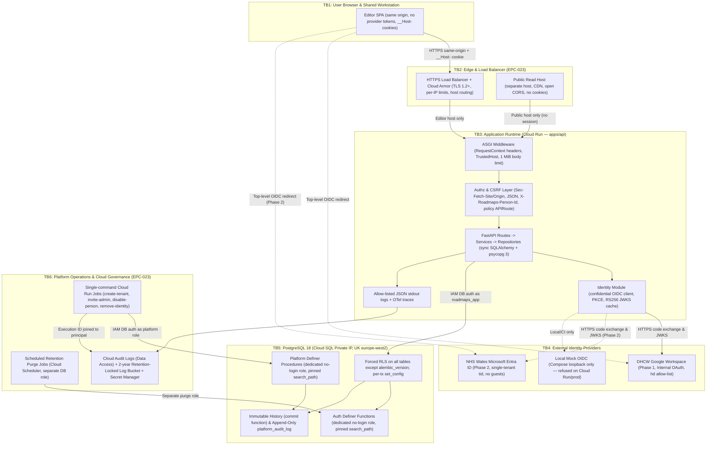
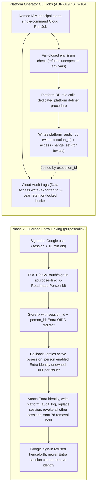

# Identity, Session, Invitation and Linking Threat Model

Design threat model for the Digital Health and Care Wales (DHCW) Roadmaps backend API and
editor sign-in flows. Written for DHCW cyber security review and phased sign-off before any
hosted API deployment, real staff data, or hosted identity provider configuration.

- **Scope**: OpenID Connect (OIDC) sign-in (DHCW Google Workspace, local mock provider, and
  planned NHS Wales Microsoft Entra ID), opaque server-side sessions, single-use
  invitations, cross-tenant isolation, route authorisation, guarded identity linking, and
  platform operator CLI jobs.
- **Out of scope**: Roadmap editing, content redaction workflows, public-site caching, and
  the legacy browser-only Google Sheets adapter (covered by separate records in
  [EPC-026](../backlog/EPC-026-roadmaps-lists-and-versioned-api/README.md),
  [EPC-028](../backlog/EPC-028-public-read-api-sheets-migration-entra-and-switch-over/README.md),
  and [ADR-003](../adr/ADR-003-browser-oauth-with-google-identity-services.md)).
- **Binding architecture decisions** (summarised inline throughout so this document can be
  reviewed standalone without repository access):
  - [ADR-015](../adr/ADR-015-the-roadmap-database-is-postgresql-tenant-scoped-and-versioned.md)
    — PostgreSQL 18 schema, tenancy, forced row-level security (RLS), roles and immutable
    history
  - [ADR-017](../adr/ADR-017-the-api-is-synchronous-fastapi-over-sqlalchemy-and-psycopg.md)
    — synchronous FastAPI API over SQLAlchemy and psycopg 3, error envelope, wire models,
    settings and migrations
  - [ADR-018](../adr/ADR-018-sign-in-through-the-api-with-a-server-side-session.md) —
    confidential OIDC client, server-side sessions, invitations, guarded identity linking,
    logging, retention and phased cyber sign-off
  - [ADR-019](../adr/ADR-019-the-api-authorises-every-route-from-a-permission-catalogue-in-code.md)
    — typed permission catalogue, shipped roles, fail-closed route policies, tenant scoping
    and IAM-gated platform operator CLI jobs
  - [ADR-020](../adr/ADR-020-the-editor-and-the-api-share-one-origin.md) — single origin
    for editor and API, separate host for public read, same-origin CSRF protection, edge
    rate limits and HTTP security headers
- **Standards referenced**: OAuth 2.0 Security Best Current Practice (RFC 9700), OAuth 2.0
  for Browser-Based Applications (RFC 10017), OWASP ASVS 5.0 (V3 Web Frontend Security, V6
  Authentication, V7 Session Management, V8 Authorisation, V10 OAuth and OIDC, V16 Security
  Logging and Error Handling), and NIST SP 800-63B-4.
- **Methodology**: STRIDE (Spoofing, Tampering, Repudiation, Information Disclosure, Denial
  of Service, Elevation of Privilege) applied flow by flow across all trust boundaries.

## Public-safe document rules and disposition legend

This repository is public, so DHCW maintains a two-layer governance split:

1. **This public design threat model** documents system architecture, trust boundaries,
   flows, standard threat classes, mitigating controls, implementing records or standing
   checks, high-level accepted residual risks already recorded in ADR-018, and the sanitised
   phased sign-off gate.
2. **DHCW's private governance record** (outside this repository) holds formal risk scoring
   and severity/exploitability ratings, reviewer identities, internal ticket references,
   internal WAF or rate-limit thresholds, raw cyber review findings, and any unfixed
   security gaps.

**Public hygiene rules that bind this file and every change touching it:**

- No severity or exploitability ratings (`High`/`Medium`/`Low` or numeric scores), no
  internal WAF or rate-limit thresholds, no reviewer personal data, and no internal ticket
  references appear here.
- No unfixed or exploitable security gap in an accepted design or merged/deployed code is
  published here or in any public PR surface (commit messages, PR bodies, Review records,
  review threads, or Delivery sections). Any newly discovered gap is reported privately to
  the owner first so the owner can tighten a story requirement, track it privately, or
  amend ADR-018 before anything is committed publicly.
- Every threat row uses exactly one of the five dispositions below:

| Disposition              | Meaning                                                                                                |
| ------------------------ | ------------------------------------------------------------------------------------------------------ |
| `Mitigated`              | Control is implemented in the repository and proven by a standing automated test or check cited inline |
| `Mitigated by design`    | Control is specified in accepted ADRs and assigned to an implementing story or infrastructure epic     |
| `Accepted residual risk` | High-level residual risk explicitly accepted by the owner in ADR-018 (listed in the register below)    |
| `Pending Entra spike`    | Phase 2 Microsoft Entra ID unknown that blocks Entra enablement until the EPC-028 spike settles it     |
| `Under review`           | Neutral marker for an item tracked in DHCW's private governance space, without vulnerability detail    |

## 1. Domain vocabulary, assets and actors

### Key domain terms

The roadmaps domain distinguishes NHS Wales directory concepts from application tenancy
([GLOSSARY.md](../GLOSSARY.md)):

- **Tenant**: An NHS Wales organisation (DHCW first) that owns its own roadmaps, lists,
  roles, memberships, invitations and change history. Nothing one tenant holds is visible to
  another.
- **Directory**: Microsoft's shared NHS Wales Entra ID register (>125,000 staff accounts
  across all NHS Wales organisations). A directory ID (`tid`) never identifies which
  application **tenant** a person belongs to; application memberships are the sole
  authority.
- **Sign-in identity**: One external account linked to a person, keyed strictly by
  `(issuer, subject)` — Google's `sub` or Entra's `oid` under the pinned NHS Wales directory
  issuer — never by email address.
- **Invitation**: A single-use offer of a tenant membership to one email address, created by
  a tenant Admin (or by a platform operator job for a tenant's first or replacement Admin).
  It is the only way a person record or tenant membership is created.
- **Membership**: A person's place in one tenant with the role(s) they hold there. Three
  shipped roles exist: **Admin** (every permission except `roadmaps:edit`, covered by
  `roadmaps:edit-any`), **Product Lead** (`roadmaps:create`, `roadmaps:edit`,
  `roadmaps:publish`, `tags:edit`), and **Viewer** (read-only across current roadmaps,
  drafts and history; no write permissions).
- **Platform operator**: A DHCW engineer authorised via Google Cloud IAM to run
  single-command Cloud Run jobs (such as creating a tenant or disabling a person). Holds no
  tenant access unless invited like any other user.

### Protected assets

| ID   | Asset                                | Confidentiality / integrity requirement                                                                      |
| ---- | ------------------------------------ | ------------------------------------------------------------------------------------------------------------ |
| A-01 | Server-side session cookies & hashes | 256-bit random cookie; only SHA-256 hash stored; never exposed to page scripts, logs, traces or cross-origin |
| A-02 | OIDC sign-in transaction state       | Single-use `state`, `nonce`, PKCE `code_verifier`, issuer and purpose bound to the initiating browser        |
| A-03 | Provider ID tokens & OAuth codes     | Validated strictly by the API; browser never holds provider tokens; API discards provider tokens after login |
| A-04 | Single-use invitation tokens         | 256-bit random token; SHA-256 hash only in PostgreSQL; never in query strings, `Referer`, logs or list APIs  |
| A-05 | Person & sign-in identity bindings   | Authoritative `(issuer, subject)` mapping; never merged by email; protected against cross-tenant takeover    |
| A-06 | Tenant memberships, roles & history  | Strict per-tenant isolation; every access mutation is an immutable, attributed `change_set`                  |
| A-07 | Unpublished drafts & private scratch | Drafts visible only to tenant members; private scratch visible only to its owner; never on the public site   |
| A-08 | Staff personal data                  | Display names, identity emails and last sign-in times; minimised; emails/last sign-in restricted to Admins   |
| A-09 | OIDC client credentials & secrets    | Google client secret in Secret Manager; Entra federated credential/certificate (never a client secret)       |
| A-10 | Platform audit log & security logs   | Append-only `platform_audit_log` (never purged); allow-listed JSON security events exported for 2 years      |

### Threat actors

| ID    | Actor                                     | Reach and capabilities                                                                                             |
| ----- | ----------------------------------------- | ------------------------------------------------------------------------------------------------------------------ |
| AC-01 | Unauthenticated internet attacker         | Sends arbitrary HTTP requests, crafts cross-site links/forms, replays URLs, floods anonymous endpoints             |
| AC-02 | Uninvited directory or Workspace user     | Holds a valid DHCW Google Workspace or NHS Wales Entra account (>125,000 users) with no tenant membership          |
| AC-03 | Tenant Viewer                             | Authenticated member of Tenant A with read-only access; may call write or admin endpoints directly                 |
| AC-04 | Product Lead (assigned or unassigned)     | Authenticated member of Tenant A; may attempt to edit unassigned roadmaps, manage lists, or view member emails     |
| AC-05 | Tenant Admin of another tenant (Tenant B) | Holds `members:manage` in Tenant B; shares the database and potentially shared `people` rows with Tenant A         |
| AC-06 | Shared workstation walk-up user           | Gains physical access to an unlocked NHS workstation left signed in, or uses the same browser after sign-out       |
| AC-07 | Forwarded-link or stolen-cookie holder    | Receives a forwarded invitation URL, inspects browser history/`Referer`, or obtains a session cookie               |
| AC-08 | Platform operator or deploy identity      | Holds IAM permission to execute Cloud Run jobs or deploy releases; must remain attributed and least-privileged     |
| AC-09 | Compromised dependency or misconfig       | Attempts to enable local mock OIDC in production, loosen RLS/roles, leak secrets into logs, or bypass route policy |

## 2. Architecture, trust boundaries and privilege roles

### System architecture and trust boundaries

The editor and API share one origin in every environment (ADR-020): locally Vite proxies
`/api` to FastAPI; in hosted environments before a custom domain, one Cloud Run service
serves both; once the custom domain is provisioned (`EPC-023`), a Google Cloud load
balancer with Cloud Armor fronts the service and `*.run.app` addresses are disabled. The
public read API uses a separate host with open CORS, no cookies and no session routes.



### Trust boundary summary

| Boundary | Transition                         | Enforced controls                                                                                                                   |
| -------- | ---------------------------------- | ----------------------------------------------------------------------------------------------------------------------------------- |
| TB1→TB2  | Browser to Edge / Load Balancer    | TLS 1.2+, HTTPS redirect, HSTS, Cloud Armor per-address limits, host allow-list with no default backend, `run.app` disabled         |
| TB2→TB3  | Edge to FastAPI API                | `TrustedHostMiddleware` (`Host` header only, never `X-Forwarded-Host`, no wildcards), 1 MiB body limit, strict response headers     |
| TB1→TB3  | Browser requests to API logic      | No CORS on editor routes, `Sec-Fetch-Site: same-origin` / `Origin`, `application/json`, person-assertion header, fail-closed policy |
| TB3→TB4  | API to OIDC Providers              | Pinned issuer allow-list in code, per-provider callback path, PKCE `S256`, `state`, `nonce`, `RS256` JWKS cache, confidential auth  |
| TB3→TB5  | API (`roadmaps_app`) to PostgreSQL | Private IP + SSL + IAM auth, `/ready` role safety check, per-transaction `set_config(…, true)`, forced RLS, minimal `EXECUTE`       |
| TB5      | Runtime role to Definer functions  | Closed list of `SECURITY DEFINER` routines owned by dedicated no-login roles (not `roadmaps_owner`), pinned `search_path`, no DDL   |
| TB6→TB5  | Platform / Purge jobs to Database  | Separate Cloud Run service accounts and DB roles, single-command entrypoints, fail-closed env check, Cloud Audit Log attribution    |

### PostgreSQL roles and definer-function privilege boundaries

No runtime login owns any table or bypasses RLS (ADR-015, ADR-018, ADR-019, `STY-091`,
`STY-103`). Every cluster login is a member of exactly one no-login group role; `PUBLIC`
has `TEMPORARY` on the database and default `EXECUTE` on functions revoked by
`bootstrap.sql`.

| Database role                                             | Login?   | Owns objects?                             | Privilege boundary and enforcement                                                                                                                               |
| --------------------------------------------------------- | -------- | ----------------------------------------- | ---------------------------------------------------------------------------------------------------------------------------------------------------------------- |
| `roadmaps_owner`                                          | No-login | Database, `public` schema, tables, views  | Holds DDL rights; never used by API or jobs at runtime; only `roadmaps_migrator` (and Cloud SQL admin during bootstrap) may `SET ROLE` to it (`NOINHERIT`)       |
| `roadmaps_migrator`                                       | No-login | None                                      | Switches to `roadmaps_owner` to run Alembic upgrades; API refuses to start if `ROADMAPS_MIGRATION_DATABASE_URL` is present (`settings.py`)                       |
| `roadmaps_app`                                            | No-login | None                                      | API runtime role; no DDL, `BYPASSRLS`, `SUPERUSER`, `TRUNCATE` or `REFERENCES`; verified at `/ready` (`services/readiness.py`); executes only runtime functions  |
| Auth definer role (`roadmaps_auth_definer`, `STY-103`)    | No-login | ADR-018 auth & purge `SECURITY DEFINER`   | Zero DDL rights; `SET`/`NOINHERIT` from `roadmaps_owner` only; minimal table grants + role-scoped RLS policies; pinned `search_path`; `EXECUTE` revoked `PUBLIC` |
| Platform definer role (`STY-103` Q4, recommended split)   | No-login | ADR-019 platform `SECURITY DEFINER` procs | Isolated from anonymous-reachable auth definers and from `roadmaps_owner` DDL rights; owns `create-tenant`, `invite-admin`, `disable-person`, `remove-identity`  |
| Platform caller role (`STY-103` S4 / `STY-104`)           | No-login | None                                      | Separate Cloud Run service account; holds only `CONNECT`, `USAGE`, and `EXECUTE` on platform definer procedures; zero direct table write grants                  |
| Purge job caller role (`ADR-019` / `STY-106` / `STY-110`) | No-login | None                                      | Separate scheduled job identity; holds `EXECUTE` only on retention purge definer functions (and Google cut-over revocation where scoped)                         |

**Closed list of `SECURITY DEFINER` routines** (each with pinned `search_path`, `EXECUTE`
revoked from `PUBLIC`, and never setting SQLSTATE or constraint names from caller data per
ADR-018 _STY-101 amendments_):

1. **Runtime (`EXECUTE` granted to `roadmaps_app`)**:
   - Sign-in identity lookup by exact `(issuer, subject)`
   - Sign-in transaction create and atomic lookup/consume
   - Session create, lookup by SHA-256 hash, idle extend, revoke current session, revoke
     all sessions for the authenticated person (`app.person_id` or verified `link`
     transaction)
   - Invitation lookup by SHA-256 token hash
   - Invitation atomic redemption (takes only token hash plus validated issuer, subject,
     email and name; locks invitation row; re-checks expiry, revocation, inviter
     `members:manage`, tenant and roles; creates person/identity/membership/session and
     writes access `change_set` + `platform_audit_log`)
   - Change-set commit function (ADR-015: builds snapshots, signs off change sets)
   - Redaction procedure (ADR-015: database itself re-verifies `content:redact` permission)
2. **Retention & cut-over (`EXECUTE` granted only to purge / cut-over job role, never `roadmaps_app`)**:
   - Purge sign-in transactions (> 1 day), ended sessions (> 30 days), and spent/expired
     invitations (> 90 days)
   - Revoke all sessions started with a Google identity (Phase 2 cut-over)
3. **Platform operations (`EXECUTE` granted only to platform caller role, never `roadmaps_app`)**:
   - Create tenant (seeds Admin, Product Lead and Viewer roles + first Admin invitation +
     access `change_set` + `platform_audit_log`)
   - Issue replacement Admin invitation (+ access `change_set` + `platform_audit_log`)
   - Disable person and revoke all sessions (+ `platform_audit_log`)
   - Remove sign-in identity (+ `platform_audit_log`)
   - Redaction escalation (`EPC-026`)

## 3. Identity data flows

### Flow A: OIDC sign-in, callback and session lifecycle

```mermaid
sequenceDiagram
  autonumber
  participant B as Browser (Editor SPA)
  participant A as FastAPI API (Same Origin)
  participant P as PostgreSQL (Definer / RLS)
  participant I as OIDC Provider (Google / Entra / Mock)

  B->>A: POST /api/v1/auth/sign-in {provider, purpose="sign-in", returnPath} (Sec-Fetch-Site: same-origin, JSON)
  A->>A: Validate provider allow-list & returnPath allow-list; generate state, nonce, PKCE S256
  A->>P: Definer: insert sign_in_transactions (10 min TTL)
  A-->>B: 200 {authorizationUrl} + Set-Cookie __Host-tx-... (SameSite=Lax, Secure, HttpOnly, Path=/)
  B->>I: Top-level navigation to authorizationUrl (state, nonce, code_challenge, prompt)
  I-->>B: 302 /api/v1/auth/callback/{provider}?code=...&state=...
  B->>A: GET /api/v1/auth/callback/{provider}?code=...&state=... (Cookie: __Host-tx-...)
  A->>P: Definer: atomically consume sign_in_transactions matching state + tx cookie + callback issuer
  A->>I: Back-channel POST token endpoint (code, code_verifier, client auth)
  I-->>A: ID token (RS256)
  A->>A: Validate RS256 via cached JWKS, iss, aud, exp/iat (<=60s), nonce, azp, hd & email_verified (or Entra tid/non-guest)
  A->>P: Definer: lookup identity by exact (issuer, subject); check person enabled & no Entra lock-out on Google
  alt Identity found & permitted
    A->>P: Definer: create 256-bit session (SHA-256 hash stored, 60m idle / 10h abs); refresh display name/email/last_sign_in
    A-->>B: 302 static editor callback route (Cache-Control: no-store) + Set-Cookie __Host-session (SameSite=Strict, Secure, HttpOnly, Path=/, no Expires)
    B->>A: GET /api/v1/me (same-origin, sends __Host-session)
    A->>P: Definer: lookup session hash; check idle/abs/revoked/enabled; read memberships (read-only person policy)
    A-->>B: 200 {personId, name, identities, memberships, idleExpiresAt, absoluteExpiresAt}
  else Uninvited or refused
    A->>A: Log allow-listed security event (IDs/code only; writes no DB person row)
    A-->>B: 302 editor error route with mapped code (Cache-Control: no-store)
  end
```

### Flow B: Invitation creation, fragment preview and atomic redemption

```mermaid
sequenceDiagram
  autonumber
  participant Adm as Tenant Admin Browser
  participant Inv as Invitee Browser
  participant A as FastAPI API
  participant P as PostgreSQL
  participant I as OIDC Provider

  Adm->>A: POST /api/v1/tenants/{slug}/invitations {email, provider, roleIds} (same-origin, X-Roadmaps-Person-Id, idempotency key)
  A->>P: Verify members:manage + access scope lock + commit function (store SHA-256 hash only, 7d expiry, access change_set)
  A-->>Adm: 201 {metadata, oneTimeToken/link} (raw token returned once; idempotent retry omits raw token)
  Adm-->>Inv: Delivers link with token in URL fragment (#.../invitations/accept?token=...)
  Inv->>Inv: Editor reads token into memory & immediately strips fragment via history.replaceState
  Inv->>A: POST invitation lookup {token} (same-origin, JSON body — never in query string)
  A->>P: Definer: lookup SHA-256(token); check pending, unexpired, tenant/roles exist, inviter still holds members:manage
  A-->>Inv: 200 {tenantName, inviterName, roleNames, provider, expiresAt} (no email) OR uniform invitation.unavailable
  Inv->>A: POST /api/v1/auth/sign-in {provider, purpose="redeem", invitationToken}
  A->>P: Definer: store sign_in_transactions referencing invitation hash/ID (never raw token)
  A-->>Inv: 200 {authorizationUrl} + __Host-tx cookie
  Inv->>I: Top-level OIDC sign-in -> callback GET /api/v1/auth/callback/{provider}
  A->>A: Validate ID token + provider matches invitation + verified email equals invited address (case-folded)
  A->>P: Definer: lock invitation row; re-check all invariants; consume token; create/reuse person & identity; add membership + access change_set + platform_audit_log; create fresh session
  A-->>Inv: 302 static callback route + new __Host-session cookie (replaces any prior browser session)
```

### Flow C: Phase 2 guarded identity linking and platform operator CLI flows



## 4. STRIDE threat and control analysis by flow

Each flow below analyses threats across STRIDE and maps them to RFC 9700, RFC 10017 and
OWASP ASVS 5.0 controls. Dispositions strictly follow the five-value legend above.

### Flow 1: OIDC sign-in start and provider redirect (`POST /api/v1/auth/sign-in`)

| ID    | STRIDE / Standard | Threat scenario                                                                           | Mitigating control(s)                                                                                                                                                                                            | Enforcing layer        | Proof / record                                           | Disposition         |
| ----- | ----------------- | ----------------------------------------------------------------------------------------- | ---------------------------------------------------------------------------------------------------------------------------------------------------------------------------------------------------------------- | ---------------------- | -------------------------------------------------------- | ------------------- |
| TM-01 | S / RFC 9700 V10  | Cross-site attacker initiates sign-in (login CSRF) to force a victim into attacker's flow | Start is a `POST` requiring `Sec-Fetch-Site: same-origin` (or exact `Origin` allow-list when Fetch Metadata is absent) and `application/json`; no CORS headers; binds `state` to `__Host-` `SameSite=Lax` cookie | Code (API)             | `STY-105`, `STY-106`, `test_headers.py`                  | Mitigated by design |
| TM-02 | T / RFC 9700 V3   | Attacker supplies an external or protocol-relative `returnPath` to cause an open redirect | `returnPath` is validated against an allow-list of internal relative editor paths before storing on the transaction; callback redirects only to the static editor callback route                                 | Code (API)             | `STY-106` S1                                             | Mitigated by design |
| TM-03 | T / RFC 9700 V10  | Two parallel tabs signing in overwrite each other's transaction cookie, causing confusion | Each transaction uses a `__Host-` cookie named for that transaction (`SameSite=Lax`, `Secure`, `HttpOnly`, `Path=/`, 10-minute TTL, port-suffixed in local mode) so concurrent tabs stay isolated                | Code (API)             | `STY-106` S1                                             | Mitigated by design |
| TM-04 | D / ADR-020 V3    | Anonymous attacker floods `POST /api/v1/auth/sign-in` to bloat `sign_in_transactions`     | `sign_in_transactions` is the sole anonymous DB write; bounded by Cloud Armor per-address rate limits, global edge ceiling, capped Cloud Run instances (`EPC-023`), 1 MiB body limit, and 1-day purge job        | Infrastructure + API   | `EPC-023`, `STY-106` S5, `test_middleware.py`            | Mitigated by design |
| TM-05 | S / RFC 9700 V10  | Attacker selects an unapproved OIDC issuer or triggers the local mock provider in prod    | Providers are a fixed issuer allow-list in code; mock, loopback and non-HTTPS issuers are refused whenever `ROADMAPS_ENV` is `production`, unset/invalid, or any Cloud Run marker is set                         | Code (API) + Container | `STY-106` S4, `EPC-023` (image test), `test_settings.py` | Mitigated by design |

### Flow 2: OIDC callback, ID token validation and identity lookup (`GET /api/v1/auth/callback/{provider}`)

| ID    | STRIDE / Standard | Threat scenario                                                                              | Mitigating control(s)                                                                                                                                                                                                                       | Enforcing layer | Proof / record                        | Disposition            |
| ----- | ----------------- | -------------------------------------------------------------------------------------------- | ------------------------------------------------------------------------------------------------------------------------------------------------------------------------------------------------------------------------------------------- | --------------- | ------------------------------------- | ---------------------- |
| TM-06 | S / RFC 9700 V10  | OAuth/OIDC mix-up attack delivers Provider A's authorisation code to Provider B's callback   | Each provider has a dedicated callback path (`/api/v1/auth/callback/{provider}`) and `sign_in_transactions` records the started `issuer`; mismatch between callback path, transaction issuer and `iss` fails                                | Code (API) + DB | `STY-106` S1                          | Mitigated by design    |
| TM-07 | S / RFC 9700 V10  | Auth-code injection, callback replay or login CSRF via stolen or forged `code` / `state`     | Callback requires matching `__Host-` transaction cookie and single-use `state` (atomically consumed on first use), exchanges `code` with PKCE `S256` `code_verifier` + confidential client auth, checks `nonce`                             | Code (API) + DB | `STY-106` S1                          | Mitigated by design    |
| TM-08 | T / RFC 9700 V10  | Forged ID token, algorithm confusion (`none` / `HS256`), expired token or wrong audience     | Maintained OIDC/JWT library (`python-jose` and hand-rolled parsing banned by ruff; library confined to `identity/` by import-linter); strict `RS256` allow-list; verifies signature, `iss`, `aud`, `exp`/`iat` (≤60 s skew), `nonce`, `azp` | Code (API) + CI | `STY-106` S1                          | Mitigated by design    |
| TM-09 | D / ASVS V10      | Unknown `kid` flood triggers repeated outbound JWKS fetches or breaks sign-in during outage  | Discovery URLs pinned; JWKS cached across provider outages; unknown `kid` triggers at most one rate-limited refetch with strict HTTP timeout; unreachable JWKS fails closed (never skips verification)                                      | Code (API)      | `STY-106` S1                          | Mitigated by design    |
| TM-10 | E / ASVS V6, V10  | Consumer Google account or non-DHCW Workspace user attempts to sign in                       | Google client is configured as Internal to DHCW Workspace (`EPC-023`), and API independently enforces `hd` allow-list and `email_verified=true` on every Google ID token                                                                    | Provider + API  | `STY-106` S1, `EPC-023`               | Mitigated by design    |
| TM-11 | E / ASVS V6, V10  | Entra guest account or non-NHS-Wales directory user attempts to sign in (Phase 2)            | Single-tenant NHS Wales Entra app registration (`https://login.microsoftonline.com/{tid}/v2.0`, never `common`/`organizations`); API pins exact `tid` and refuses guest accounts                                                            | Provider + API  | `EPC-023`, `EPC-028`                  | Mitigated by design    |
| TM-12 | S / ASVS V6, V10  | nOAuth / mutable-email account takeover or pre-hijacking across providers or reassignments   | Sign-in identities key strictly on `(issuer, subject)` (Google `sub`, Entra `oid`), never email; identities are never merged by email; email and name are display attributes refreshed at sign-in                                           | Code (API) + DB | `STY-103` S1, `STY-106` S1            | Mitigated by design    |
| TM-13 | D / ASVS V6       | Uninvited user among >125,000 NHS Wales / Workspace accounts signs in to pollute `people`    | Person records are created only upon invitation redemption; uninvited sign-in writes zero database rows, logs an allow-listed security event, and redirects to "You haven't been invited"                                                   | Code (API) + DB | `STY-106` S2                          | Mitigated by design    |
| TM-14 | E / ASVS V6       | Disabled person or person who already linked Entra attempts Google sign-in                   | Every callback checks person is not disabled and refuses any Google identity if the person holds an Entra identity (ADR-018 Option 11)                                                                                                      | Code (API) + DB | `STY-104` S3, `STY-106` S1, `EPC-028` | Mitigated by design    |
| TM-15 | I / ASVS V16      | OIDC `code` and `state` appear in callback URL query strings and reach edge request logs     | Application access logs record route templates only (`access_log.py`); `code` is single-use, PKCE-bound and useless without confidential client credentials; `state` is single-use; edge request logs restricted                            | Code + Infra    | `test_logs.py`, `EPC-023`, ADR-018    | Accepted residual risk |
| TM-16 | S / ASVS V6       | Provider does not enforce MFA or does not assert MFA evidence (`amr` / `auth_time`) in token | Relies on each provider's own organisation policy for now (no API-enforced MFA claim check yet); recorded explicitly in ADR-018 Option 7 & _Consequences_                                                                                   | Provider        | ADR-018 Option 7 & _Consequences_     | Accepted residual risk |
| TM-17 | D / ADR-018       | Google Workspace outage prevents new sign-ins while Google is the sole provider              | Open sessions and public read do not depend on the OIDC provider; cached JWKS persists; no fallback provider during Phase 1 (accepted in ADR-018 _Who a person is_)                                                                         | Architecture    | ADR-018 _Who a person is_             | Accepted residual risk |
| TM-18 | S / ASVS V10      | Entra client credential compromise (Phase 2)                                                 | Entra uses a federated credential trusting the API's Google Cloud service account, or a certificate in Secret Manager — never a long-lived client secret; exact mechanism settled by the Entra spike                                        | Infra + API     | `EPC-023`, `EPC-028` (Entra spike)    | Pending Entra spike    |

### Flow 3: Server-side session lifecycle, `/me`, expiry, extension and sign-out

| ID    | STRIDE / Standard | Threat scenario                                                                                 | Mitigating control(s)                                                                                                                                                                                                                                                                                                                                                                                    | Enforcing layer      | Proof / record                                                                                           | Disposition            |
| ----- | ----------------- | ----------------------------------------------------------------------------------------------- | -------------------------------------------------------------------------------------------------------------------------------------------------------------------------------------------------------------------------------------------------------------------------------------------------------------------------------------------------------------------------------------------------------- | -------------------- | -------------------------------------------------------------------------------------------------------- | ---------------------- |
| TM-19 | S / RFC 10017 V7  | Session fixation across sign-in, invitation redemption or identity linking                      | Opaque 256-bit random session ID generated server-side, stored only as SHA-256 hash; session ID replaced at sign-in, `redeem`, and `link`; only the session service writes sessions (import-linter)                                                                                                                                                                                                      | Code (API) + DB      | `STY-106` S1, `STY-110` S3, `EPC-028`                                                                    | Mitigated by design    |
| TM-20 | I / RFC 10017 V3  | XSS or third-party script steals provider tokens or session credential from browser storage     | No provider tokens ever reach the browser (`AuthClient` drops `getAccessToken`); session cookie is `__Host-`, `Secure`, `HttpOnly`, `SameSite=Strict`, `Path=/`; dedicated origin; strict CSP + Trusted Types (report-only first) + `frame-ancestors 'none'` + `nosniff` + `CORP: same-origin`                                                                                                           | API + Editor + Infra | `test_headers.py`, `STY-106`, `STY-107`, `EPC-023`, `EPC-028`                                            | Mitigated by design    |
| TM-21 | I / ASVS V7       | Cached authenticated API responses or redirects expose session data on a shared browser/proxy   | `RequestContext` sets `Cache-Control: no-store`, `X-Content-Type-Options: nosniff`, `Content-Security-Policy: default-src 'none'; frame-ancestors 'none'`, `Cross-Origin-Resource-Policy: same-origin` on every non-public response (redirects & refusals included)                                                                                                                                      | Code (API)           | `middleware.py`, `test_headers.py`                                                                       | Mitigated              |
| TM-22 | E / ASVS V7       | Revoked, disabled or demoted user retains access until token expiry                             | Every request re-reads the session (via hash definer), person enabled flag, tenant membership and roles from PostgreSQL; disabling a person or changing roles takes effect on the very next request                                                                                                                                                                                                      | Code (API) + DB      | `STY-104` S3, `STY-105` S3, `STY-106` S3, `STY-111`                                                      | Mitigated by design    |
| TM-23 | E / ASVS V7       | Leaver disabled in Google Workspace or Entra keeps an open application session                  | Server enforces 60-minute idle and 10-hour absolute session expiry (cannot extend past absolute cap); platform `disable-person` or tenant member removal revokes immediately; up to 10 h window if not revoked in-app                                                                                                                                                                                    | Code (API) + Ops     | `STY-106` S3, `STY-104` S3, ADR-018 _Consequences_                                                       | Accepted residual risk |
| TM-24 | T / ASVS V7       | Shared desk: User B signs in while User A's tab still holds an open form, submitting as User B  | Every authenticated state-changing request carries `X-Roadmaps-Person-Id` matching the session's person (else refused); on tab focus after new-tab re-sign-in, editor re-checks `/me` and discards held form + cached queries if person changed                                                                                                                                                          | API + Editor         | `STY-105` S4, `STY-107` S3, `STY-109` S4                                                                 | Mitigated by design    |
| TM-25 | S / ASVS V7       | Shared desk: after User A signs out on Google Workspace, User B clicks User A's Google account  | Sign-out revokes the server session row and expires the cookie (without `Clear-Site-Data: "cookies"`); next Google sign-in sends `prompt=select_account` (stopping silent login, not deliberate click); Entra uses `prompt=login`                                                                                                                                                                        | API + Provider       | `STY-106` S3, ADR-018 Option 13 & _Consequences_                                                         | Accepted residual risk |
| TM-26 | S / ASVS V7       | Shared desk: walk-up attacker uses an unlocked browser left signed in (session cookie restored) | Cookie carries no `Expires`/`Max-Age`, but browser session restore can keep it; server 60-minute idle / 10-hour absolute limits bound duration, "Sign out everywhere" revokes all sessions, and no unpublished drafts live in browser storage; walk-up while signed in remains accepted residual risk                                                                                                    | API + Editor         | `STY-106` S3, `STY-109` S3, ADR-018 _Sessions_                                                           | Accepted residual risk |
| TM-27 | I / ASVS V16      | Session IDs, cookies, emails, SQL parameters or caller inputs leak into logs, traces or 422s    | Allow-listed `JsonFormatter` (`ALLOWED_EXTRA_FIELDS`), route-template access logs, exception types/SQLSTATE only (messages local non-Cloud-Run only), `hide_parameters=True`, OTel span allow-list, FastAPI telemetry off, 422 strips `input`/`msg`/`ctx`/`url`/forbidden keys + caps errors/loc (security events arrive in `STY-106`; hosted OTel collector adds a second redaction layer in `EPC-023`) | Code (API)           | `logs.py`, `tracing.py`, `errors.py`, `database.py`, `test_logs.py`, `test_tracing.py`, `test_errors.py` | Mitigated              |
| TM-28 | I / ADR-018       | Ended sessions or expired sign-in transactions accumulate indefinitely in PostgreSQL            | Scheduled retention purge CLI deletes sign-in transactions after 1 day and ended sessions after 30 days through dedicated definer functions (retention subject to data protection assessment confirmation)                                                                                                                                                                                               | Code (API) + Infra   | `STY-106` S5, `EPC-023`                                                                                  | Mitigated by design    |

### Flow 4: Invitation creation, listing, revocation, preview and atomic redemption

| ID    | STRIDE / Standard | Threat scenario                                                                                | Mitigating control(s)                                                                                                                                                                                                                    | Enforcing layer | Proof / record                               | Disposition         |
| ----- | ----------------- | ---------------------------------------------------------------------------------------------- | ---------------------------------------------------------------------------------------------------------------------------------------------------------------------------------------------------------------------------------------- | --------------- | -------------------------------------------- | ------------------- |
| TM-29 | I / ASVS V3, V16  | Raw invitation token leaks into HTTP request logs, proxy logs, `Referer` or browser history    | Token travels only in the URL fragment (`#…`, never sent on HTTP requests); editor extracts into memory and immediately strips via `history.replaceState` before any navigation/reload; lookup and redeem send token in `POST` JSON body | Editor + API    | `STY-110` S2, `STY-112` S1                   | Mitigated by design |
| TM-30 | I / ASVS V6       | Database read or idempotent retry exposes a raw invitation token                               | 256-bit random token stored only as SHA-256 hash; raw token returned once on creation (never in list endpoints, logs or DB); idempotent retry returns metadata without raw token (`STY-110` D1); DB scan test proves no raw token stored | Code (API) + DB | `STY-110` S1, `STY-110` D1                   | Mitigated by design |
| TM-31 | S / ASVS V6       | Forwarded invitation link is opened and redeemed by an unintended colleague                    | Redemption requires BOTH the 256-bit single-use token AND an OIDC sign-in from the named provider whose verified email equals the invited address (case-folded); preview never reveals the expected email address                        | Code (API) + DB | `STY-110` S2, `STY-110` S3                   | Mitigated by design |
| TM-32 | T / ASVS V6       | Spoofed or unverified email claim used to redeem an invitation without controlling the mailbox | Google enforces Internal Workspace + `hd` allow-list + `email_verified=true`; Entra verified-email claim (authoritative directory-controlled claim) is explicitly gated on the Entra spike before Entra invitations open                 | Provider + API  | `STY-106` S1, `STY-110` S3, `EPC-028`        | Pending Entra spike |
| TM-33 | T / ASVS V6, V8   | Concurrent redemption race or replay uses one invitation twice, or uses a revoked/stale invite | Redemption definer function locks the invitation row, atomically re-checks expiry (7 days), revocation, inviter's current `members:manage` right (or platform issuer), tenant and roles, consumes once, and writes access `change_set`   | Code (API) + DB | `STY-110` S3                                 | Mitigated by design |
| TM-34 | I / ASVS V6       | Attacker probes the public lookup endpoint to enumerate invitation states or brute-force links | 256-bit token entropy (hashed SHA-256), same-origin `POST` + JSON guard, edge rate limits (`EPC-023`), and one uniform error code (`invitation.unavailable`) for unknown, expired, revoked, spent or invalidated links                   | API + Infra     | `STY-105` S4, `STY-110` S2, `EPC-023`        | Mitigated by design |
| TM-35 | S / ASVS V6       | Tricked user clicks an invitation link and joins an unexpected tenant without consent          | Editor never redeems on link load; it clears the fragment, previews inviting tenant name, inviter name and offered roles, and posts `purpose=redeem` only on explicit user click                                                         | Editor + API    | `STY-112` S1, `STY-112` S2                   | Mitigated by design |
| TM-36 | E / ASVS V8       | Non-admin creates, lists or revokes tenant invitations, or acts without audit trail            | Requires `members:manage` policy on tenant route; non-members get 404, non-admins get 403; every create, revoke and redeem writes an attributed access `change_set` via the commit function; purged after 90 days                        | Code (API) + DB | `STY-103` S3, `STY-105` S5, `STY-110` S1, S4 | Mitigated by design |

### Flow 5: Tenant-scoped requests, route authorisation and cross-tenant isolation

| ID    | STRIDE / Standard | Threat scenario                                                                                   | Mitigating control(s)                                                                                                                                                                                                                                                                 | Enforcing layer    | Proof / record                                                              | Disposition            |
| ----- | ----------------- | ------------------------------------------------------------------------------------------------- | ------------------------------------------------------------------------------------------------------------------------------------------------------------------------------------------------------------------------------------------------------------------------------------- | ------------------ | --------------------------------------------------------------------------- | ---------------------- |
| TM-37 | E / ASVS V8       | New API route is accidentally shipped without an authentication or authorisation check            | Custom `APIRoute` class refuses to register any route without exactly one declared policy (`public`, `signed_in`, `tenant_member`, `tenant_permission`); standing test walks every route (mounted included) against reviewed public allow-list                                        | Code (API) + Tests | `STY-105` S1                                                                | Mitigated by design    |
| TM-38 | I / E / ASVS V8   | Cross-tenant read/write (BOLA) or tenant existence enumeration by a member of another tenant      | Every tenant route names its tenant in the request (never in session); dependency validates membership and returns uniform 404 for non-members or unknown IDs; composite `(tenant_id, …)` FKs + forced RLS (`TENANT_POLICY`) + per-tx `set_config(…, true)`                           | Code (API) + DB    | `database.py`, `test_tenancy.py`, `STY-103` S2, `STY-105` S3, S5            | Mitigated by design    |
| TM-39 | I / ASVS V8       | Pooled DB connection leaks `app.tenant_id` or `app.person_id` from Request A to Request B         | SQLAlchemy `after_begin` listener sets both with `set_config(…, true)` (transaction-local only) using bound parameters; absent values stay unset and fail closed; integration test proves zero leakage across transactions                                                            | Code (API) + DB    | `database.py`, `apps/api/tests/integration/test_tenancy.py`                 | Mitigated              |
| TM-40 | E / ASVS V8       | String typo or unknown permission name in a tenant role silently grants or bypasses access        | Typed `Permission` `StrEnum` in code; source-level check forbids raw permission string literals outside catalogue; unknown DB permission fails closed and logs allow-listed error; generated role-by-route matrix verifies all roles                                                  | Code (API) + Tests | `STY-105` S2, `STY-105` S5                                                  | Mitigated by design    |
| TM-41 | T / ASVS V3       | Cross-site request forgery (CSRF) or cross-origin credentialed read against editor endpoints      | Editor and API share one origin with zero CORS headers; state-changing requests require `Sec-Fetch-Site: same-origin` (or `Origin` match) + `application/json`; `SameSite=Strict` cookie is second layer; all `GET`s except callback tested read-only                                 | Code (API)         | `middleware.py`, `test_headers.py`, `STY-105` S4                            | Mitigated by design    |
| TM-42 | T / ASVS V3       | Host-header poisoning, `X-Forwarded-Host` spoofing, or oversized/malformed payload DoS            | `TrustedHostMiddleware` checks `Host` only (never `X-Forwarded-Host`, no wildcards, no `www.` redirect); 1 MiB `RequestBodyLimitMiddleware`; `ApiRequestModel` sets `extra="forbid"` (`wire.py`), paired with native Pydantic collection/key bounds (`apps/api/AGENTS.md`, `DEF-043`) | Code (API)         | `app.py`, `wire.py`, `test_middleware.py`, `test_wire.py`, `test_errors.py` | Mitigated              |
| TM-43 | I / ASVS V8       | Viewer or Product Lead reads other members' email addresses or last sign-in timestamps            | Member list exposes names and roles to all members, and emails, last sign-in, invitations and access review only to `members:manage` (enforced by API service projection and role-by-route matrix)                                                                                    | Code (API)         | `STY-111` S1, `STY-113` S1                                                  | Mitigated by design    |
| TM-44 | D / ASVS V8       | Concurrent or accidental removal/demotion leaves a tenant with zero active Admins                 | Access scope lock serialises membership/role writes; API refuses to end or demote the last enabled Admin (`member.last_admin`); platform `invite-admin` provides recovery if sole Admin account is lost elsewhere                                                                     | Code (API) + DB    | `STY-111` S3, `STY-104` S2                                                  | Mitigated by design    |
| TM-45 | E / ASVS V8       | Staff mover retains old organisation's tenant membership because NHS Wales Entra account persists | Members page displays each member's last sign-in; six-monthly access review prompts Tenant Admins to confirm or remove each member (each confirmation recorded as an access `change_set`)                                                                                             | Code (API) + Ops   | `STY-111` S1, `STY-114`                                                     | Mitigated by design    |
| TM-46 | E / ASVS V8       | Tenant Admin performs high-impact access change without recent re-authentication (Phase 1)        | On Google Workspace, no step-up is enforced (Google offers no documented forced re-auth); relies on session lifetimes and attributed access `change_set`s; Phase 2 adds Entra `acrs` step-up (amending ADR-018)                                                                       | API + Provider     | ADR-018 Option 14 & _Consequences_                                          | Accepted residual risk |

### Flow 6: Guarded identity linking and Google-to-Entra transition (Phase 2)

| ID    | STRIDE / Standard | Threat scenario                                                                                 | Mitigating control(s)                                                                                                                                                                                                                                                                                                                                                                                                                                                            | Enforcing layer       | Proof / record                                        | Disposition            |
| ----- | ----------------- | ----------------------------------------------------------------------------------------------- | -------------------------------------------------------------------------------------------------------------------------------------------------------------------------------------------------------------------------------------------------------------------------------------------------------------------------------------------------------------------------------------------------------------------------------------------------------------------------------- | --------------------- | ----------------------------------------------------- | ---------------------- |
| TM-47 | E / ASVS V8       | Tenant Admin of Tenant B attaches or removes an identity to hijack/lock out Tenant A access     | Only the signed-in person may attach an identity (via `link`); only the person (never their last) or a platform operator may remove one; tenant admins can never attach or remove identities (they end memberships)                                                                                                                                                                                                                                                              | Code (API) + DB       | ADR-018 Option 9, `STY-104` S3, `EPC-028`             | Mitigated by design    |
| TM-48 | E / ASVS V6, V7   | Attacker with a stolen session cookie or walk-up access links their own Entra account to victim | Multi-layer guard: Entra-only; at most one identity per issuer; initiating session must be <10 min old and remain active/unrevoked through callback; identity already owned by anyone else is refused; linking replaces session and revokes all other sessions, shows new identity + timestamp on Account page, enforces a 7-day removal hold, bars sessions started with the newer identity from removing any identity, and allows platform operator `remove-identity` recovery | Code (API) + DB + Ops | ADR-018 _Linking identities_, `STY-104` S3, `EPC-028` | Mitigated by design    |
| TM-49 | S / ASVS V7       | Walk-up attacker on an unlocked desk within 10 minutes of sign-in initiates a hostile `link`    | Bounded by the guards in TM-48 (revoking other sessions, Account page visibility, 7-day removal hold, operator undo); residual walk-up risk on an unlocked desk is explicitly noted in ADR-018 _Linking identities_                                                                                                                                                                                                                                                              | Architecture + Ops    | ADR-018 _Linking identities_                          | Accepted residual risk |
| TM-50 | E / ASVS V6       | After linking Entra, person (or compromised Google account) keeps using Google to bypass Entra  | At every callback, a Google identity is refused for any person holding an Entra identity; new invitations name Entra once enabled; at announced cut-over, Google sign-in stops and all Google sessions are revoked                                                                                                                                                                                                                                                               | Code (API) + DB       | `STY-106` S1, `EPC-028`                               | Mitigated by design    |
| TM-51 | E / ASVS V6       | High-impact access changes or redaction under Entra lack step-up assurance (Phase 2)            | Phase 2 requires an Entra authentication context (`acrs`) for access changes and redaction (amending ADR-018); claim shape and Conditional Access behaviour are verified in the EPC-028 Entra spike                                                                                                                                                                                                                                                                              | Provider + API        | `EPC-023`, `EPC-028` (Entra spike)                    | Pending Entra spike    |

### Flow 7: Platform operator CLI flows and database privilege boundaries

| ID    | STRIDE / Standard | Threat scenario                                                                              | Mitigating control(s)                                                                                                                                                                                                                                                                                                                       | Enforcing layer    | Proof / record                                                                                                                           | Disposition         |
| ----- | ----------------- | -------------------------------------------------------------------------------------------- | ------------------------------------------------------------------------------------------------------------------------------------------------------------------------------------------------------------------------------------------------------------------------------------------------------------------------------------------- | ------------------ | ---------------------------------------------------------------------------------------------------------------------------------------- | ------------------- |
| TM-52 | E / ASVS V8       | Runtime API login holds excessive DB rights, owns tables, bypasses RLS, or runs migrations   | `bootstrap.sql` creates strict no-login roles (`roadmaps_owner`, `roadmaps_migrator`, `roadmaps_app`) with `NOBYPASSRLS` and revokes `PUBLIC` `TEMPORARY`/routine `EXECUTE`; `settings.py` refuses `ROADMAPS_MIGRATION_DATABASE_URL` on API startup; `/ready` refuses any unsafe login                                                      | DB + Code (API)    | `bootstrap.sql`, `settings.py`, `services/readiness.py`, `test_bootstrap.py`, `test_readiness.py`                                        | Mitigated           |
| TM-53 | E / ASVS V8       | Bug or SQL injection in `roadmaps_app` abuses a `SECURITY DEFINER` function or `search_path` | Closed list of definer functions owned by dedicated no-login definer roles (never `roadmaps_owner`, zero DDL), pinned `search_path`, `EXECUTE` revoked from `PUBLIC` and granted only to the exact caller role; `roadmaps_app` cannot execute platform or purge procedures; DB functions never populate SQLSTATE/constraint names from data | DB + Tests         | `STY-103` S1, S4, `STY-104` S1, `STY-106`                                                                                                | Mitigated by design |
| TM-54 | T / ASVS V8       | Application role bypasses RLS via `TRUNCATE`/`REFERENCES`, or alters immutable history/audit | `roadmaps_app` has no `TRUNCATE` or `REFERENCES` on any table (explicitly tested in `STY-103`); working-table writes require a signed-off change set (deferred & immediate triggers); `change_sets`, `change_summaries` and `platform_audit_log` deny `UPDATE`/`DELETE`/`TRUNCATE`                                                          | DB + Tests         | `STY-103` S1, S3, `EPC-024/delivery-notes.md`                                                                                            | Mitigated by design |
| TM-55 | E / ASVS V8       | Operator invokes a different command or injects security-relevant settings via job overrides | Each Cloud Run job is one single-command entrypoint (`create-tenant`, `invite-admin`, `disable-person`, `remove-identity`); operators hold only job-run-with-overrides IAM (cannot alter image/command); jobs take no security-relevant setting from runtime env and fail closed on any unexpected env var                                  | Code (CLI) + Infra | `STY-104` S4, `EPC-023`                                                                                                                  | Mitigated by design |
| TM-56 | R / ASVS V16      | Unattributed or spoofed platform operator execution (e.g., forged CLI `--operator` flag)     | Principal is never typed on the CLI; Cloud Run Data Access audit logs are enabled and exported to a 2-year retention-locked bucket (`EPC-023`), where the job's `execution_id` in `platform_audit_log` joins to the verified IAM principal; job changes raise alerts                                                                        | Infra + DB + CLI   | `STY-104` S1–S3, `EPC-023`                                                                                                               | Mitigated by design |
| TM-57 | I / ASVS V16      | Hosted `create-tenant` / `invite-admin` job prints a one-time Admin token into Cloud Logging | Cloud Run forwards stdout/stderr to Cloud Logging (2-year export); `STY-104` S1 permits stdout output in local mode only and `STY-104` Q3 requires a non-log delivery channel (short-lived operator-only secret or operator public-key encryption) with a standing test proving no raw token reaches stdout/stderr outside local mode       | Code (CLI) + Infra | `STY-104` S1, `STY-104` Q3, `EPC-023`                                                                                                    | Mitigated by design |
| TM-58 | E / ASVS V8       | Exposed operator web admin surface or support impersonation leaks tenant data                | No operator web surface and no impersonation (not even read-only); operators hold no tenant access unless invited through standard tenant membership; support uses screen sharing                                                                                                                                                           | Architecture       | ADR-019 Option 12                                                                                                                        | Mitigated by design |
| TM-59 | E / T / Supply    | Compromised dependency, CI workflow or leaked secret enters the repository                   | GitHub secret scanning + push protection, CodeQL, weekly/main OSV lockfile audit, PR dependency review, Dependabot security updates, zizmor, SHA-pinned Actions, 7-day release cooldown (`uv` `exclude-newer` & `pnpm` `minimumReleaseAge`), ruff `S`/banned-API rules                                                                      | CI + Repo          | `CHO-031` (Done), `apps/api/pyproject.toml`, `pnpm-workspace.yaml`, `.github/workflows/ci.yml`, `.github/workflows/dependency-audit.yml` | Mitigated           |
| TM-60 | E / T / Supply    | Compromised container image, build pipeline or cloud deployment identity                     | Minimal non-root container image, image vulnerability scan, SBOM and build provenance attestation, GitHub Workload Identity Federation conditioned on repo/ref/env (no service account keys), separate plan/apply IAM roles, protected GitHub deployment environment, UK-only GCP org policies                                              | Infra (EPC-023)    | `EPC-023`                                                                                                                                | Mitigated by design |

## 5. Accepted residual-risk register

Only residual risks explicitly accepted by the owner in
[ADR-018](../adr/ADR-018-sign-in-through-the-api-with-a-server-side-session.md) appear
here. Any newly accepted risk must amend ADR-018 first.

| ID    | Accepted residual risk                                                                      | Bounding controls and scope                                                                                                                                  | Owner sign-off status                  | Revisit trigger                                      |
| ----- | ------------------------------------------------------------------------------------------- | ------------------------------------------------------------------------------------------------------------------------------------------------------------ | -------------------------------------- | ---------------------------------------------------- |
| RR-01 | No API-enforced MFA evidence on sign-in, for every role (TM-16)                             | Relies on DHCW Google Workspace 2-Step Verification and NHS Wales Entra directory policy; invitation is the app gate                                         | Accepted — owner, ADR-018 (2026-11-21) | Phase 2 Entra spike / Conditional Access / `acrs`    |
| RR-02 | Up to 10 hours of access for a leaver whose application session is already open (TM-23)     | Bounded by 60-minute idle and 10-hour absolute server-enforced session lifetimes; immediate revocation via Tenant Admin removal or platform `disable-person` | Accepted — owner, ADR-018 (2026-11-21) | If tenant scale warrants SCIM or shorter lifetimes   |
| RR-03 | No step-up authentication on Google Workspace for access changes or redaction (TM-46)       | Relies on 60-minute idle / 10-hour absolute lifetimes and attributed immutable access `change_set`s                                                          | Accepted — owner, ADR-018 (2026-11-21) | Phase 2 Entra authentication context (`acrs`)        |
| RR-04 | Shared desk: after signing out on Google, the last account is one click away (TM-25)        | Sign-out revokes the server session and expires the cookie; next Google sign-in sends `prompt=select_account` (preventing silent login)                      | Accepted — owner, ADR-018 (2026-11-21) | Phase 2 Entra (`prompt=login`) & Google retirement   |
| RR-05 | Shared desk: walk-up on an unlocked workstation left signed in (TM-26, TM-49)               | 60-minute idle timeout, no browser storage for tokens or drafts, `X-Roadmaps-Person-Id` + tab-focus `/me` check, `link` <10m + 7d hold + operator undo       | Accepted — owner, ADR-018 (2026-11-21) | NHS workstation screen-lock policy; Phase 2 step-up  |
| RR-06 | OIDC `code` and `state` travel in callback URL query strings into edge request logs (TM-15) | `code` is single-use, bound to PKCE `S256` and confidential client auth; `state` is single-use; app logs record route templates only; edge logs restricted   | Accepted — owner, ADR-018 (2026-11-21) | Periodic review of EPC-023 request-log access policy |
| RR-07 | Google Workspace outage stops new sign-ins while Google is the sole provider (TM-17)        | Existing sessions and the public read API do not depend on the OIDC provider; cached JWKS persists across outages                                            | Accepted — owner, ADR-018 (2026-11-21) | Phase 2 Entra cut-over                               |
| RR-08 | Delivery rework risk from coding local/dev identity work in parallel with cyber review      | Threat model is drafted first (`STY-102`); Phase 1 cyber sign-off strictly gates any hosted deployment, Google Workspace client/secret and real data         | Accepted — owner, ADR-018 (2026-11-25) | Resolved when Phase 1 cyber sign-off completes       |

## 6. Pending Entra spike items and open grilling points

### Entra ID spike items (`Pending Entra spike` — gates Phase 2)

Three Microsoft Entra ID details are explicitly deferred to the `EPC-028` spike and block
**Phase 2 (Entra & linking addendum)** sign-off:

1. **Verified email claim for Entra invitations (TM-32)**: Confirm which claim in the NHS
   Wales Entra v2.0 ID token is directory-controlled and authoritative for invitation email
   matching. Blocks Entra invitations until settled.
2. **Entra confidential client authentication (TM-18)**: Confirm federated workload identity
   credential trusting the API's Google Cloud service account versus a managed certificate
   in Secret Manager (never a client secret).
3. **Step-up authentication context `acrs` (TM-51)**: Confirm Entra v2.0 ID token `acrs`
   claim delivery and Conditional Access authentication context behaviour for access changes
   and redaction (will amend ADR-018 when Entra lands).

**Entra spike boundary (ADR-018 _EPC-024 amendments_)**: The `EPC-028` Entra spike may run
before Phase 2 sign-off **only** with a spike-only app registration, operators' own
accounts, and nothing persisted to a hosted database (or waits for its own owner-recorded
cyber approval if NHS Wales requires one).

### Open implementation design questions in unstarted stories

The following design choices are tracked in unstarted `Needs grilling` stories and will be
settled by the owner before those stories are implemented:

- **Platform definer role separation**
  ([STY-103](../backlog/EPC-024-tenancy-sign-in-and-optional-api-mode/STY-103-tenancy-people-roles-memberships-and-access-history-schema.md#open-questions)
  Q4): Recommended dedicated `roadmaps_platform_definer` role separate from
  `roadmaps_auth_definer` and `roadmaps_owner`.
- **Hosted platform CLI invitation hand-over channel**
  ([STY-104](../backlog/EPC-024-tenancy-sign-in-and-optional-api-mode/STY-104-platform-operator-cli-for-tenants-bootstrap-invitations-and-person-control.md#open-questions)
  Q3): Recommended out-of-band delivery outside Cloud Run stdout/stderr so raw Admin
  invitation tokens never reach Cloud Logging or 2-year log exports.
- **OIDC/JWT library and local mock OIDC server**
  ([STY-106](../backlog/EPC-024-tenancy-sign-in-and-optional-api-mode/STY-106-oidc-sign-in-server-side-sessions-local-mock-provider-and-me.md#open-questions)
  Q1–Q2): Recommended `PyJWT[crypto]` + `httpx` and deterministic in-repo loopback mock
  server with ephemeral runtime RSA keys.
- **Invitation creation idempotency and email-mismatch refusal code**
  ([STY-110](../backlog/EPC-025-tenant-members-and-invitations/STY-110-invitation-create-list-revoke-lookup-and-oidc-redemption-api.md#open-questions)
  D1, Q3): Confirm omitting raw token on idempotent create retry (never storing raw tokens)
  and whether email mismatch uses `invitation.email_mismatch` (without echoing expected
  email) or `invitation.unavailable`.
- **Hosted non-production authentication and security alert routing**
  ([EPC-023](../backlog/EPC-023-hosting-and-infrastructure-security/README.md#owner-decisions-waiting)):
  Real staff identities in a production-grade pre-production environment (since local mock
  is never admitted on Cloud Run) and DHCW security monitoring destination.
- **Retention period confirmation**
  ([EPC-028](../backlog/EPC-028-public-read-api-sheets-migration-entra-and-switch-over/README.md#owner-decisions-waiting)):
  Data protection assessment confirming default retention windows (1-day sign-in
  transactions, 30-day ended sessions, 90-day spent/expired invitations, 2-year exported
  security events, and retention for people with zero memberships).

## 7. Cyber security sign-off

> **Owner-only gate — never edited by an agent.**
> Completing `STY-102` delivers this draft threat model so local/development coding and
> DHCW cyber security review can proceed in parallel. A `Done` `STY-102` record is **never**
> cyber security sign-off. Only the **owner** updates the table below once DHCW cyber
> security's private governance review concludes. Reviewer names, internal ticket references
> and raw findings remain exclusively in DHCW's private governance record.

**What each phase gates (cited by [EPC-023](../backlog/EPC-023-hosting-and-infrastructure-security/README.md) and [EPC-028](../backlog/EPC-028-public-read-api-sheets-migration-entra-and-switch-over/README.md)):**

- **Phase 1: Google Workspace** — must record `Status: Signed off` with `Disposition` set to
  `Approved` or `Approved — conditions met` (any open condition stays `Pending`), `Date`,
  and `Reviewed revision` (the git commit SHA of this file matching DHCW's private
  governance record) before **any hosted deployment of the API in any environment** and
  before provisioning or configuring **the Google Workspace OAuth client, secret, or real
  data** (real staff sign-ins store real personal data regardless of environment).
- **Phase 2: Entra & linking** — must record `Status: Signed off` under the exact same rule
  (after the `EPC-028` Entra spike settles the three spike unknowns above) before **any
  Entra app registration with a hosted redirect URI, any hosted Entra credential, or any
  Entra issuer in hosted settings**.
- **Reopen rule**: Any material change to a signed-off phase's flows or controls returns
  that phase to `Pending` until the owner records it as reviewed or not material.

| Phase                     | Status  | Date | Disposition | Reviewed revision |
| ------------------------- | ------- | ---- | ----------- | ----------------- |
| Phase 1: Google Workspace | Pending | —    | —           | —                 |
| Phase 2: Entra & linking  | Pending | —    | —           | —                 |
