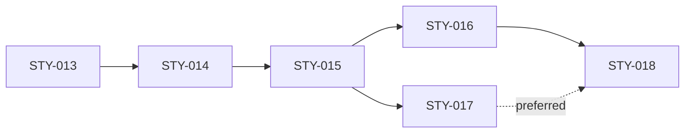

# EPC-003: DHCW design alignment — a DHCW staff tool that still looks like generic SaaS

- **Status**: Active — planned 2026-11-10 from the owner's answers in the alignment analysis; STY-013 to STY-016 delivered and merged; STY-017 delivered in its PR, which awaits merge
- **Progress**: 5 of 6 terminal (STY-017 awaits merge); next selectable: STY-018 once STY-017 merges; blocked on: nothing
- **Binding ADRs**: ADR-010, ADR-005, ADR-008, ADR-009

## Summary

The editor works and is accessible, but it doesn't look like a DHCW service:

- neutral greys, an indigo accent and the Geist font;
- a SaaS-style landing page;
- a focus ring too faint for WCAG 1.4.11.

This epic re-expresses DHCW's design system in our own components (ADR-010): DHCW
colours and type, its yellow focus indicator, the DHCW logo, and its buttons, tags,
callouts, cards, header, phase banner and footer. Dark mode stays. A locked theme and
lint rules then make off-brand styling fail the build. The epic also keeps failures on
screen rather than in toasts, and warns staff before their session ends. It leaves the
dashboard sidebar for the roadmap editor, and changes no data or behaviour beyond those
two.

## Owner decisions waiting

None.

## Findings

Audited at `22c3336` on 2026-11-10; the evidence and searches are in
[the alignment analysis](../../analysis/dhcw-design-system-alignment.md#where-the-editor-falls-short-today).

### F1 — Off-brand look

Neutral oklch greys, an indigo `--brand` accent, Geist, rounded SaaS cards and a hero
with a gradient glow. Nothing says DHCW apart from the app's name.

### F2 — The focus ring fails WCAG 1.4.11

`ring-ring/50` resolves to about 1.5:1 on white, in the button, badge, roadmap card,
header link and skip link. axe does not test focus indicators, so the E2E suite passes.

### F3 — Control borders would fail 1.4.11

`--input` is about 1.2:1 on white. No form controls ship yet, but the roadmap editor
will add them.

### F4 — Nothing enforces tokens

There are 9 raw Tailwind palette classes outside `components/ui`, per-component `dark:`
colours, and an inline colour in the roadmap swatch. No rule or test stops more.
Review is the only guard.

### F5 — Failures announced by toast

`AuthNotifications` toasts OAuth failures and a blocked popup, which the start page also
shows inline. DHCW has no toast pattern; toasts are transient and easy to miss.

### F6 — The session ends without warning

The app expires the session 60 s before Google's expiry and only then asks the user to
reconnect. The roadmap editor would lose the user's flow mid-edit.

## Design

1. DHCW values enter as `--nhsw-*` primitives behind semantic tokens, with a drift test
   against the pinned release (F1, ADR-010).
2. Roboto, the compact type scale, DHCW radius and the yellow focus utilities replace
   the current theme (F1, F2). `--input` meets 3:1 (F3).
3. The Tailwind theme is locked to semantic tokens, and lint and tests reject every
   other way to set a colour, size, radius, shadow or focus style (F4).
4. Shared components take DHCW's look; features use their variants rather than
   hand-rolled styles (F1, F4).
5. The shell, logo, phase banner, footer and pages follow DHCW's staff layout, minus the
   sidebar (F1).
6. Failures are shown inline and persist; the session warns before it ends (F5, F6).
7. Screenshot tests hold the result (F1–F4).
8. **Unchanged:**
   - the layering rules (ADR-002), the data read, query keys and routes;
   - every list, detail, error, expired and refresh state's behaviour;
   - accessible names, except where a story says otherwise;
   - copy, except the strings a story adds or the toasts it removes;
   - the roadmap colour stays decorative only (ADR-009).

## Shared assumptions and contracts

### Token tiers and names

STY-013 creates and owns `src/styles/globals.css` with three layers:

- `--nhsw-*` primitives;
- `--app-dark-*` primitives;
- semantic tokens: shadcn's names, plus `--link`, `--link-hover`, `--focus`,
  `--focus-foreground`, `--control-shadow` and
  `--status-{neutral,info,success,warning,danger}-{bg,fg,border}`.

Later stories add semantic tokens only, each with a pair in the contrast test, and never
use a primitive outside `globals.css`.

- `--border` is decorative and exempt from 3:1.
- A boundary that people need in order to find a control uses `--input`, which is held
  to 3:1.
- A tint or overlay is its own token, never an opacity modifier (STY-014 S8).

### Type and focus utilities

STY-013 defines:

- the text tokens `text-heading-xl`, `-l`, `-m`, `-s` and `-xs`, `text-body` and
  `text-body-xs`;
- the focus utilities `focus-fill` (buttons and button-styled links), `focus-ring`
  (cards and inputs; menu items take `focus-fill`, STY-015 D5) and `focus-link` (text links).

STY-013 configures `cn`'s class merge with these names and the semantic shadows, so
merging never drops a type size as a colour. From STY-014, they are the only way to set
type size or focus styling.

### The data colour exception

A roadmap's own colour (ADR-009) is the only colour from data. It is set only inside
`RoadmapSwatch`, by a justified lint exception that STY-014 adds and lists. A new
data-driven colour needs an ADR-010 amendment.

### Copy

Every new or changed string goes through the `copywriter` skill, in English and Welsh,
including the logo's alt text, the phase banner, the footer and the session warning.

STY-017 changes the toast rule in the copywriter's `references/patterns.md` together
with the behaviour.

DHCW's names are fixed: "Digital Health and Care Wales" and "Iechyd a Gofal Digidol
Cymru".

### Screenshots and example data

Each story that changes visible UI publishes before/after screenshots
(`references/screenshots.md`), desktop and phone, light and dark, and Welsh where copy
changes. Use only the example data in `tests/fixtures/sheets/`.

## Stories

| ID      | Story                                                                                                                                                             | Area                                               | Depends on | State |
| ------- | ----------------------------------------------------------------------------------------------------------------------------------------------------------------- | -------------------------------------------------- | ---------- | ----- |
| STY-013 | [The app uses DHCW's colours, type and focus indicator](../_archive/EPC-003-dhcw-design-alignment/STY-013-dhcw-tokens-type-and-focus.md)                          | Features/UI + Docs                                 | —          | ✅    |
| STY-014 | [Off-brand styling fails the build](../_archive/EPC-003-dhcw-design-alignment/STY-014-semantic-token-enforcement.md)                                              | Features/UI + CI/CD                                | STY-013    | ✅    |
| STY-015 | [Shared components look like DHCW's](../_archive/EPC-003-dhcw-design-alignment/STY-015-dhcw-components.md)                                                        | Features/UI                                        | STY-014    | ✅    |
| STY-016 | [The shell and pages are a DHCW staff service](../_archive/EPC-003-dhcw-design-alignment/STY-016-dhcw-shell-and-pages.md)                                         | Features/UI + i18n + E2E                           | STY-015    | ✅    |
| STY-017 | [Failures stay on screen, and staff are warned before their session ends](../_archive/EPC-003-dhcw-design-alignment/STY-017-notifications-and-session-warning.md) | Domain + Infrastructure + Features/UI + i18n + E2E | STY-015    | ✅    |
| STY-018 | [Screenshot tests hold the DHCW look](STY-018-visual-regression.md)                                                                                               | E2E + CI/CD                                        | STY-016    |       |

## Sequencing

- STY-013 to STY-016 run strictly in order: each restyles what the next builds on, and
  STY-014 must land before the restyling so it is built under the rules.
- STY-017 needs STY-015's alert variants. It can run beside STY-016 but touches the
  start page, so prefer it after.
- STY-018 goes last, so its baselines capture the finished look.

## Out of scope

- **The dashboard sidebar shell** (ADR-010 _Deferred_). It comes with the first record
  that adds a second top-level destination or the roadmap editor, and lists the roadmaps
  so users can switch between them.
  - It uses shadcn's `sidebar` (Base UI) with the `--sidebar-*` tokens STY-013 reserves.
  - It collapses to icons, and goes off-canvas below tablet.
  - STY-016's header chips move into its top bar; the editor canvas may collapse it.
- **Form patterns** (error summary, labels, hints, the "Error:" title prefix). They come
  with the roadmap editor, built on STY-013's `--input` and focus tokens.
- **Per-view page titles.** A separate record when the roadmap detail gains content
  (EPC-001's STY-009 next steps).
- **A fluent Welsh review.** DHCW's "don't machine-translate" rule adds weight to it,
  but it is a launch task, not this epic's.
- **Upgrading the DHCW pin.** Done when needed, by the steps STY-013 documents.

## Defects

None.

## Related

- [Aligning the editor with the DHCW design system](../../analysis/dhcw-design-system-alignment.md)
  (Outcome: ADR-010 and this epic)
- ADR-010, ADR-005, ADR-008, ADR-009
- [DHCW design system v0.1.104](https://github.com/DHCW-Digital-Health-and-Care-Wales/dhcw-design-system/tree/v0.1.104)
