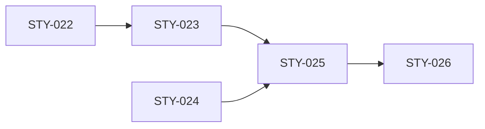

# EPC-005: Editing — a Product Lead changes a roadmap's text and publishes it to the spreadsheet

- **Status**: Active — planned 2026-11-11 after grilling; a thin slice to prove that edits
  reach the data source safely; richer editing follows
- **Progress**: 0 of 5 terminal; next selectable: STY-022 or STY-024; blocked on: nothing
- **Binding ADRs**: ADR-012, ADR-011, ADR-009, ADR-002, ADR-003, ADR-008, ADR-010

## Summary

The editor shows every roadmap and its items but cannot change them: a Product Lead
still edits the spreadsheet by hand. This epic proves the round trip. On a roadmap's
page they edit, in place and in English, the roadmap's title, status label, product
lead, vision and service description, and each item's title, description, expected
outcome and phase. Edits stay pending, tagged "Changed", until one deliberate "Publish
changes" (or "Save changes" on an unpublished roadmap) writes them all to the
spreadsheet at once. A co-lead's change to the same field stops the publish and is
shown side by side. Items gain an `Item ID` column so the right row is written. Adding,
deleting or moving items, tags, organisations, details, Welsh and drafts come later.

## Owner decisions waiting

None. The owner settled the product decisions in grilling rounds 1–3, Q28–Q31 and
Q32–Q34 (2026-11-11) and accepted ADR-012; each story's Decisions cite the answers it rests on.
The owner's own step outside this repository: add `Item ID` to the spreadsheet's
`Template` tab and to the public site's README (ADR-012 Option 7).

## Findings

Audited at `8479405` on 2026-11-11.

### F1 — Nothing writes to the data source

`SheetsClient` has `getJson` only and sends `GET` alone
(`rg -n "getJson|method:" src/infrastructure/google-sheets/sheets-client.ts`);
`RoadmapRepository` has two reads. The token's scope already allows writing (ADR-003),
so no new consent is needed.

### F2 — Items have no identity

Items are keyed by their position in the list
(`rg -n "position" src/features/roadmaps/group-roadmap-items.ts`), as ADR-011 Option 4
chose. A co-lead's inserted or sorted row would make a positional write overwrite the
wrong item (persona A12).

### F3 — The roadmap's own text is not on its page

The detail page shows the title only. The list card shows the status label, service
description and product lead; the vision appears nowhere
(`rg -n "vision|serviceDescription|productLead|statusLabel" src/features --glob '!*.test.*'`).
There is nothing on the roadmap's page to edit in place.

### F4 — The tab list read cannot place a new column

The metadata read asks for `sheetId`, `title`, `index` and `hidden`
(`rg -n -A1 "SPREADSHEET_METADATA_FIELDS =" src/infrastructure`). A write that adds a
column must know the tab's grid width: writing beyond it fails.

### F5 — The E2E fake answers reads only

`tests/e2e/fixtures/fake-sheets.ts` returns 404 for any method other than `GET`
(`rg -n 'method !== "GET"' tests/e2e/fixtures`).

### F6 — Every session end clears what was read, and nothing else exists to keep

Disconnect (header and session warning) clears auth-scoped queries through
`onDisconnect` (`rg -n onDisconnect src/app/composition.ts`); expiry invalidates them.
Pending edits are new state, outside the query cache, so each of these paths needs a
rule: kept through expiry and Reconnect, and on Disconnect kept or discarded as the
Product Lead chooses (STY-025).

## Design

1. The repository gains one write call that re-reads, checks for conflicts field by
   field, assigns missing item IDs, adds missing columns and writes every change in one
   atomic request (F1, F4, ADR-012).
2. Items carry `id: string | null`, read from `Item ID` by header (F2, ADR-012).
3. The roadmap's page gains an "About this roadmap" block above its items (F3), first
   read-only, then editable.
4. Pending edits live in one in-memory store in `features/`, keyed by roadmap, separate
   from the query cache; each edit keeps its base value (F6, ADR-012).
5. The E2E fake accepts the write, applies it to its spreadsheet and records it, so a
   reload after publishing shows the published text (F5).
6. **Unchanged:** reads (two for the list, three for a roadmap), their states and
   errors; the roadmap list's grouping and order; Welsh content; the `Template` tab;
   `Last updated`; family, category, colour and published; the session and its
   warning, apart from Disconnect's question.

## Shared assumptions and contracts

### What is editable

ADR-012 §"What is editable" is the list; every story cites it. Interface copy calls the
fields by the glossary's names (title, status label, product lead, vision, service
description, description, expected outcome, phase), never by their sheet headers.

### The pending-edit store

One store per app instance in `features/` (STY-025 chooses `features/roadmaps/` or a
new `features/editing/`), never persisted. A pending edit names its roadmap, its target
(the roadmap's own text, or an item by ID, or by position plus its loaded content when
it has no ID), its field, its base value and its pending value. An edit back to the
base value is no edit. The store is the only source of "Changed", "Unpublished changes"
and the leave warning. STY-025 builds it; STY-026 reads its base values.

### The publish call

ADR-012 §"The repository call" is the contract. STY-023 fixes its names and the shape of
its outcome and records them in its Delivery; STY-025 and STY-026 build on that record.

### Session paths

| Path                                       | Pending edits                                                                                     |
| ------------------------------------------ | ------------------------------------------------------------------------------------------------- |
| Navigating between pages                   | kept                                                                                              |
| Refresh on either page                     | kept, shown over the re-read text; bases unchanged; a change the re-read already holds is dropped |
| A publish whose result never arrives       | kept; the page asks for a Refresh, which drops what was written (STY-023, STY-025)                |
| Session expires, or a 401 during a publish | kept; publishing waits for Reconnect                                                              |
| Renewal ("Stay connected")                 | kept                                                                                              |
| Disconnect (header or session warning)     | asks first when any roadmap has pending edits: keep, discard or cancel (Q29)                      |
| Reload or close the tab                    | the browser asks first; then lost                                                                 |
| Language or theme change                   | kept                                                                                              |
| The roadmap disappears from the list       | discarded, and the page says so (STY-026)                                                         |

### Copy

Every new string goes through the `copywriter` skill in English and Welsh. "Publish"
and "Save" follow the glossary: "Publish changes" on a published roadmap, "Save changes"
on one that is not, and the note on a published roadmap says changes appear on the
public site after its next nightly update. A success is a page notice (the STY-017
pattern); a failure stays on screen and keeps the edits. Copy never says sheet, tab,
row, column, cell or ID.

### Example data only

As in EPC-004: tests use `tests/fixtures/sheets/` or inline rows. The fixtures gain no
`Item ID` column, so the first publish in a test exercises adding it; a test needing IDs
writes them inline or publishes first.

## Stories

| ID      | Story                                                                                   | Area                                     | Depends on       | State |
| ------- | --------------------------------------------------------------------------------------- | ---------------------------------------- | ---------------- | ----- |
| STY-022 | [Each roadmap item keeps an identity](STY-022-items-keep-an-identity.md)                | Domain + Infrastructure                  | —                |       |
| STY-023 | [The repository publishes a roadmap's changes](STY-023-repository-publishes-changes.md) | Domain + Infrastructure + Features + E2E | STY-022          |       |
| STY-024 | [A roadmap's page shows what the roadmap is about](STY-024-about-this-roadmap.md)       | Features/UI + i18n (en + cy) + E2E       | —                |       |
| STY-025 | [A Product Lead edits a roadmap and publishes it](STY-025-edit-then-save-or-publish.md) | Features/UI + i18n (en + cy) + E2E       | STY-023, STY-024 |       |
| STY-026 | [A co-lead's change is shown, not overwritten](STY-026-co-lead-conflicts.md)            | Features/UI + i18n (en + cy) + E2E       | STY-025          |       |

## Sequencing

STY-022 and STY-024 can run in parallel; STY-023 needs STY-022's IDs; STY-025 needs the
write call and the block it makes editable; STY-026 needs the publish flow it
interrupts. Each lands on the default branch before its dependants start. STY-023 must
stay one change: its write, conflict check and E2E fake prove each other. Nothing is
editable in the interface until STY-025, which also handles the conflict outcome in the
interim: until STY-026, any conflict or missing item stops the publish with a plain
message and keeps the edits.

## Out of scope

- **Adding, deleting, reordering items, or moving them between horizons**: the next
  editing records; moving needs placement editing.
- **Tags, organisations and details**: structured fields with their own editors.
- **Welsh content** (ADR-012 Option 3): a later record, which may add Welsh columns.
- **Family and colour**: [EPC-006](../EPC-006-product-families-and-colours/README.md),
  since they are set per roadmap but belong together.
- **Category, published, `Last updated`**: later records; staleness (A7) owns
  `Last updated`.
- **Drafts, autosave, browser storage of pending edits** (A9, A10): later.
- **An approval step** (A6, deferred by the owner).
- **Adding `Item ID` to the `Template` tab or the public site's README**: the owner's
  step (ADR-012 Option 7).
- **Showing parser problems** (for example a duplicate ID): the sheet-health view, a
  later record.

## Defects

None.

## Related

- ADR-012 (this epic's decisions), ADR-011, ADR-009, ADR-002, ADR-003
- [The roadmap tab format](../../analysis/roadmap-tab-format.md),
  [the roadmap index format](../../analysis/roadmaps-tab-format.md)
- [EPC-004 Roadmap items](../_archive/EPC-004-roadmap-items/README.md) (archived), whose
  item model and reads this epic writes back
- [EPC-006 Product families and colours](../EPC-006-product-families-and-colours/README.md)
- The persona's needs: [Product Lead](../personas/product-lead.md) A9, A10, A12
