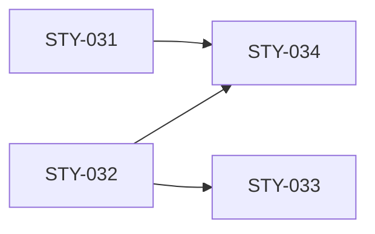

# EPC-007: Item placement and organisations — moved and chosen, not retyped in the sheet

- **Status**: Active — grilled in rounds 1–4 (2026-11-13); ADR-014 accepted
- **Progress**: 1 of 4 terminal (STY-031 awaits merge); next selectable: STY-032;
  blocked on: nothing
- **Binding ADRs**: ADR-014, ADR-012, ADR-011, ADR-002, ADR-008

## Summary

A Product Lead can edit an item's text (EPC-005) but still opens the spreadsheet to move
an item from Later to Next, or to change who the work is for. This epic makes both
pending edits, published with the rest. A "Move to…" menu on each card, or a choice in
the edit form, moves an item to any horizon or section. A checkbox list in the form sets
its organisations. The organisations become data the repository serves, as the
database will, so the card shows short names and the families page lists them in full.
Reordering items within a placement, and editing the organisation list, stay out.

## Owner decisions waiting

None.

## Findings

Audited at `5546d47` on 2026-11-13.

| Where                             | Placement today                             | Organisations today                                     |
| --------------------------------- | ------------------------------------------- | ------------------------------------------------------- |
| Item card                         | grouped under its heading; unplaced flagged | codes, in the public site's order (`organisationCodes`) |
| Item edit form                    | not offered                                 | not offered                                             |
| Pending edits, publish, conflicts | not a field                                 | not a field                                             |
| Families and categories page      | —                                           | not shown                                               |
| Repository                        | `placement` on each item                    | `organisations`, a fixed union, from a domain constant  |

### F1 — Placement and organisations are read-only

`EDITABLE_ITEM_FIELDS` holds title, description, expected outcome and phase only
(`rg -n "EDITABLE_ITEM_FIELDS =" -A6 src/domain`); ADR-012 keeps the rest read-only.
The persona's _Move items between horizons_ means a trip to the sheet today.

### F2 — Every pending item field is free text

`FieldChange` holds a `base` and `value` string, and the edit form offers a typed field
or one choice from a list (`EditFormField.options`, STY-028). A set of organisations has
no field type yet. The conflict review and publish dialog name a field by its catalogue
label, and the conflict review shows its values as text (`rg -n "itemFields" src/features/roadmaps/editing`).

### F3 — The organisation list is a constant in two layers

`ORGANISATIONS` in `domain/` is the vocabulary and `organisationCodes` in `features/`
labels it (`rg -n "ORGANISATIONS|organisationCodes" src --glob '!*.test.*'`). A list
the database serves would mean changing both, and every feature that uses them.

### F4 — An unknown organisation code is dropped on read

The parser leaves out a code it doesn't know and records a problem
(`rg -n "unknown-organisation" src/infrastructure`); the item never carries it. Writing
the cell from the item would drop it without a word.

### F5 — A roadmap may have no `Organisations` column

The `ProductC` fixture's header has none (`docs/analysis/roadmap-tab-format.md`,
_Example data_). ADR-012 already adds a missing column on publish.

## Design

Set in grilling rounds 1–4 (2026-11-13) and recorded in ADR-014; each story's Decisions
cite the answers.

1. Placement becomes an editable item field, moved from a "Move to…" menu on the card
   or a choice in the form; publishing writes `Horizon` only, so the item keeps its row
   order (F1).
2. Organisations become an editable item field, a set chosen from checkboxes (F1, F2).
3. `listOrganisations()` on the repository serves the list, flagging national ones;
   items carry `organisationIds`; no feature reads a constant; the screen sorts (F3).
4. A code the list doesn't hold is kept on the item as written, so the form can say it
   will be removed (F4).
5. A missing `Organisations` column is added on publish, as ADR-012 adds one (F5).
6. **Unchanged:** ADR-012's publish, conflict, Refresh and session rules; the six
   placements and their page order; row order within a placement; the parser's header
   matching; tags, details and Welsh content stay read-only.

## Shared assumptions and contracts

### Two new item fields

Placement and organisations join the item's editable fields, each one value for pending
edits, conflicts and Refresh (ADR-014): a placement compared as its id (none for an
unplaced item), organisations as a set of ids. STY-031 extends the pending-change model
for a field that is not free text; STY-034 builds on that extension, not a second one.
The publish dialog and the conflict review name each new field by its catalogue label;
the conflict review shows its values as the page does: a placement by its heading, organisations by short
names.

### The organisation list

STY-032 owns the `Organisation` type, `listOrganisations()` and `organisationIds`;
STY-033 and STY-034 read them through the repository's query. The repository promises
no order: each screen shows national organisations first, then sorts by the label it
shows in the interface's language (ADR-014), through one shared sort STY-032 provides.

### What the editor writes

A change to what is written goes in README _What the editor writes_ in the same PR, and
the PR says so: STY-031 adds the `Horizon` cell, STY-034 the `Organisations` cell and
column.

### Copy

Every new string goes through the `copywriter` skill in English and Welsh. Placement
headings reuse `roadmaps.items.placements.*`. Organisation short names and codes are
data, not catalogue copy, and stay English; full names come with the list in both
languages.

## Stories

| ID      | Story                                                                                                                           | Area                                       | Depends on       | State |
| ------- | ------------------------------------------------------------------------------------------------------------------------------- | ------------------------------------------ | ---------------- | ----- |
| STY-031 | [A Product Lead moves an item to another horizon](../_archive/EPC-007-item-placement-and-organisations/STY-031-move-an-item.md) | Domain + Infra + UI + i18n (en + cy) + E2E | —                | ✅    |
| STY-032 | [Organisations come from the repository, shown by name](STY-032-organisations-from-the-repository.md)                           | Domain + Infra + UI + Docs                 | —                |       |
| STY-033 | [The organisations are listed with families and categories](STY-033-list-the-organisations.md)                                  | Features/UI + i18n (en + cy)               | STY-032          |       |
| STY-034 | [A Product Lead chooses who an item's work is for](STY-034-choose-organisations.md)                                             | Domain + Infra + UI + i18n (en + cy) + E2E | STY-031, STY-032 |       |

## Sequencing

One at a time, in number order (round 3 Q22): STY-031, STY-032, STY-033, STY-034.
STY-032 has no hard need of STY-031, and STY-033 none of STY-034, but the owner chose
this order. STY-034 needs STY-031's extension of the pending-change model and STY-032's
list.

## Out of scope

- **Reordering items within a placement, or a moved item at the top of its new
  placement** (round 1 Q3): a later record, which moves rows.
- **Drag and drop** (Q4): the menu covers phone and keyboard.
- **An `Organisations` tab, or adding, renaming or removing an organisation** (round 2
  Q13): the list is in code until the database replaces Sheets.
- **Welsh short names** (Q7): short names stay English.
- **Tags, details, adding or deleting items, Welsh content**: later editing records.
- **The public site reading the organisation list**: its own repository, once the
  database exists.

## Defects

None.

## Related

- ADR-014 (this epic's decisions); ADR-012, ADR-011, ADR-013 (the lists precedent)
- [EPC-005 Editing](../_archive/EPC-005-editing/README.md), whose pending edits and
  publish this epic extends
- [EPC-006 Product families and colours](../EPC-006-product-families-and-colours/README.md),
  whose page STY-033 extends
- [The roadmap tab format](../../analysis/roadmap-tab-format.md)
- The persona: [Product Lead](../personas/product-lead.md), _Move items between horizons_
