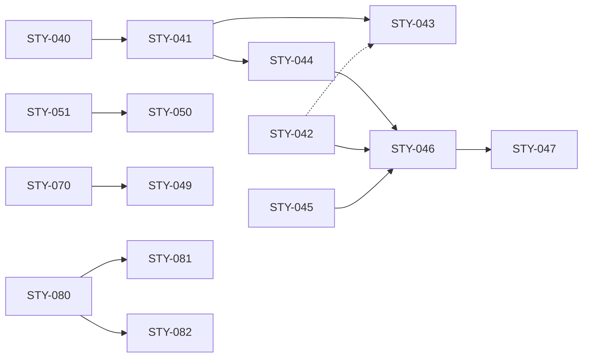

# EPC-011: Adding roadmaps and items — started here, not in the spreadsheet, in one dialog each

- **Status**: Active — grilled with the owner on 2026-11-14; STY-040 to STY-047
  delivered; reordering settled on 2026-11-16 as STY-051 then STY-050, both delivered;
  removing a published item grilled on 2026-11-19 as STY-070 then STY-049, both
  delivered; quick add grilled on 2026-11-20 as STY-080 to STY-082, all delivered
- **Progress**: 15 of 16 terminal; next selectable: none;
  blocked on: STY-048 waits for grilling
- **Binding ADRs**: ADR-012, ADR-011, ADR-009, ADR-013, ADR-014, ADR-002, ADR-003, ADR-005,
  ADR-006, ADR-010, ADR-008

## Summary

A Product Lead can edit everything about a roadmap and its items, but cannot start
either: both are begun by hand in the spreadsheet. This epic lets them add a roadmap
from the roadmap list and add items on a roadmap's page. A new roadmap is written at
once and starts not published; a new item is a pending edit, published with the rest.
Both are added in a dialog, and the owner asked that editing converge on the same
dialogs: one for a roadmap, adding it or editing "About this roadmap" ("Product
details" since STY-065), and one for an
item. The in-place edit forms go. A Product Lead can also put a placement's items in
the order they want (STY-051, STY-050), and remove a published item, pending until
published (STY-070, STY-049). Quick add, a title field ending each placement, adds
items where they will go, one after another (STY-080 to STY-082). Removing a roadmap is
recorded for later.

## Owner decisions waiting

- [STY-048](STY-048-remove-a-roadmap.md#open-questions) — how a roadmap is removed, and
  what happens to its items

None blocks any other story.

## Findings

Audited at `400c90c` on 2026-11-14.

| Where                 | Adding                                                                                     |
| --------------------- | ------------------------------------------------------------------------------------------ |
| Roadmap list          | no action; the empty list says the spreadsheet lists no roadmaps                           |
| Roadmap page          | Edit and Move on each item; nothing adds one; an empty roadmap shows "No items yet"        |
| Families page         | "Add a family", written at once: the one add the editor has (STY-029)                      |
| Repository            | no call adds a roadmap or an item (`rg -n "add" src/domain/roadmap/roadmap-repository.ts`) |
| Connected spreadsheet | a Product Lead copies the `Template` tab and types a row in the roadmap index              |

### F1 — A roadmap is started in the spreadsheet, in two places that must agree

A roadmap is a row of the roadmap index whose `Sheet` cell names the tab holding its
items (ADR-009). The owner reports that Product Leads copy the `Template` tab to start
one (`docs/analysis/roadmap-tab-format.md`). The tab's name, the `Sheet` cell and the
public address are one value: the public site's address is the slug of `Sheet`
(`slugify`, `src/infrastructure/google-sheets/roadmap-index-parser.ts`). A typo in
either place gives a roadmap whose items can't be read (ADR-011, `invalid-data`).

### F2 — The editor has never read or changed the `Template` tab

ADR-011 says the `Template` tab is never read; ADR-012 Option 7 and the persona's
answered question say the editor never touches it. Copying it is a read. The owner's
request for this epic is the decision that changes that: the tab is copied, and still
never changed.

### F3 — Nothing adds an item, so a roadmap added here would be a dead end

Every item screen starts from an item the data source already holds
(`EDITABLE_ITEM_FIELDS`, `ItemChanges.item`). A pending edit is found again at publish
by its item's ID or position (ADR-012); a new item has neither.

### F4 — A roadmap with no items is one click from public

"Publish roadmap" checks only what would fail the public site's nightly update
(STY-035 S4). A roadmap with no items passes. Adding roadmaps here makes that case
common.

### F5 — Edit forms open in place, and there is no dialog to put a form in

An item's form opens inside its card and "About this roadmap"'s inside its section;
`src/components/ui/` has an alert dialog for confirmations and no dialog for a form.
The card form holds its card in place while open (`held`, `cardHoldKey` in
`roadmap-items.tsx`) and starts Tags, Organisations and Details shut because a card is
narrow (EPC-009 F6, EPC-010 F6).

### F6 — Items can be neither removed nor reordered here

No screen removes an item or a roadmap, and an item's place in its horizon is its
row's place in the tab (ADR-014, as it stood: a move wrote the `Horizon` cell alone;
since STY-051 a published move also moves the row, Design 8). A new item therefore had
one possible place without a new kind of write: after the last row.

## Design

1. A Product Lead adds a roadmap from the roadmap list, in a dialog that asks its
   title, short name, product family, category and product lead. It is written at once:
   a row in the roadmap index and a copy of the `Template` tab without its example
   rows, together or not at all. It starts not published (F1, F2). STY-040 (the write),
   STY-041 (the dialog).
2. The short name is the roadmap's identity: it names the tab, fills `Sheet` and ends
   the public address. It is suggested from the title, shown, and may be changed before
   adding, never after (F1). STY-040, STY-041.
3. One roadmap dialog adds and edits: editing "About this roadmap" opens it with every
   About field and no short name (F5). STY-043.
4. One item dialog adds and edits: the card's in-place form goes, and Edit opens the
   dialog with today's fields (F5). STY-044.
5. A Product Lead adds an item from the "Add an item" button on the roadmap's page. The
   item is pending, tagged "New", until the roadmap is published or saved, when it is
   written after the roadmap's last item (F3, F6). STY-045 (the write), STY-046 (the
   dialog), STY-047 (the publish dialog).
6. A roadmap with no items shows one panel with the button, and the publish dialog says
   when the public would see a roadmap with no items (F4). STY-042, STY-046.
7. **Unchanged:** ADR-012's per-roadmap, all-or-nothing publish, its conflict rules and
   Refresh, apart from a removal's (item 9); what each field writes (README, _What the
   editor writes_), apart from the row moves of item 8 and the row deletes of item 9;
   English only; Move on an item's card; who may edit (anyone connected, ADR-012
   Option 14).
8. A moved item goes last in its new placement, and publishing moves its row (STY-051).
   A Product Lead reorders a placement's items from each card's Move menu; the order is
   a pending edit of the placement, written as row moves, and a co-lead's change to the
   same placement's items is a conflict reviewed with both orders (STY-050). Settled on
   the wayfinder map
   [Reordering a placement's items](https://github.com/DHCW-Digital-Health-and-Care-Wales/roadmaps/issues/102),
   whose tickets each story's Decisions cite.
9. A Product Lead removes a published item from its card, after a question that offers
   Not doing first; the removal is pending, struck through with Undo, and publishing
   deletes its row, last in the write. A co-lead's change to the item is a conflict,
   and an item already gone counts as removed (STY-070, the write; STY-049, the
   screen). Settled in the grilling of 2026-11-19.
10. Quick add: each placement ends with "Add an item", which opens a title field in its
    place; Enter adds a new item there, title only, and opens the next field; leaving
    drops it. Its expand button opens the item dialog with the title and placement, and
    the publish dialog flags a new item with only a title. Adding never asks to
    reconnect. STY-080 (the control), STY-081 (the expand), STY-082 (the flag).

## Shared assumptions and contracts

### The dialogs

- STY-041 adds the dialog primitive with the shadcn CLI, Base UI flavour (ADR-005), and
  builds the roadmap dialog in its adding form. STY-043 gives the same dialog its
  editing form; STY-044 builds the item dialog in its editing form and STY-046 gives it
  its adding form. Each pair is one component, not two.
- **Closing** (owner): Cancel, Escape and the close button at its top right (EPC-017)
  close a dialog and drop what was typed, without asking; a click outside it does
  nothing. On a phone a dialog fills the width from the foot of the screen and
  scrolls. A story cites this rule and tests it; it does not restate it.
- **An expired session** (owner) keeps the dialog and its text. A dialog is modal, so
  nothing behind it can be reached: one that writes at once (adding a roadmap)
  offers Reconnect inside itself (STY-041 S11); one whose Done or "Add item" only
  keeps a pending edit still works while expired, as the in-place forms did.
- Focus goes to the dialog's first field as it opens and back to the control that
  opened it as it closes, unless a story says where else.

### What is written at once, and what is pending

A new roadmap is written at once, as a family is (STY-029). Everything else stays a
pending edit: a new item, and every change made in either dialog's editing form.

### What the editor writes

STY-040, STY-045, STY-051 and STY-050 each change README _What the editor writes_ in
their own PR and say so in the PR, since the format is a contract with the public site.
STY-070 changes it too: publishing deletes a removed item's row. No other story changes
a write, but STY-048 will once grilled. STY-051 and STY-050 change no column or cell
format: they move and insert rows, whose order the public site already reads.

### ADR amendments

- STY-040 amends ADR-009 (the editor adds a row to the roadmap index), ADR-011 (the
  `Template` tab is copied to start a roadmap, and its header is read to check it; its
  rows are never read, and it is still never changed), ADR-012 (Option 7 stands:
  never written; a new write at once), ADR-013 ("the editor never creates a tab"
  becomes: it creates a roadmap's tab, and never the `Families` or `Categories` tab)
  and ADR-002 (a repository call that adds a roadmap), in place, citing its decisions.
  It updates the persona's answered question on format ownership to match.
- STY-045 amends ADR-012 (a new item is a pending edit; how its row is written and
  settled) and ADR-011 if the item model changes.
- STY-051 and STY-050 do not amend an ADR: the PR that wrote them amended ADR-014 (a
  moved item goes last, and its row moves) and ADR-012 (how rows are moved, the
  protected-row refusal, and an order as a pending edit) in place, on the owner's
  choice (STY-051 D5). Each story checks its build against those amendments.
- STY-070 amends ADR-012 (a removal is a pending edit; its row is deleted last; its
  conflict, its "already gone" and its lost answer), citing STY-049's Decisions.

### Refactoring and code quality come first

Owner, 2026-11-14: this epic reworks screens and components that exist (both edit
forms, the roadmap page, the pending changes), so refactoring and code quality are a
high priority for every story, ahead of the smallest diff. A story that moves a form
deletes what it replaces in the same PR (the in-place forms, the card's hold), shares
one component where the epic says one, and leaves no second path beside the new one.
Reviewers hold each PR to this.

### How the grilling is cited

"Round n" is the grilling on adding a roadmap; "items round n" is the one on adding
an item, which also settled the dialogs. Both were on 2026-11-14, and each story's
Decisions cite the round and question an answer came from. "Quick add round n" is the
grilling of 2026-11-20 on quick add (STY-080 to STY-082).

### Glossary

STY-040 adds **Short name** and brings **Roadmap**, **Published roadmap** and
**Worksheet** (the `Template` entry) up to date. STY-045 brings **Pending edit** and
**Roadmap item** up to date. **Order** and **Position** were added, and **Pending
edit** and **Conflict** extended to orders, by the PR that wrote STY-050 and STY-051.
STY-070 extends **Pending edit** and **Conflict** to a removal. **Quick add** was added,
planned, by the PR that wrote STY-080 to STY-082.

## Stories

| ID      | Story                                                                                                                                                                       | Area                                                                | Depends on                | State |
| ------- | --------------------------------------------------------------------------------------------------------------------------------------------------------------------------- | ------------------------------------------------------------------- | ------------------------- | ----- |
| STY-040 | [The repository adds a roadmap](../_archive/EPC-011-adding-roadmaps-and-items/STY-040-the-repository-adds-a-roadmap.md)                                                     | Domain + Infrastructure + Docs                                      | —                         | ✅    |
| STY-041 | [A Product Lead adds a roadmap](../_archive/EPC-011-adding-roadmaps-and-items/STY-041-add-a-roadmap.md)                                                                     | Features/UI + i18n (en + cy) + E2E                                  | STY-040                   | ✅    |
| STY-042 | [A roadmap's page shows About in a panel, and says when it is empty](../_archive/EPC-011-adding-roadmaps-and-items/STY-042-the-roadmap-page-about-panel-and-empty-state.md) | Features/UI + i18n (en + cy) + E2E                                  | —                         | ✅    |
| STY-043 | [“About this roadmap” is edited in the roadmap dialog](../_archive/EPC-011-adding-roadmaps-and-items/STY-043-edit-about-in-the-roadmap-dialog.md)                           | Features/UI + i18n (en + cy) + E2E                                  | STY-041                   | ✅    |
| STY-044 | [An item is edited in a dialog](../_archive/EPC-011-adding-roadmaps-and-items/STY-044-edit-an-item-in-a-dialog.md)                                                          | Features/UI + i18n (en + cy) + E2E                                  | STY-041                   | ✅    |
| STY-045 | [The repository publishes a new item](../_archive/EPC-011-adding-roadmaps-and-items/STY-045-the-repository-publishes-a-new-item.md)                                         | Domain + Infrastructure + Docs                                      | —                         | ✅    |
| STY-046 | [A Product Lead adds an item](../_archive/EPC-011-adding-roadmaps-and-items/STY-046-add-an-item.md)                                                                         | Features/UI + i18n (en + cy) + E2E                                  | STY-042, STY-044, STY-045 | ✅    |
| STY-047 | [The publish dialog names the new items](../_archive/EPC-011-adding-roadmaps-and-items/STY-047-a-new-item-in-the-publish-dialog.md)                                         | Features/UI + i18n (en + cy) + E2E                                  | STY-046                   | ✅    |
| STY-048 | [A Product Lead removes a roadmap](STY-048-remove-a-roadmap.md)                                                                                                             | to be decided                                                       | —                         |       |
| STY-049 | [A Product Lead removes a published item](../_archive/EPC-011-adding-roadmaps-and-items/STY-049-remove-a-published-item.md)                                                 | Features/UI + i18n (en + cy) + E2E                                  | STY-070                   | ✅    |
| STY-050 | [A Product Lead reorders the items in a placement](../_archive/EPC-011-adding-roadmaps-and-items/STY-050-reorder-items-in-a-placement.md)                                   | Domain + Infrastructure + Features/UI + i18n (en + cy) + E2E + Docs | STY-051                   | ✅    |
| STY-051 | [A moved item goes last in its new placement](../_archive/EPC-011-adding-roadmaps-and-items/STY-051-a-moved-item-goes-last-in-its-new-placement.md)                         | Domain + Infrastructure + Features/UI + i18n (en + cy) + E2E + Docs | —                         | ✅    |
| STY-070 | [The repository publishes a removed item](../_archive/EPC-011-adding-roadmaps-and-items/STY-070-the-repository-publishes-a-removed-item.md)                                 | Domain + Infrastructure + Docs                                      | —                         | ✅    |
| STY-080 | [A Product Lead adds items where they will go, by title alone (quick add)](../_archive/EPC-011-adding-roadmaps-and-items/STY-080-quick-add-items-where-they-go.md)          | Features/UI + i18n (en + cy) + E2E                                  | —                         | ✅    |
| STY-081 | [A quick add title opens in the item dialog for its other details](../_archive/EPC-011-adding-roadmaps-and-items/STY-081-expand-quick-add-into-the-item-dialog.md)          | Features/UI + i18n (en + cy) + E2E                                  | STY-080                   | ✅    |
| STY-082 | [The publish dialog flags a new item that has only a title](../_archive/EPC-011-adding-roadmaps-and-items/STY-082-the-publish-dialog-flags-a-title-only-item.md)            | Features/UI + i18n (en + cy) + E2E                                  | STY-080                   | ✅    |

## Sequencing

Deliver in ID order, one at a time: STY-040 to STY-047. Each story is cut to fit one
agent's context (owner, 2026-11-14): a repository write is its own story, ahead of the
screen that uses it, and keeps its contract documents, which must change with it.
STY-042, STY-043, STY-044, STY-046 and STY-047 all change the roadmap's page, so none
runs beside another. STY-041 brings the dialog primitive that STY-043 and STY-044
need; STY-043 prefers STY-042 first, which puts Edit beside the About heading.
STY-048 waits for grilling; when grilled, it follows STY-040, by preference. STY-070
comes before STY-049 (owner, 2026-11-19): the write ahead of its screen. STY-051 comes before STY-050 (owner,
2026-11-16): it brings the row moves STY-050 builds on, and is usable on its own. Both
change the publish plan and the roadmap's page, so neither runs beside the other or
beside STY-070 or STY-049, nor do those two beside each other. Quick add (owner,
2026-11-20) delivers STY-080, then STY-081, then STY-082, one at a time: each depends on
STY-080, STY-080 and STY-081 change the roadmap's page and the item dialog, and STY-082
reads the new items STY-080 makes title-only.

## Out of scope

- **Changing a roadmap's short name**: it is its identity and public address; a rename
  would break links and needs the tab renamed with the row. No record; a Product Lead
  asking for it would bring it in.
- **Welsh titles and Welsh item text**: English only, as every edit is (ADR-012
  Option 3).
- **Listing a tab that already exists** as a roadmap: its row is typed in the
  spreadsheet, as today (STY-040 D7).
- **A sheet-health view** for a missing or unusable `Template`: the refusal says who
  fixes it (STY-041 S7).

## Defects

- [DEF-006](../_archive/defects/DEF-006-a-refused-reconnect-drops-the-add-a-roadmap-dialog.md):
  a reconnect Google refuses drops the "Add a roadmap" dialog and what was typed.
  Won't fix (owner, 2026-11-14): rare and a small loss; reopen on evidence from real users.
- [DEF-008](../_archive/defects/DEF-008-focus-is-lost-after-add-a-roadmap-closes-in-safari.md):
  focus is lost when "Add a roadmap" closes, for a Product Lead who clicked it in
  Safari. Done; found by STY-043's review, which fixed the same for About's Edit.
- [DEF-009](../_archive/defects/DEF-009-a-published-new-item-is-not-shown-when-the-read-after-it-fails.md):
  a new item that was published is not shown when the read after the publish fails,
  until a Refresh succeeds. Done; found by STY-046's review.
- [DEF-010](../_archive/defects/DEF-010-a-publishing-dialog-changes-what-it-shows-once-written.md):
  a dialog that publishes changes what it shows once its changes are no longer
  pending: the publish dialog's list empties, as it closes or when a read leaves
  nothing to publish, and a tick box can appear. Done; found by STY-047's delivery.
- [DEF-011](../_archive/defects/DEF-011-an-edit-back-to-the-text-last-read-is-dropped-before-a-read-holds-a-publish.md):
  an edit back to the text last read is dropped while a published edit waits for a
  read. Superseded by DEF-015 (owner, 2026-11-15); found by DEF-009's review.
- [DEF-012](../_archive/defects/DEF-012-an-item-without-an-id-edited-again-before-a-read-is-reported-changed.md):
  an item without an ID, edited again before a read holds its publish, is reported
  changed. Superseded by DEF-015 (owner, 2026-11-15); found by DEF-009's review.
- [DEF-013](../_archive/defects/DEF-013-a-test-checks-the-roadmap-dialog-s-opening-focus-before-it-moves.md):
  a test checks the roadmap dialog's opening focus before it has moved, so Verify
  fails now and then. Done (high priority, owner, 2026-11-15); found by the retro of
  DEF-009.
- [DEF-014](../_archive/defects/DEF-014-publish-roadmap-carries-its-dialog-and-outcome-to-another-roadmap.md):
  "Publish roadmap" carries its dialog and outcome onto another roadmap's page when the
  Product Lead moves between them during the write. Done (owner, 2026-11-15); found by
  DEF-010's review.
- [DEF-015](../_archive/defects/DEF-015-a-write-the-editor-can-t-read-back-leaves-the-app-out-of-step.md):
  a write the editor can't read back leaves the app out of step with the data source;
  it holds the whole app until a Refresh succeeds, replacing DEF-009's keep-pending
  rules. Done (owner, 2026-11-15); from the grilling of DEF-011 to DEF-014.
- [DEF-016](../_archive/defects/DEF-016-the-item-dialog-s-focus-tour-counts-a-focus-guard-as-a-stop.md):
  the item dialog's focus tour counts a focus guard as a stop, so an E2E run fails now
  and then. Done (owner, 2026-11-19); found by DEF-015's delivery.
- [DEF-017](../_archive/defects/DEF-017-an-edit-made-while-a-publish-moves-its-item-is-reported-as-removed.md):
  an edit made while a publish moves its item's row is reported as removed, for an
  item that has never had an ID. Won't fix (owner, 2026-11-19, as STY-051 D8); found by
  STY-051's review.
- [DEF-023](../_archive/defects/DEF-023-an-open-quick-add-title-is-lost-when-a-read-leaves-the-roadmap-with-no-items.md):
  a quick add title typed but not added is lost when a read leaves the roadmap with no
  items, and its panel takes the placements' place. Won't fix (owner, 2026-11-20): too
  rare, and a few words lost; found by STY-080's review.
- [DEF-024](../_archive/defects/DEF-024-a-moved-item-test-moves-focus-before-the-publish-notice-takes-it.md):
  a moved item test moves focus before the publish notice has taken it, so E2E
  fails now and then, seen in CI since STY-080. Done with CHO-030; found by STY-081's
  retro.

## Related

- [CHO-010](../_archive/chores/CHO-010-check-adding-a-roadmap-against-a-real-spreadsheet.md): the
  checks of STY-040's write against a real test spreadsheet, which its delivery could
  not run. Done: the owner ran them, 2026-11-15.
- [CHO-015](../_archive/chores/CHO-015-check-adding-an-item-against-a-real-spreadsheet.md): the
  check of STY-045's write, a new item's row, against a real test spreadsheet, which
  its delivery could not run. Done: the owner ran it, 2026-11-15.
- [CHO-019](../chores/CHO-019-check-a-published-move-against-a-real-spreadsheet.md): the
  check of STY-051's write, a moved item's row, against a real test spreadsheet, which
  its delivery could not run. Proposed.
- [CHO-020](../chores/CHO-020-check-a-published-order-against-a-real-spreadsheet.md): the
  check of STY-050's write, a placement's rows reordered and a new item's row
  inserted, against a real test spreadsheet, which its delivery could not run.
  Proposed.
- [CHO-025](../chores/CHO-025-check-a-published-removal-against-a-real-spreadsheet.md):
  the check of STY-070's write, a removed item's row deleted or the last one cleared,
  against a real test spreadsheet, which its delivery could not run. Proposed.
- [CHO-011](../_archive/chores/CHO-011-the-dialog-tests-share-their-setup.md): the
  test setup STY-041 wrote out per spec, shared before STY-043, STY-044 and STY-046
  copy it. Done.
- [CHO-012](../_archive/chores/CHO-012-the-other-tests-use-the-shared-fixtures.md): the
  family and category lists other tests declared, and the connected state every
  page test declared. Done, in its PR.
- [CHO-013](../_archive/chores/CHO-013-the-page-focus-tour-tells-its-stops-apart.md): the page
  focus tour named text fields alike, so it could miss one. Done, in its PR.
- [CHO-014](../chores/CHO-014-slim-the-e2e-suite.md): the E2E suite slimmed where a
  test holds only geometry or repeats a run, as the owner asked after CHO-011 cut the
  add-a-roadmap journey to one run. STY-043 re-pointed the About tests at the roadmap
  dialog and ran About's panel behaviour once; STY-044 re-pointed the item-form tests
  at the item dialog and kept the long tag and the long detail at one width.
- [`docs/analysis/add-a-roadmap-ux-analysis.md`](../../analysis/add-a-roadmap-ux-analysis.md):
  twelve mock-ups over four journeys. Outcome: a dialog for adding a roadmap, landing on
  the new roadmap; a dialog for adding an item; one panel on an empty roadmap.
- [`docs/analysis/remove-a-published-item-ux-analysis.md`](../../analysis/remove-a-published-item-ux-analysis.md):
  six designs over two journeys for STY-049, drawing every option of its Q1–Q3.
  Outcome: A1's pending struck card, behind a confirmation that offers Not doing first
  (A2's question), and B1's conflict review; the write split out as STY-070. Recorded
  in STY-049's Decisions.
- [`docs/analysis/reorder-items-ux-analysis.md`](../../analysis/reorder-items-ux-analysis.md):
  nine mock-ups over three journeys, for STY-050. Outcome: "To the top", "Up one",
  "Down one" and "To the bottom" in each card's Move menu; "Order changed" and "Undo
  order" beside the placement's heading; one line in the publish dialog. Recorded in
  STY-050's Decisions (D3–D7).
- [`docs/analysis/add-items-ux-analysis.md`](../../analysis/add-items-ux-analysis.md):
  five ways to add items beyond the one "Add an item" button, and a working version of
  quick add. Outcome: E, quick add, grilled into STY-080 to STY-082 on 2026-11-20; A to D
  are not taken.
- `docs/analysis/roadmaps-tab-format.md` and `docs/analysis/roadmap-tab-format.md`: the
  roadmap index and roadmap tab formats, and the `Template` tab.
- [EPC-008](../_archive/EPC-008-publishing-and-freshness/README.md): "Publish roadmap",
  whose dialog STY-042 adds a line to.
- [EPC-006](../_archive/EPC-006-product-families-and-colours/README.md): "Add a
  family", the write-at-once precedent.
- Persona: `docs/backlog/personas/product-lead.md` (A1, A2, A9, A10, A12; _Publishing
  by mistake_).
