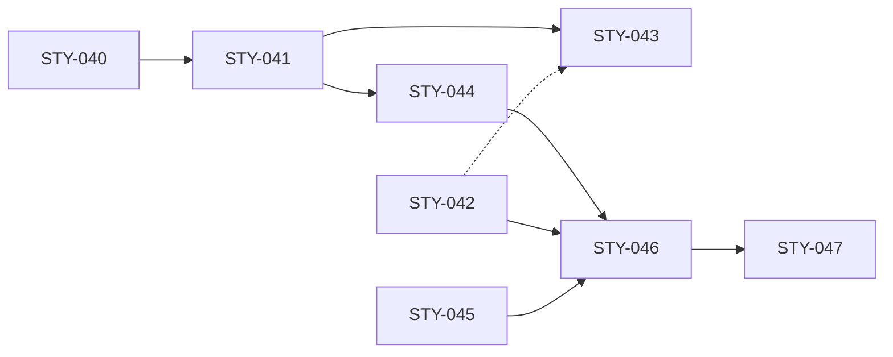

# EPC-011: Adding roadmaps and items — started here, not in the spreadsheet, in one dialog each

- **Status**: Active — grilled with the owner on 2026-11-14; eight stories Proposed, three
  recorded for later grilling
- **Progress**: 0 of 11 terminal; next selectable: STY-040; blocked on: nothing
- **Binding ADRs**: ADR-012, ADR-011, ADR-009, ADR-013, ADR-014, ADR-002, ADR-003, ADR-005,
  ADR-006, ADR-010, ADR-008

## Summary

A Product Lead can edit everything about a roadmap and its items, but cannot start
either: both are begun by hand in the spreadsheet. This epic lets them add a roadmap
from the roadmap list and add items on a roadmap's page. A new roadmap is written at
once and starts not published; a new item is a pending edit, published with the rest.
Both are added in a dialog, and the owner asked that editing converge on the same
dialogs: one for a roadmap, adding it or editing "About this roadmap", and one for an
item. The in-place edit forms go. Removing a roadmap, removing a published item and
reordering items are recorded for later.

## Owner decisions waiting

- [STY-048](STY-048-remove-a-roadmap.md#open-questions) — how a roadmap is removed, and
  what happens to its items
- [STY-049](STY-049-remove-a-published-item.md#open-questions) — whether removing an
  item is pending, and what "Not doing" is for
- [STY-050](STY-050-reorder-items-in-a-horizon.md#open-questions) — how items are
  reordered, and what is written

None blocks STY-040 to STY-047.

## Findings

Audited at `400c90c` on 2026-11-14.

| Where                 | Adding                                                                                     |
| --------------------- | ------------------------------------------------------------------------------------------ |
| Roadmap list          | no action; the empty list says the spreadsheet lists no roadmaps                           |
| Roadmap page          | Edit and Move on each item; nothing adds one; an empty roadmap shows "No items yet"        |
| Families page         | "Add a family", written at once: the one add the editor has (STY-029)                      |
| Repository            | no call adds a roadmap or an item (`rg -n "add" src/domain/roadmap/roadmap-repository.ts`) |
| Connected spreadsheet | a Product Lead copies the `Template` tab and types a row in the roadmap index              |

### F1 — A roadmap is started in the spreadsheet, in two places that must agree

A roadmap is a row of the roadmap index whose `Sheet` cell names the tab holding its
items (ADR-009). The owner reports that Product Leads copy the `Template` tab to start
one (`docs/analysis/roadmap-tab-format.md`). The tab's name, the `Sheet` cell and the
public address are one value: the public site's address is the slug of `Sheet`
(`slugify`, `src/infrastructure/google-sheets/roadmap-index-parser.ts`). A typo in
either place gives a roadmap whose items can't be read (ADR-011, `invalid-data`).

### F2 — The editor has never read or changed the `Template` tab

ADR-011 says the `Template` tab is never read; ADR-012 Option 7 and the persona's
answered question say the editor never touches it. Copying it is a read. The owner's
request for this epic is the decision that changes that: the tab is copied, and still
never changed.

### F3 — Nothing adds an item, so a roadmap added here would be a dead end

Every item screen starts from an item the data source already holds
(`EDITABLE_ITEM_FIELDS`, `ItemChanges.item`). A pending edit is found again at publish
by its item's ID or position (ADR-012); a new item has neither.

### F4 — A roadmap with no items is one click from public

"Publish roadmap" checks only what would fail the public site's nightly update
(STY-035 S4). A roadmap with no items passes. Adding roadmaps here makes that case
common.

### F5 — Edit forms open in place, and there is no dialog to put a form in

An item's form opens inside its card and "About this roadmap"'s inside its section;
`src/components/ui/` has an alert dialog for confirmations and no dialog for a form.
The card form holds its card in place while open (`held`, `cardHoldKey` in
`roadmap-items.tsx`) and starts Tags, Organisations and Details shut because a card is
narrow (EPC-009 F6, EPC-010 F6).

### F6 — Items can be neither removed nor reordered here

No screen removes an item or a roadmap, and an item's place in its horizon is its
row's place in the tab (ADR-014: a move writes the `Horizon` cell alone). A new item
therefore has one possible place without a new kind of write: after the last row.

## Design

1. A Product Lead adds a roadmap from the roadmap list, in a dialog that asks its
   title, short name, product family, category and product lead. It is written at once:
   a row in the roadmap index and a copy of the `Template` tab without its example
   rows, together or not at all. It starts not published (F1, F2). STY-040 (the write),
   STY-041 (the dialog).
2. The short name is the roadmap's identity: it names the tab, fills `Sheet` and ends
   the public address. It is suggested from the title, shown, and may be changed before
   adding, never after (F1). STY-040, STY-041.
3. One roadmap dialog adds and edits: editing "About this roadmap" opens it with every
   About field and no short name (F5). STY-043.
4. One item dialog adds and edits: the card's in-place form goes, and Edit opens the
   dialog with today's fields (F5). STY-044.
5. A Product Lead adds an item from one "Add an item" button on the roadmap's page. The
   item is pending, tagged "New", until the roadmap is published or saved, when it is
   written after the roadmap's last item (F3, F6). STY-045 (the write), STY-046 (the
   dialog), STY-047 (the publish dialog).
6. A roadmap with no items shows one panel with the button, and the publish dialog says
   when the public would see a roadmap with no items (F4). STY-042, STY-046.
7. **Unchanged:** ADR-012's per-roadmap, all-or-nothing publish, its conflict rules and
   Refresh; what each field writes (README, _What the editor writes_); English only;
   Move on an item's card; who may edit (anyone connected, ADR-012 Option 14).

## Shared assumptions and contracts

### The dialogs

- STY-041 adds the dialog primitive with the shadcn CLI, Base UI flavour (ADR-005), and
  builds the roadmap dialog in its adding form. STY-043 gives the same dialog its
  editing form; STY-044 builds the item dialog in its editing form and STY-046 gives it
  its adding form. Each pair is one component, not two.
- **Closing** (owner): Cancel and Escape close a dialog and drop what was typed,
  without asking; a click outside it does nothing. On a phone a dialog fills the
  width from the foot of the screen and scrolls. A story cites this rule and tests
  it; it does not restate it.
- **An expired session** (owner) keeps the dialog and its text. A dialog is modal, so
  nothing behind it can be reached: one that writes at once (adding a roadmap)
  offers Reconnect inside itself (STY-041 S11); one whose Done or "Add item" only
  keeps a pending edit still works while expired, as the in-place forms do.
- Focus goes to the dialog's first field as it opens and back to the control that
  opened it as it closes, unless a story says where else.

### What is written at once, and what is pending

A new roadmap is written at once, as a family is (STY-029). Everything else stays a
pending edit: a new item, and every change made in either dialog's editing form.

### What the editor writes

STY-040 and STY-045 each add to README _What the editor writes_ in their own PR and say
so in the PR, since the format is a contract with the public site. No other story
changes a write.

### ADR amendments

- STY-040 amends ADR-009 (the editor adds a row to the roadmap index), ADR-011 (the
  `Template` tab is copied to start a roadmap, and its header is read to check it; its
  rows are never read, and it is still never changed), ADR-012 (Option 7 stands:
  never written; a new write at once), ADR-013 ("the editor never creates a tab"
  becomes: it creates a roadmap's tab, and never the `Families` or `Categories` tab)
  and ADR-002 (a repository call that adds a roadmap), in place, citing its decisions.
  It updates the persona's answered question on format ownership to match.
- STY-045 amends ADR-012 (a new item is a pending edit; how its row is written and
  settled) and ADR-011 if the item model changes.

### Refactoring and code quality come first

Owner, 2026-11-14: this epic reworks screens and components that exist (both edit
forms, the roadmap page, the pending changes), so refactoring and code quality are a
high priority for every story, ahead of the smallest diff. A story that moves a form
deletes what it replaces in the same PR (the in-place forms, the card's hold), shares
one component where the epic says one, and leaves no second path beside the new one.
Reviewers hold each PR to this.

### How the grilling is cited

"Round n" is the grilling on adding a roadmap; "items round n" is the one on adding
an item, which also settled the dialogs. Both were on 2026-11-14, and each story's
Decisions cite the round and question an answer came from.

### Glossary

STY-040 adds **Short name** and brings **Roadmap**, **Published roadmap** and
**Worksheet** (the `Template` entry) up to date. STY-045 brings **Pending edit** and
**Roadmap item** up to date.

## Stories

| ID      | Story                                                                                                                         | Area                               | Depends on                | State |
| ------- | ----------------------------------------------------------------------------------------------------------------------------- | ---------------------------------- | ------------------------- | ----- |
| STY-040 | [The repository adds a roadmap](STY-040-the-repository-adds-a-roadmap.md)                                                     | Domain + Infrastructure + Docs     | —                         |       |
| STY-041 | [A Product Lead adds a roadmap](STY-041-add-a-roadmap.md)                                                                     | Features/UI + i18n (en + cy) + E2E | STY-040                   |       |
| STY-042 | [A roadmap's page shows About in a panel, and says when it is empty](STY-042-the-roadmap-page-about-panel-and-empty-state.md) | Features/UI + i18n (en + cy) + E2E | —                         |       |
| STY-043 | [“About this roadmap” is edited in the roadmap dialog](STY-043-edit-about-in-the-roadmap-dialog.md)                           | Features/UI + i18n (en + cy) + E2E | STY-041                   |       |
| STY-044 | [An item is edited in a dialog](STY-044-edit-an-item-in-a-dialog.md)                                                          | Features/UI + i18n (en + cy) + E2E | STY-041                   |       |
| STY-045 | [The repository publishes a new item](STY-045-the-repository-publishes-a-new-item.md)                                         | Domain + Infrastructure + Docs     | —                         |       |
| STY-046 | [A Product Lead adds an item](STY-046-add-an-item.md)                                                                         | Features/UI + i18n (en + cy) + E2E | STY-042, STY-044, STY-045 |       |
| STY-047 | [The publish dialog names the new items](STY-047-a-new-item-in-the-publish-dialog.md)                                         | Features/UI + i18n (en + cy) + E2E | STY-046                   |       |
| STY-048 | [A Product Lead removes a roadmap](STY-048-remove-a-roadmap.md)                                                               | to be decided                      | —                         |       |
| STY-049 | [A Product Lead removes a published item](STY-049-remove-a-published-item.md)                                                 | to be decided                      | —                         |       |
| STY-050 | [A Product Lead reorders the items in a horizon](STY-050-reorder-items-in-a-horizon.md)                                       | to be decided                      | —                         |       |

## Sequencing

Deliver in ID order, one at a time: STY-040 to STY-047. Each story is cut to fit one
agent's context (owner, 2026-11-14): a repository write is its own story, ahead of the
screen that uses it, and keeps its contract documents, which must change with it.
STY-042, STY-043, STY-044, STY-046 and STY-047 all change the roadmap's page, so none
runs beside another. STY-041 brings the dialog primitive that STY-043 and STY-044
need; STY-043 prefers STY-042 first, which puts Edit beside the About heading.
STY-048 to STY-050 wait for grilling; when grilled, STY-048 follows STY-040 and
STY-049 follows STY-046, by preference.

## Out of scope

- **Changing a roadmap's short name**: it is its identity and public address; a rename
  would break links and needs the tab renamed with the row. No record; a Product Lead
  asking for it would bring it in.
- **Welsh titles and Welsh item text**: English only, as every edit is (ADR-012
  Option 3).
- **Listing a tab that already exists** as a roadmap: its row is typed in the
  spreadsheet, as today (STY-040 D7).
- **A sheet-health view** for a missing or unusable `Template`: the refusal says who
  fixes it (STY-041 S7).

## Defects

None.

## Related

- [`docs/analysis/add-a-roadmap-ux-analysis.md`](../../analysis/add-a-roadmap-ux-analysis.md):
  twelve mock-ups over four journeys. Outcome: a dialog for adding a roadmap, landing on
  the new roadmap; a dialog for adding an item; one panel on an empty roadmap.
- `docs/analysis/roadmaps-tab-format.md` and `docs/analysis/roadmap-tab-format.md`: the
  roadmap index and roadmap tab formats, and the `Template` tab.
- [EPC-008](../_archive/EPC-008-publishing-and-freshness/README.md): "Publish roadmap",
  whose dialog STY-042 adds a line to.
- [EPC-006](../_archive/EPC-006-product-families-and-colours/README.md): "Add a
  family", the write-at-once precedent.
- Persona: `docs/backlog/personas/product-lead.md` (A1, A2, A9, A10, A12; _Publishing
  by mistake_).
