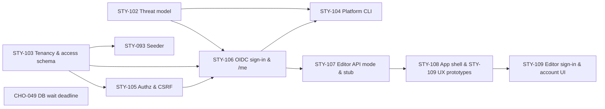

# EPC-024: Tenancy, sign-in and optional API mode — identity across the stack beside Sheets

- **Status**: Active — decomposed from owner answers (2026-11-25: 1a, 2b, 3a, 4a, 5a);
  stories start `Needs grilling` / `Placeholder` and become selectable as each is grilled
- **Progress**: 1 of 10 terminal; next selectable: STY-103 (STY-108 grilled, waits on
  STY-107; grill STY-105, STY-093 or CHO-049 next)
- **Binding ADRs**: ADR-002, ADR-008, ADR-010, ADR-015, ADR-017, ADR-018, ADR-019, ADR-020

## Summary

[EPC-022](../_archive/EPC-022-monorepo-and-backend-foundation/README.md) delivered the
monorepo, API skeleton, migrations harness, OpenAPI contract and tracing, with no domain
tables or endpoints yet. This epic delivers the first full-stack vertical slice of the
backend: PostgreSQL tenancy, people, identities, roles, memberships and access-history
tables with forced row-level security; the deterministic seeder (`STY-093`) and platform
operator CLI; ADR-019's fail-closed route authorisation and ADR-020's same-origin guard;
OIDC sign-in (local mock provider + Google Workspace) and opaque PostgreSQL sessions; and
an optional build-time API mode (`VITE_DATA_SOURCE=api`) in the editor with sign-in,
session expiry handling, single-tenant DHCW shell and Account page (while the backend
remains multi-tenant from the start and multi-tenant editor UX moves to
[EPC-030](../EPC-030-multi-tenant-organisation-switching-and-onboarding-ux/README.md)).
Google Sheets stays the default deployed mode throughout; in API mode, unimplemented
roadmap and family screens fail cleanly against a stub repository until
[EPC-026](../EPC-026-roadmaps-lists-and-versioned-api/README.md) and
[EPC-027](../EPC-027-editor-roadmap-editing-on-the-api/README.md) implement them.

## Owner decisions waiting

- [STY-104](STY-104-platform-operator-cli-for-tenants-bootstrap-invitations-and-person-control.md#open-questions) —
  CLI entrypoints, local link format and hosted Cloud Run out-of-band link mechanism
- [STY-105](STY-105-route-authorisation-policy-tenant-dependency-and-same-origin-guard.md#open-questions) —
  person-assertion header name (`{tenantSlug}` path parameter settled in `STY-105` D2)
- [STY-106](STY-106-oidc-sign-in-server-side-sessions-local-mock-provider-and-me.md#open-questions) —
  mock OIDC provider image/implementation, OIDC library choice and `/me` response shape
- [STY-107](STY-107-editor-optional-api-mode-reshaped-auth-client-and-stub-roadmap-repository.md#open-questions) —
  `VITE_DATA_SOURCE` config behaviour, `AuthClient` shape during dual-mode transition and
  stub error copy
- [STY-109](STY-109-editor-sign-in-session-expiry-tenant-switcher-and-account-page-on-the-api.md#open-questions) —
  final UI, routing and E2E details once `STY-108` settles the chosen shell and page
  designs (URL layout and zero-memberships flow settled in `STY-108` D4, D6)
- [STY-093](STY-093-a-deterministic-seeder.md) — Placeholder awaiting acceptance criteria
- [CHO-049](../chores/CHO-049-every-routes-database-wait-has-a-deadline.md) — Placeholder
  awaiting timeout policy

## Findings

Audited at `7d40d5cc` on 2026-11-25:

### F1 — The API has its foundation but no tables, routes or identity yet

- `apps/api/src/roadmaps_api/models.py` declares `Base` with `NAMING_CONVENTION` and zero
  models; `apps/api/src/roadmaps_api/routes/api_v1.py` has no contract routes yet.
- `apps/api/src/roadmaps_api/database.py` already installs `after_begin` for
  `app.tenant_id` and `app.person_id` and exports `TENANT_POLICY`.
- `apps/api/src/roadmaps_api/bootstrap.sql` creates `roadmaps_owner`, `roadmaps_migrator`
  and `roadmaps_app`, but not yet ADR-018's dedicated no-login definer role or ADR-019's
  platform-job role.

### F2 — The editor composition root is hard-wired to Google Sheets and GIS

- `apps/editor/src/app/composition.ts` unconditionally constructs
  `createGoogleAuthClient` and `GoogleSheetsRoadmapRepository`.
- `apps/editor/src/app/config.ts` requires `VITE_GOOGLE_CLIENT_ID` and
  `VITE_GOOGLE_SPREADSHEET_ID` unconditionally, preventing an API-mode build without
  Sheets credentials.
- `apps/editor/src/domain/auth/auth-client.ts` exposes `getAccessToken()` on `AuthClient`
  and models Sheets-only connection states (`initializing`, `ready`, `connecting`,
  `connected`, `expired`, `error`) with no person identity, tenant or permissions.
- `apps/editor/src/infrastructure/roadmaps-api/` holds only `api-error.ts` (currently
  exempted in `knip.jsonc` until `composeApp` imports it).

### F3 — No UX prototypes exist yet for sign-in, account or member screens

- `docs/backlog/personas/` previously held only `product-lead.md`; `tenant-admin.md`,
  `viewer.md` and `public-reader.md` were added and accepted alongside the updated
  `product-lead.md` on 2026-11-25.
- ADR-018 and ADR-019 introduce new screens (Sign-in, "You haven't been invited",
  Account page, Tenant switcher, Invitation acceptance, Members & Invitations) that need
  cohesive prototyping before UI stories code them.

## Design

Owner answers of 2026-11-25 (EPC-024 decomposition):

1. **Full-stack vertical slices, sign-in first** (F1, F2): build tenancy, authorisation,
   OIDC sign-in/sessions and optional editor API mode end-to-end here; member management
   and invitations follow in
   [EPC-025](../EPC-025-tenant-members-and-invitations/README.md); roadmaps and lists
   follow in [EPC-026](../EPC-026-roadmaps-lists-and-versioned-api/README.md) and
   [EPC-027](../EPC-027-editor-roadmap-editing-on-the-api/README.md).
2. **Threat model first, parallel local build** (ADR-018 _EPC-024 amendments_): write
   `STY-102` first so DHCW cyber security can review it while local/dev identity work
   proceeds; cyber sign-off gates deployment and real data (EPC-023, EPC-028).
3. **Build-time data-source switch and stub repository** (F2):
   `VITE_DATA_SOURCE=sheets|api` (default `sheets`, leaving GitHub Pages untouched). In
   API mode, `ApiRoadmapRepository` rejects unimplemented roadmap/list calls with a
   dedicated "not yet available" `AppError` kind so existing screens show their standard
   error panel cleanly while Account and Members screens work.
4. **Just-in-time persona-led UX prototypes before each UI story** (F3; refined 2026-11-26,
   `STY-108` D2–D4): `STY-108` runs just-in-time after `STY-107` to prototype the Sheets →
   API app shell shift and `STY-109` (Sign-in/refusals/zero-membership, single-tenant
   authenticated shell & Account menu, Account page, and session expiry) against
   `product-lead.md`, `tenant-admin.md` and `viewer.md`. `EPC-025`'s UI stories
   (`STY-112`, `STY-113`) each prototype just-in-time after they are grilled, and
   multi-tenant editor UX (tenant switcher, multi-tenant `/` landing/picker, joining a
   second tenant) is deferred to
   [EPC-030](../EPC-030-multi-tenant-organisation-switching-and-onboarding-ux/README.md)
   while the backend and `/$tenantSlug/…` URLs stay multi-tenant from the start.
5. **Unchanged:** Google Sheets remains the default and deployed data source; every
   existing Sheets test and E2E spec keeps passing untouched.

## Shared assumptions and contracts

### API conventions (carried from EPC-022)

Every API story inherits ADR-017's layering, error envelope, camelCase wire models
(`ApiRequestModel` with `extra="forbid"`, `ApiResponseModel`), `pnpm api:contract`
regeneration (`apps/api/openapi.json` + `packages/api-types`), mapping every new
`ErrorCode` in `apps/editor/src/infrastructure/roadmaps-api/api-error.ts`, upgrade-only
backwards-compatible migrations with explicit `roadmaps_app` grants, 100% branch
coverage, and adding seeder factories to `STY-093` for every new table. See
[delivery-notes.md](delivery-notes.md).

### Dual-mode editor contract

- `VITE_DATA_SOURCE` accepts `"sheets"` (default when unset) or `"api"`.
- In `"sheets"` mode, `VITE_GOOGLE_CLIENT_ID` and `VITE_GOOGLE_SPREADSHEET_ID` remain
  required and behaviour is unchanged.
- In `"api"` mode, Google Sheets env vars are not required; the editor calls same-origin
  `/api/v1/*` paths (proxied by Vite locally, ADR-020).
- `AuthClient` exposes no access token; Sheets token access stays internal between
  `GoogleAuthClient` and `GoogleSheetsRoadmapRepository` inside `composeApp`.
- Stubbed `ApiRoadmapRepository` methods reject with a non-retryable `not-implemented`
  (name settled in `STY-107`) `AppError` kind with plain English and Welsh copy explaining
  the feature is not yet available on the API.

## Stories

| ID      | Story                                                                                                                                                                                         | Area                                                          | Depends on                | State |
| ------- | --------------------------------------------------------------------------------------------------------------------------------------------------------------------------------------------- | ------------------------------------------------------------- | ------------------------- | ----- |
| STY-102 | [Threat model for sign-in, sessions, invitations and linking](../_archive/EPC-024-tenancy-sign-in-and-optional-api-mode/STY-102-threat-model-for-sign-in-sessions-invitations-and-linking.md) | Docs                                                          | —                         | ✅    |
| STY-103 | [Tenancy, people, roles, memberships and access-history schema](STY-103-tenancy-people-roles-memberships-and-access-history-schema.md)                                                        | API                                                           | —                         |       |
| STY-093 | [A deterministic seeder](STY-093-a-deterministic-seeder.md)                                                                                                                                   | API                                                           | STY-103                   |       |
| CHO-049 | [Every route's database wait has a deadline](../chores/CHO-049-every-routes-database-wait-has-a-deadline.md)                                                                                  | API                                                           | —                         |       |
| STY-104 | [Platform operator CLI for tenants, bootstrap invitations and person control](STY-104-platform-operator-cli-for-tenants-bootstrap-invitations-and-person-control.md)                          | API                                                           | STY-102, STY-103, STY-106 |       |
| STY-105 | [Route authorisation policy, tenant dependency and same-origin guard](STY-105-route-authorisation-policy-tenant-dependency-and-same-origin-guard.md)                                          | API                                                           | STY-103                   |       |
| STY-106 | [OIDC sign-in, server-side sessions, local mock provider and `/me`](STY-106-oidc-sign-in-server-side-sessions-local-mock-provider-and-me.md)                                                  | API + Infrastructure + CI/CD                                  | STY-102, STY-103, STY-105 |       |
| STY-107 | [Editor optional API mode, reshaped AuthClient and stub roadmap repository](STY-107-editor-optional-api-mode-reshaped-auth-client-and-stub-roadmap-repository.md)                             | Domain + Infrastructure + Features/UI + i18n (en + cy)        | STY-106                   |       |
| STY-108 | [UX prototypes for sign-in, account, invitation acceptance and members management](STY-108-ux-prototypes-for-sign-in-account-invitation-acceptance-and-members-management.md)                 | Docs                                                          | STY-107                   |       |
| STY-109 | [Editor sign-in, session expiry, tenant switcher and account page on the API](STY-109-editor-sign-in-session-expiry-tenant-switcher-and-account-page-on-the-api.md)                           | Features/UI + Routing + Infrastructure + i18n (en + cy) + E2E | STY-107, STY-108          |       |

## Sequencing

- **Start in parallel**: `STY-102` (threat model, Done), `STY-103` (first schema migration
  and enforcement suite, Proposed), and `CHO-049` (independent DB timeout chore).
- **After `STY-103`**: `STY-093` (seeder) and `STY-105` (authorisation & CSRF framework)
  can run in parallel.
- **After `STY-102`, `STY-103` and `STY-105`**: `STY-106` lands OIDC sign-in, sessions
  and `/me` (cyber review of `STY-102` proceeds in parallel and gates hosted deployment,
  ADR-018 _EPC-024 amendments_).
- **After `STY-106`**: `STY-104` (platform CLI, implementing and proving `disable-person`
  session revocation directly against real sessions) and `STY-107` (editor API mode +
  stub) run in parallel, and `EPC-025`'s `STY-111` (members API) unblocks; once `STY-104`
  and `STY-093` also land, `STY-110` (invitations API) unblocks.
- **After `STY-107`**: `STY-108` runs just-in-time to settle the API app shell and
  `STY-109` UX prototypes; once its _Outcome_ lands, `STY-109` delivers the API-mode
  sign-in, session-warning, single-tenant shell and Account experience, unblocking
  `EPC-025`'s UI stories (`STY-112`, `STY-113`).

## Out of scope

- Invitations API, member management API and Members & Invitations editor screens:
  [EPC-025](../EPC-025-tenant-members-and-invitations/README.md).
- Multi-tenant editor UX (tenant switcher, multi-tenant `/` landing/picker and joining a
  second tenant in the UI):
  [EPC-030](../EPC-030-multi-tenant-organisation-switching-and-onboarding-ux/README.md)
  (`STY-108` D4).
- Roadmap, item, list, scratch, draft and publication schema and endpoints:
  [EPC-026](../EPC-026-roadmaps-lists-and-versioned-api/README.md).
- Editor roadmap reading/editing on the API:
  [EPC-027](../EPC-027-editor-roadmap-editing-on-the-api/README.md).
- Entra ID sign-in, identity linking, public read API, Sheets import and switch-over:
  [EPC-028](../EPC-028-public-read-api-sheets-migration-entra-and-switch-over/README.md).
- Cloud Run, Cloud SQL, Cloud Armor and custom domain provisioning:
  [EPC-023](../EPC-023-hosting-and-infrastructure-security/README.md).

## Defects

None.

## Related

- [ADR-002](../../adr/ADR-002-layered-architecture-and-repository-boundary.md),
  [ADR-015](../../adr/ADR-015-the-roadmap-database-is-postgresql-tenant-scoped-and-versioned.md),
  [ADR-017](../../adr/ADR-017-the-api-is-synchronous-fastapi-over-sqlalchemy-and-psycopg.md),
  [ADR-018](../../adr/ADR-018-sign-in-through-the-api-with-a-server-side-session.md),
  [ADR-019](../../adr/ADR-019-the-api-authorises-every-route-from-a-permission-catalogue-in-code.md),
  [ADR-020](../../adr/ADR-020-the-editor-and-the-api-share-one-origin.md)
- [Identity threat model](../../analysis/identity-threat-model.md)
- [Identity and authorisation analysis](../../analysis/identity-and-authorisation.md)
- [Replacing Google Sheets](../../operations/replacing-google-sheets.md)
- [EPC-022](../_archive/EPC-022-monorepo-and-backend-foundation/README.md),
  [EPC-023](../EPC-023-hosting-and-infrastructure-security/README.md),
  [EPC-025](../EPC-025-tenant-members-and-invitations/README.md),
  [EPC-026](../EPC-026-roadmaps-lists-and-versioned-api/README.md),
  [EPC-027](../EPC-027-editor-roadmap-editing-on-the-api/README.md),
  [EPC-028](../EPC-028-public-read-api-sheets-migration-entra-and-switch-over/README.md),
  [EPC-030](../EPC-030-multi-tenant-organisation-switching-and-onboarding-ux/README.md)
- [Product Lead persona](../personas/product-lead.md),
  [Tenant Admin persona](../personas/tenant-admin.md),
  [Viewer persona](../personas/viewer.md)
