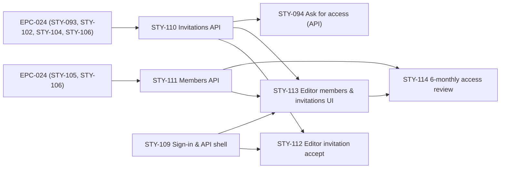

# EPC-025: Tenant members and invitations — Tenant Admins onboarding Product Leads across the stack

- **Status**: Active — decomposed from owner answers (2026-11-25: 1a, 4a, 5a); stories
  start `Needs grilling` / `Placeholder` and become selectable as each is grilled
- **Progress**: 0 of 6 terminal; next selectable: none (depends on EPC-024's STY-093,
  STY-104, STY-105, STY-106 and STY-109)
- **Binding ADRs**: ADR-002, ADR-008, ADR-010, ADR-015, ADR-017, ADR-018, ADR-019, ADR-020

## Summary

Builds end-to-end user management and invitation workflows on top of
[EPC-024](../EPC-024-tenancy-sign-in-and-optional-api-mode/README.md), across PostgreSQL,
FastAPI, `@roadmaps/api-types` and the editor's optional API mode. Tenant Admins can
invite new users (such as Product Leads, Viewers or additional Admins) by email and copy
a single-use invitation link; invited colleagues open the link, see which tenant and
person invited them, sign in and redeem their membership atomically; all members can see
who is in the tenant and their roles, while Tenant Admins also see emails and last
sign-in times, revoke pending invitations, change roles and remove members (protected by
the last-admin guard). Six-monthly access reviews (`STY-114`) and uninvited access
requests (`STY-094`) follow at the end of the epic.

## Owner decisions waiting

- [STY-110](STY-110-invitation-create-list-revoke-lookup-and-oidc-redemption-api.md#open-questions) —
  re-inviting an already-pending email and email-mismatch refusal code
- [STY-111](STY-111-tenant-members-list-role-changes-and-membership-removal-api.md#open-questions) —
  member list projection, self-removal and whether a disabled Admin counts toward the last-admin guard
- [STY-112](STY-112-editor-invitation-acceptance-and-redemption-flow.md#open-questions) —
  invitation fragment URL path and behaviour when another user is already signed in
- [STY-113](STY-113-editor-members-and-invitations-management.md#open-questions) —
  provider selector default when only one sign-in provider is enabled
- [STY-114](STY-114-six-monthly-member-access-review.md) — Placeholder awaiting core
  members workflow
- [STY-094](STY-094-ask-for-access-to-a-tenant.md) — Placeholder awaiting STY-110

## Findings

Greenfield for tenant member and invitation endpoints and UI; audited against ADR-015,
ADR-018 and ADR-019 on 2026-11-25:

- ADR-018 requires invitations to carry a 256-bit token stored only as its SHA-256 hash,
  7-day expiry, delivered in a URL fragment (`#…`) so it never reaches request logs or
  `Referer`; the editor clears the fragment, displays tenant and inviter, and posts the
  token only when the person accepts; redemption matches a verified provider email
  case-folded and consumes the token atomically through a dedicated definer function,
  recording an access change set.
- ADR-019 scopes member visibility: every member reads names and roles (and roadmap
  assignments once `EPC-026` adds them); emails, last sign-in, pending invitations,
  role changes, removals and access reviews require `members:manage`.
- ADR-019 enforces at least one Admin per tenant under the access scope lock; the
  six-monthly access review records each confirmation as an access change set.
- `STY-104` (EPC-024) already exercises platform-issued first-admin invitations; `STY-110`
  completes the lookup, redemption, tenant-admin creation and revocation paths for both
  platform and admin invitations.

## Design

Owner answers of 2026-11-25 (EPC-024 / EPC-025 decomposition):

1. **Core lifecycle first, access review and ask-for-access second** (Q5): deliver
   inviting users, copying links, redeeming invitations, viewing members, changing roles,
   revoking invitations and removing members (with last-admin guard) across API and
   editor first (`STY-110`–`STY-113`), then `STY-114` (six-monthly access review) and
   `STY-094` (ask for access).
2. **Just-in-time UX prototypes before each UI story** (Q4; refined 2026-11-26, `STY-108`
   D2): `STY-112` (Invitation acceptance) and `STY-113` (Members & Invitations) each get a
   lightweight just-in-time `ux-prototypes` step right after they are grilled (building on
   the API shell settled in `STY-108` / `STY-109`), rather than prototyping upfront in
   `STY-108`.
3. **Unchanged:** Google Sheets mode stays untouched and never shows Members or
   Invitation screens.

## Shared assumptions and contracts

- Inherits all API conventions and delivery notes from
  [EPC-024](../EPC-024-tenancy-sign-in-and-optional-api-mode/delivery-notes.md) (camelCase
  wire models, `extra="forbid"`, `pnpm api:contract`, `api-error.ts` mapping, 100% branch
  coverage, role-by-route matrix and cross-tenant sweep).
- Every invitation create, revoke and redeem, and every member role change, membership
  removal and access review confirmation, writes an access-scope `change_set` signed off
  by ADR-015's commit function.
- Any request model with collection fields bounds every collection natively in Pydantic per
  `apps/api/AGENTS.md` and ADR-020 (_DEF-043 amendments_). (`STY-103` D3 sets a single
  `NOT NULL role_id` per membership and invitation in v1.)

## Stories

| ID      | Story                                                                                                                                      | Area                                                                   | Depends on                         | State |
| ------- | ------------------------------------------------------------------------------------------------------------------------------------------ | ---------------------------------------------------------------------- | ---------------------------------- | ----- |
| STY-110 | [Invitation create, list, revoke, lookup and OIDC redemption API](STY-110-invitation-create-list-revoke-lookup-and-oidc-redemption-api.md) | API + Infrastructure                                                   | STY-093, STY-102, STY-104, STY-106 |       |
| STY-111 | [Tenant members list, role changes and membership removal API](STY-111-tenant-members-list-role-changes-and-membership-removal-api.md)     | API + Infrastructure                                                   | STY-105, STY-106                   |       |
| STY-112 | [Editor invitation acceptance and redemption flow](STY-112-editor-invitation-acceptance-and-redemption-flow.md)                            | Domain + Infrastructure + Features/UI + Routing + i18n (en + cy) + E2E | STY-109, STY-110                   |       |
| STY-113 | [Editor members and invitations management](STY-113-editor-members-and-invitations-management.md)                                          | Domain + Infrastructure + Features/UI + Routing + i18n (en + cy) + E2E | STY-109, STY-110, STY-111          |       |
| STY-114 | [Six-monthly member access review across the API and editor](STY-114-six-monthly-member-access-review.md)                                  | API + Infrastructure + Features/UI + i18n (en + cy)                    | STY-111, STY-113                   |       |
| STY-094 | [Ask for access to a tenant](STY-094-ask-for-access-to-a-tenant.md)                                                                        | API                                                                    | STY-110                            |       |

## Sequencing

- Once `STY-106` lands in EPC-024, `STY-111` unblocks immediately; once `STY-093`,
  `STY-102`, `STY-104` and `STY-106` have landed, `STY-110` unblocks as well.
- Once `STY-109` + `STY-110` (+ `STY-111`) land, `STY-112` and `STY-113` (each with a
  just-in-time `ux-prototypes` pass right after grilling, `STY-108` D2) complete the full
  vertical slice for Tenant Admins inviting and managing Product Leads.
- `STY-114` and `STY-094` follow after the core lifecycle (or can wait while `EPC-026`
  starts roadmaps & lists).

## Out of scope

- Multi-tenant editor UX (joining a second tenant in the UI, tenant switcher and
  multi-tenant `/` landing/picker; the API and `/$tenantSlug/…` URLs stay multi-tenant
  from day one):
  [EPC-030](../EPC-030-multi-tenant-organisation-switching-and-onboarding-ux/README.md)
  (`STY-108` D4).
- Roadmap assignments (`assignments:manage` and showing "who leads which roadmap" on the
  member list): arrives when roadmaps exist in
  [EPC-026](../EPC-026-roadmaps-lists-and-versioned-api/README.md) and
  [EPC-027](../EPC-027-editor-roadmap-editing-on-the-api/README.md).
- Email delivery of invitation links (deferred; ADR-018 Option 8 — Admins copy the link).
- Custom editable tenant roles (`roles:manage`, ADR-019 Option 3).
- Pending join requests UI for `STY-094` (follows `STY-094` once the API contract settles).

## Defects

None.

## Related

- [ADR-015](../../adr/ADR-015-the-roadmap-database-is-postgresql-tenant-scoped-and-versioned.md),
  [ADR-017](../../adr/ADR-017-the-api-is-synchronous-fastapi-over-sqlalchemy-and-psycopg.md),
  [ADR-018](../../adr/ADR-018-sign-in-through-the-api-with-a-server-side-session.md),
  [ADR-019](../../adr/ADR-019-the-api-authorises-every-route-from-a-permission-catalogue-in-code.md),
  [ADR-020](../../adr/ADR-020-the-editor-and-the-api-share-one-origin.md)
- [EPC-024](../EPC-024-tenancy-sign-in-and-optional-api-mode/README.md),
  [EPC-026](../EPC-026-roadmaps-lists-and-versioned-api/README.md),
  [EPC-027](../EPC-027-editor-roadmap-editing-on-the-api/README.md),
  [EPC-030](../EPC-030-multi-tenant-organisation-switching-and-onboarding-ux/README.md)
- [Tenant Admin persona](../personas/tenant-admin.md),
  [Product Lead persona](../personas/product-lead.md),
  [Viewer persona](../personas/viewer.md)
