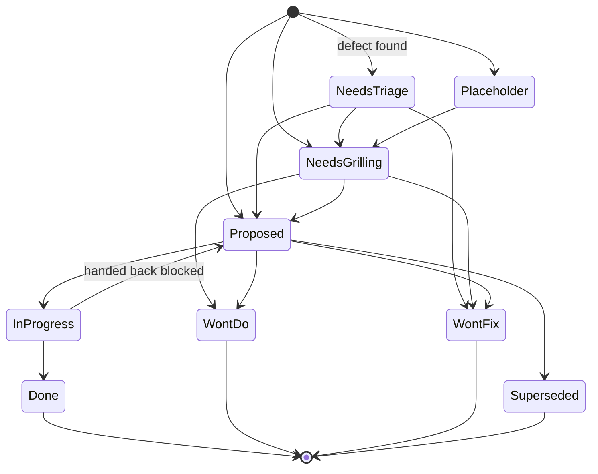

# Status lifecycle

The first word(s) of a record's Status line is one token from the table for
its type. Text after an em dash is a one-line note. Selection reads the token
only. The bootstrap stories in `_archive/bootstrap/` keep their legacy
statuses and are not rewritten.

## Stories, chores and defects

| Token          | Applies to   | Meaning                                                         | Set by                   | Selectable | Location   |
| -------------- | ------------ | --------------------------------------------------------------- | ------------------------ | ---------- | ---------- |
| Needs triage   | defect       | Found during delivery, review or retro; owner has not looked    | the finder               | no         | live       |
| Placeholder    | story, chore | Exists so dependents can point at it; not yet designed          | agent                    | no         | live       |
| Needs grilling | all          | A product decision blocks it; Open questions lists them         | agent                    | no         | live       |
| Proposed       | all          | Specified and agreed; may be selected once Depends on is met    | agent after grilling     | yes        | live       |
| In progress    | all          | A delivery agent holds it; note names the branch or PR          | delivering agent         | no         | live       |
| Done           | all          | Implemented and verified in a PR; `Delivered` says if merged    | delivering agent         | no         | `_archive` |
| Won't fix      | defect       | Owner decided not to fix                                        | owner only               | no         | `_archive` |
| Won't do       | story, chore | Owner decided against doing it                                  | owner only               | no         | `_archive` |
| Superseded     | all          | Another record holds all its remaining scenarios; note names it | agent, citing the record | no         | `_archive` |

Live records sit in `docs/backlog/{epic}/`, `chores/` or `defects/`; terminal
ones in `docs/backlog/_archive/{epic}/`, `_archive/chores/` or
`_archive/defects/`.

### Rules

- **Won't fix / Won't do need the owner's word.** An agent may recommend one
  (as option (a) of an Open question) but sets it only against an owner
  answer. The record gains a Decisions entry: who, date, source, the reason,
  and the trigger that would reopen it. Then the file moves to `_archive/` and
  its row in the epic or index is marked `✗` with the token, not deleted.
- **Superseded** is an agent's call only when the successor already holds
  every remaining scenario verbatim or by reference; otherwise it is the
  owner's decision. Never use Superseded to mean Won't fix.
- **Partial delivery is not Done.** A scenario the owner drops or moves is a
  Decisions entry, not a departure, and the story can then be Done.
- **Done moves with the PR.** The PR that delivers a record sets Done, moves
  the file to `_archive/` and marks its epic row. `Delivered` is filled with
  the PR's URL and `open` in a commit pushed once the PR exists; whoever merges
  or closes it later updates the note. Dependents wait for the required
  behaviour on the default branch, not for the note.
- **Reopening** a Won't fix / Won't do: move the file back to the live tree,
  set Proposed or Needs grilling, and add a Decisions entry citing the
  trigger. The ID is kept.
- **Terminal tokens and location agree**: Done, Won't fix, Won't do and
  Superseded live in `_archive/`; nothing else does.

## Epics

`Active` | `Done` (every row terminal) | `Won't do` (owner) — a Won't do epic
stays in place with its stories each closed as Won't do or Superseded. A Done
epic moves to `_archive/{epic}/`.

## ADRs

`.claude/skills/domain-modeling/ADR-FORMAT.md` owns an ADR's lifecycle.
